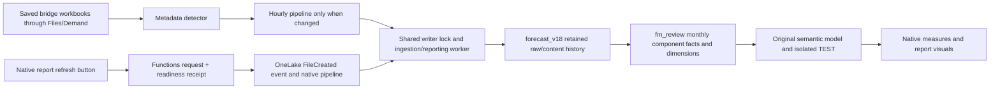

# ForecastMaster / UK-ANI-Demand — maintained project understanding

**Read this first when resuming this project, including after chat compaction.**
This is the single maintained project reference requested by the user. Its path
stays stable despite the R17.8 folder name. It covers the whole known workflow,
not only the date repair. Detailed public schema/DAX/visual catalogs are below;
read the resume section first and load only the relevant catalog sections.

Last reviewed: **24 October 2026**, including the retained chat from 20 October,
its 205 user messages, current code/receipts, the returned `test01.txt` R02
result, and the matching `test02.txt` / downloaded inventory R01 JSON. Textual history was reviewed; this is not a claim that every old image,
attachment, prior chat or live workspace item was re-inspected. Raw chat and
company observations are not copied here. New results update this reference;
[feedback/STATUS.md](../../feedback/STATUS.md) owns dated runtime receipts.

## Resume in one minute

**Current company state — compact R17.8 TEST R01, verifier R02:** the operator
returned **TEST_R178_INSTALLED_AND_BOUNDED_CHECKS_VERIFIED** on 24 October 2026.
Installation and the declared bounded receiving check are complete. No further
setup cell, verifier/probe retry, reset or manual refresh is requested.
[Reviewed success receipt](../../feedback/logs/2026-10-24-r178-installed-bounded-verification-reviewed.json).

Confirmed within that run:

- All **nine physical/semantic date groups** agree exactly, zero invalid dates:
  five 84-month sets and four three-row UK/October source/native cutoff groups.
- **12 paired scalar comparisons, zero mismatches**: one available ADS driver,
  market/ef/share, 12M, FY and future month. Values remain private; independent
  Excel/R16.6 and all-driver/all-window parity are not thereby established.
- **Eight files / eight distinct choice labels**, zero missing import timestamps,
  zero hash suffixes. This is the global native helper; the date cutoff cohort
  is UK/2026-10 with three rows. These are different scopes, not a discrepancy.
- Candidate semantic metadata matches the private candidate; cloud mapping is
  preserved. Identity, install-success/new-Completed processing prerequisites and
  before/after processing-history/date-signature stability checks passed by the
  exact source path. No model/source write, refresh or publication was requested.

**Current action — company Power BI Desktop:** extract ALL contents of
[test-release-r01/candidate/ForecastMaster Compact Native R17.8 TEST.zip](test-release-r01/candidate/ForecastMaster%20Compact%20Native%20R17.8%20TEST.zip)
to a NEW folder; open **ForecastMaster Compact Native R17.8 TEST.pbip**.
ZIP SHA256 `94e6167b95ffc6691c5d3f552a7bfbab01d8e0416d68a209d5d24a14cdf21c6b`,
45833 bytes. Use TEST, not fabricated SAMPLE; close the older TEST project first.
[Receiving steps 5–6](test-release-r01/OPEN%20FIRST.txt) now apply; steps 1–4 are complete.

Prove a small native slice first (available UK/2026-10, Market/Units, Total), then
check Sectors, Section/Measure, month bounds, independent Review trend versus
multiple Table trends, driver→sector expansion and file checkbox selection/clear.
Return top/chart/Executive/files screenshots and Performance Analyzer DAX/total
times for graph and both summaries, identifying Total/Sectors, exact selections
and first/repeated-load conditions. Refresh visuals in Performance Analyzer is
a report query, not another Fabric model refresh. Do not clear caches or alter
configuration to manufacture a speed result. Any visual error: capture its exact
details/context before more tests or any setup/refresh retry.

**Remaining gates:** actual native layout/interaction/export, broad independent
Excel/R16.6 business parity and comparable company visual performance. No speed
improvement or production readiness is claimed from scalar/model verification.
Full native S&OP, FX and R16.6 feature parity remain separate. Production
**R16.6 / ForecastMaster Review stays unchanged**; built-in visuals only and
other/company-laptop access continue. Do not publish or replace production.

**Earlier failures are retained:** the old verifier counter TypeError was fixed
by R02; a later Direct Lake table-version/backend request failure blocked its
first run, then the UI showed a newer Completed operation before this success.
No guard was weakened. The original backend root cause remains unknown; this is
not a permanent service-health guarantee.
[Partial old verifier](../../feedback/logs/2026-10-23-r178-verifier-r01-partial.json),
[refresh gate stop](../../feedback/logs/2026-10-23-r178-verifier-r02-refresh-gate-stopped.json),
[Direct Lake failure/later success](../../feedback/logs/2026-10-24-r178-direct-lake-failure-and-later-success-reviewed.json).
Keep private backups and markers; old date-cache recovery stays closed.

**Other retained evidence:** inventory R01 confirmed 13 visible items, 24 physical
/269 fields; original model 15 tables/209 fields/47 measures/5 relationships,
TEST baseline 39/333/98/12. These are dated inventory counts; the adapter adds
one hidden measure, without a new full count export in this return. Local
qualification remains 207 synthetic native queries/1868 assertions, 14 release
tests and 67 schema documents; verifier R02 also has four native counter
regressions. Prior evidence is retained, not rerun for this documentation update.
Local UI automation remains unavailable and graph authority UNKNOWN for this
unregistered repository; neither is silently promoted by the company result.

## Compact native R17.8 R01 implementation and limits

CODE: new `test-release-r01/` preserves every older candidate, inventory and
recovery file. It uses the verified 39-table / 333-field / 98-measure / 12-relationship
TEST baseline. The adapter adds only hidden N File Available (expected total 99
semantic measures), updates native file-mode admission to infer actual checkbox
selection, changes the file-label expression, removes the obsolete headline
source-row guard, retains source scenario separation in Executive, and refuses
invalid cutoff display. All original tables, roles, relationships, sources,
numeric calculation bodies and numeric formats are preserved. Dynamic-format
line-array serialization is compared as identical text, without dropping unknown
metadata. Whole TEST BIM hash is pinned to inventory R01 before update.

DESIGN/CODE: one 1440 × 1330 Demand page, 26 built-in visuals. Separate Section /
Measure; monthly Start/End; labelled compact right Review trend / View / Table
trends; one external dynamic measure heading; native solid/dashed/dotted lines,
legends/end labels; no axis sliders. Native driver-to-sector Executive drill with
absolute/% variances. One searchable checkbox file list with UTC imports,
collision-only v1/v2 labels and no raw hash. Existing ImportedAtUTC sort key is
retained. No duplicate file table, Source mode dropdown or Apply controls. The
file filter affects values without pinning scope slicers. Heavy visuals retain
categorical admission but have no external measure-value filter. Matrix height
is fixed; native expand/scroll/Focus does not imply automatic page reflow.

RECEIVING: 12 sequential paired scalar preflight comparisons (transient values),
quiet-processing and source/date/concurrency checks, private whole-file SHA256 /
length backup, write-once attempt marker and one updateDefinition POST with retry
configuration total=0 / allowPurgeData=False. Full readback and cloud preservation
precede success. After one manual TEST full refresh, read-only verifier checks
new processing time, complete candidate metadata/cloud mapping, exact nine
physical/semantic date groups, unique readable file labels and 12 paired scalar
checks against the private old formulas. It requests no refresh/update/rollback.
Return counts-only receipts; raw definitions/company values remain private.

LOCAL: [native receipt](test-release-r01/VALIDATION-NATIVE.json) includes exact
input fingerprints. Standard six Demand measures, Units/Value, named annual,
YTD/YTG/H1/H2 masks, complete 6/12/24 windows, weighted ratios/missing/zero,
automatic/selected/ambiguous versions, matching actual/forecast boundary,
Total/Drivers/Sectors, two independent Executive windows and collision/import
labels were executed. The final input generator reproduces all four engine
inputs. The offline Power BI plugin reports 62 public formula nodes/97 heuristic
edges; this is not a live company graph. Production, notebooks, schedules,
permissions, Lakehouse tables and source data were not changed.

COMPANY: installation, processing and declared bounded read-only verification
are complete (verifier R02 success, 24 October). UNKNOWN/PENDING: native
rendering/interactions/export/speed, broad independent Excel/business acceptance,
full native S&OP and full R16.6 feature/FX parity. This is TEST qualification, not a production
replacement. The historical generated catalog below still documents the preserved
draft/public baseline, with this release's scoped differences recorded here.

## How to read this reference

- **COMPANY** = specific operator-returned evidence, dated and scoped; not a
  fresh live API inspection by this laptop. A reported pass is independently
  checked for its stated scope before being accepted here.
- **CODE** = the contract in preserved repository source. It describes what the
  version implements, not proof it is installed in the receiving workspace.
- **DESIGN** = requested/approved user behavior, including changes superseding
  older decisions. HTML and fabricated SAMPLEs are review artifacts.
- **LOCAL** = mocks, source/schema/geometry checks or synthetic calculations.
- **UNKNOWN** = absent, incomplete, stale or unexecuted evidence. Never fill an
  inventory gap with a plausible object name, date, relationship or measure.

Navigation: [system map](#system-map-and-known-fabric-objects),
[storage/identity](#data-flow-storage-and-identity),
[physical schema](#physical-table-and-field-contracts),
[business rules](#business-meaning-and-calculation-contracts),
[design](#report-design-and-selection-contracts),
[acceptance and validation](#acceptance-and-staged-validation),
[decisions/history](#decisions-and-delivery-history),
[recovery evidence](#latest-r02-result-and-what-it-proves),
[verified company inventory](#company-inventory-r01),
[gaps](#what-is-still-unknown-and-how-to-complete-the-reference),
[public catalog](#public-source-catalog-names-fields-relationships-dax-and-visuals).

## System map and known Fabric objects

Coordination is the **public** cross-laptop code/instructions repository. The
Smart Demand Manager application/private workbook authority is a separate repo;
its business/workbook contracts remain there. No source workbook, cached company
model, credential, company figure or unredacted definition belongs in Coordination.
Installed Power BI plugins here do not imply a company session. Do not request
company sign-in, tenant settings, service-principal setup or IT support here.

| Item | Known identity | Evidence/state |
| --- | --- | --- |
| Workspace | UK-ANI-Demand; `f5cb5742-9a7c-4337-a4c0-952706dddf0b` | COMPANY, retained setup and R02 exact TEST route |
| Lakehouse | ForecastMaster; `d6e33ebd-67b1-420a-8d84-c3a0d04d8b21` | COMPANY, known OneLake route verified by R01/R02 |
| Original semantic model | `e7af2967-7725-4108-a170-9e490d4e35bb` | CODE-bound original; never an update target in this native TEST repair |
| Native TEST semantic model | ForecastMaster Native OneLake R17.1 - TEST; `31d00232-ac03-48fe-af39-f2e4bae82443` | COMPANY created 22 October; R17.8 scoped adapter installed; bounded verifier R02 passed 24 October |
| Published report | ForecastMaster Review / R16.6 fallback | User confirmed replacement publication on 22 October; no native replacement accepted |
| Maintained ingestion notebook | ForecastMaster_Refresh; `e2e0952d-4317-4936-bf0f-2c34698371dc` | COMPANY R05.4 and targeted FILES patch installation evidence |
| Hourly pipeline | ForecastMaster_Hourly; `ef3ba5c2-3eef-4c20-bac1-a8399fa5cb20` | COMPANY manual success and original schedule setup; post-targeted schedule status still pending |
| Legacy controller | ForecastMaster_Controller | Manual SharePoint request path tested; five-minute polling rejected |
| Native event notebook | ForecastMaster_Native_Adhoc; `e9ce6cb0-1622-44cd-b83a-4f8680199478` | COMPANY creation, event execution and duplicate recovery confirmed |
| Native pipeline | ForecastMaster_Adhoc; `62dcc460-bbd0-49b7-bcce-8f95885643c3` | COMPANY button/event/model-completion path confirmed |
| Functions item | ForecastMaster_Actions | R06-NATIVE-R01 and later targeted detector publication reported |
| Function entry points | checkDemandAccessR04, checkNativeStateR05, checkDemandChangesR05, submitNativeRefreshR06 | Retained source contracts; exact live full function inventory not exported |
| Activator/rule | ForecastMaster_Adhoc_Events / ForecastMaster_Adhoc_NativeRequests | COMPANY 21 October running rule evidence; not an ongoing live-state guarantee |
| Setup notebook | ForecastMaster_GM_Setup | Explicit receiving location; one NEW cell only, never Run all |

Report version R17.8 and model display name R17.1 TEST are different version
labels; do not create a second model just to make those labels match.
R01 now supplies the complete returned account-visible item list and the one
published report/model binding, below. Connections, shortcut targets, child
rule/function definitions and effective permissions were not fully inventoried.



The shared refresh machinery's normal model target is not changed by the TEST
repair. A TEST full refresh processes the existing model; it is not a source
workbook ingestion or a production report publication.

## Data flow, storage and identity

**CODE sources:** [R05.4 reader](../notebook-r05.4/Refresh/source/reader.py),
[ingestion](../notebook-r05.4/Refresh/source/fast_refresh.py),
[catalog](../notebook-r05.4/Refresh/source/catalog.py),
[reporting](../notebook-r05.4/Refresh/source/reporting.py),
[targeted hourly candidate](../hourly-targeted-r01/candidate/Refresh/source/hourly_worker.py).
The R16.6 [GM reporting rule setup](../report-gm-desktop-r16.6/SETUP%20REPORTING%20FEED.py)
adds exact source identities. Existing non-GM rules are retained.

1. The company source root is `Files/Demand`, historically a SharePoint-backed
   shortcut. Input is the saved XLSX/XLSM bridge and its saved formula caches;
   ingestion is not an Excel recalculation engine. Save/recalculate in Excel
   before requesting refresh. Exclude temporary `~$` files.
2. The filename contract is affiliate / driver / Bridge / cycle / EF / IMS /
   version suffix, with arbitrary supported suffixes. Explicit workbook metadata
   and agreed parser rules define identity/cutoffs; never repair dates by guessing
   from the filename. Local/Ext is internal source provenance, not a required GM UI filter.
3. Raw `SourceRevisionID` identifies imported **content** (hash). All successfully
   imported revisions are retained, even when a path is edited or removed.
4. Reporting `SourceRevisionID` identifies a **saved path**, from
   `SHA256('current-file-v1|' + normalized relative path)`. It is intentionally
   different from raw content identity. `RawSourceRevisionID`/`ContentRevisionID`
   map the current saved path back to the completed content revision.
5. `_file_state` is the current successful pointer per path. Reporting uses
   `CURRENT_FILE_PER_PATH`; retaining history must not add old versions into
   today's forecast. Different saved scenario files remain distinct choices.
6. Report projection aggregates exact source components into month/channel/
   sub-channel/sector facts and carries numeric/missing counts. Changed-file
   slices are replaced completely so removed months/rows cannot survive a merge.
7. Projection signatures, rule hashes and content receipts let unchanged data
   reuse reporting tables. Helper dimensions are small snapshots. Raw source
   history is not re-read for every report interaction.
8. Automatic Delta purging is disabled by R05.4. Do not reintroduce deletion of
   imported revisions or VACUUM as a performance shortcut. This does not restore
   revisions deleted before that policy was installed.

**Import timestamp nuance:** report `FileLabel` is built from
`PathFirstSeenAtUtc`, but R05.4 assigns that field from the current path pointer's
`LastSuccessAtUtc`. Raw `FirstImportedAtUtc` belongs to the content receipt.
The R17.7 `ImportedAtUTC` parses the report label. These are ingestion metadata,
not proof of approval, publication or source-modified time. Never describe one
of these stamps as another without an explicit schema change and qualification.

Known storage boundaries (relative to the ForecastMaster Lakehouse):

| Path | Purpose |
| --- | --- |
| Files/Demand | Source workbook access root/shortcut |
| Tables/ and, where verified, Tables/dbo/ | Existing Delta table locations; require one unambiguous path |
| Files/ForecastMasterControls/MeasureCatalog.csv | Versioned business/reporting classification input |
| Files/ForecastMasterControls/ReportMeasureRules.csv | Exact component/metric projection rules |
| Files/ForecastMasterRefreshState/ | Shared lock, ledgers, batches, receipts and baseline state |
| .../native-requests/ | Native producer request files only |
| .../native-ready/ | Hash-bound readiness receipts |
| .../metadata-baselines/ | Successful metadata baselines |
| .../upgrades/ and .../report-upgrades/ | Private full backups and staged-upgrade receipts |

A storage path, SQL endpoint, Direct Lake model and report are different objects.
The source probe confirmed **Direct Lake on OneLake via AzureStorage.DataLake**,
not the original draft's SQL.Database/view route. That SQL-only adapter is retired
for this source; do not revive it as the current architecture.

## Physical table and field contracts

This section is the **CODE writer contract**. The later [company inventory](#company-inventory-r01)
provides all 24 observed physical table/field schemas, including two additional
operational state/maintenance tables. Delta versions and table row contents
remain unqueried. Primary/grain keys below are logical upsert keys, not claims
that SQL constraints/indexes exist.

### Raw/source layer: forecast_v18_*

Shared wide identity fields (string unless stated otherwise):
`SourceRevisionID`, `SourceFileName`, `SourceRelativePath`, `SourceSheet`,
`SourceTable`, `MeasureKey`, `Country`, `GrowthDriver`, `DemandCycle`, `Version`,
`Revision`, `ExFactoryActualsThrough`, `IMSActualsThrough`, `PublicationStatus`,
`PublicationOrigin`, `SourceProfile`, `PreviousPublication`, `CanonicalSection`,
`ContextRole`, `Channel`, `SubChannel`, `Sector`, `Manufacturer`, `Product`,
`Section`, `Measure`.

| Table suffix | Grain/key | Additional/exact fields and purpose |
| --- | --- | --- |
| history | ObservationID per content/table/source row/month | Shared fields + SourceRow(long), DemandMonth(date), SourceMonthHeader(string), ValueKind(string), ValueRaw(string), ValueNumber(double), ValueText(string), ValueBoolean(boolean), SourceFormula(string), FormulaCacheState(string), ObservationID(string), SourceMeasureID(string) |
| source_measures | SourceMeasureID | SourceRevisionID, SourceMeasureID, MeasureKey, Country, SourceProfile, GrowthDriver, DemandCycle, Section, Measure, CanonicalSection, ContextRole; strings |
| calendar | CalendarID | SourceRevisionID, SourceProfile, Country, GrowthDriver, DemandCycle, DemandMonth(date), CalendarDays(day count), WorkingDays(numeric source), CalendarID |
| controls | ControlID | SourceRevisionID, SourceProfile, Country, GrowthDriver, DemandCycle, SourceSheet, SourceTable, SourceRow(long), Channel, SubChannel, Sector, Manufacturer, Product, Section, Measure, ControlID, InputSlot; distinct source control rows |
| quality | ObservationID | History-shaped Data Quality rows; preserve original observations and failure semantics |
| source_revisions | SourceRevisionID | SourceRevisionID, SourceBytes, SourceFileName, SourceRelativePath, Contract, FirstImportedAtUtc, WideRows, Observations, DefinedNamesJson, PublicationStatus, PublicationOrigin, SourceProfile, Country, GrowthDriver, DemandCycle, Revision, ExFactoryActualsThrough, IMSActualsThrough, PreviousPublication; receipt fields stored as strings |
| ingestion_events | Run audit/event rows | RunID, ObservedAtUtc, SourcePath, SourceRelativePath, SourceModifiedAt, SourceBytes, ReaderContract, Status, SourceRevisionID, Observations, Message; strings |
| file_state | SourcePath | SourcePath, SourceRelativePath, SourceModifiedAt, SourceBytes, SourceRevisionID, ReaderContract, LastSuccessAtUtc; successful pointer strings |
| measure_configuration_snapshots | ConfigurationID / MeasureKey / effective range | ConfigurationID, CapturedAtUtc, MeasureKey, SourceSection, SourceMeasure, DisplayName, ReportingEnabled, EffectiveFromCycle, EffectiveToCycle, ValueRole, Unit, AggregationRule, ComparisonRule, DefinitionStatus, Owner, ChangeReason, RawConfigurationJson, CanonicalSection, Family, Dependency; strings |
| measure_assignments | SourceMeasureID | Source-measures fields + DisplayName, ReportingEnabled, Family, Dependency, ValueRole, AggregationRule, ComparisonRule, Unit, EffectiveFromCycle, EffectiveToCycle, DefinitionStatus, Owner, ChangeReason, ConfigurationID, CatalogState |
| catalog_refresh_state | Signature | Signature, CompletedAtUtc; configuration/source-cohort cache receipt |

The raw history keeps string metadata dates and typed observation months; report
projection converts the actual cutoff fields to physical DATE. Do not conflate
the raw receipt's string type with the report DATE/semantic dateTime declaration.

### Reporting layer: fm_review_*

| Table | Grain/key | Fields |
| --- | --- | --- |
| fm_review_facts | SourceRevisionID + Channel + SubChannel + Sector + Month + ComponentKey | Six grain fields, Amount(double), NumericCells(long), MissingCells(long). Monthly aggregated components; no per-product dimension is retained here. |
| fm_review_files | One current saved report path ID | SourceRevisionID, SourceFileName, SourceRelativePath, Country, DemandCycle, GrowthDriver, SourceProfile, IMSActualsThrough(date), ExFactoryActualsThrough(date), PublicationStatus, FileLabel |
| fm_review_reference | SourceRevisionID | Same file metadata; reference/actual-source context is separate from selected plan context |
| fm_review_measures | MetricKey | MetricKey, Section, Measure, Unit, Aggregation, CutoffFamily, NumeratorKey, DenominatorKey, SortIndex(long) |
| fm_review_months | Month | Month(date), MonthLabel, Year(long), MonthNumber(long), MonthIndex(long; months from 2000-01) |
| fm_review_axis | Month | Physical writer copies the same five month fields; simplified SAMPLE exposes Month only |
| fm_review_periods | PeriodKey | Year, PeriodType, PeriodKey, Label, SortIndex. Original writer emits FY/YTD/YTG; native periods separately add H1/H2. |
| fm_review_series | SeriesID | SeriesID, SeriesKind, SourceRevisionID, SeriesLabel, SortIndex; actual/trend/plan identities |
| fm_review_modes | Mode | Mode, SortIndex; legacy reporting comparison modes |
| fm_review_projection_receipts | SourceRevisionID | SourceRevisionID, RuleHash, ProjectedAtUtc, ContentRevisionID |
| fm_review_refresh_state | Signature | Signature, CompletedAtUtc |

`ReportMeasureRules.csv` fields: `MetricKey`, `Section`, `Measure`, `Unit`,
`Aggregation`, `CutoffFamily`, `NumeratorKey`, `NumeratorSection`,
`NumeratorMeasure`, `NumeratorManufacturer`, `NumeratorRequireProduct`,
`DenominatorKey`, `DenominatorSection`, `DenominatorMeasure`,
`DenominatorManufacturer`, `DenominatorRequireProduct`, `SortIndex`.
Unknown/duplicate/conflicting component definitions refuse projection. Supported
aggregation kinds are SUM/RATIO; calendar family is explicitly IMS/EF. A metric
label is not permission to substitute a similar source measure.

### Native semantic layer: fm_native_*

R17.1 adds calculated metadata on top of the preserved original Direct Lake
model, avoiding SQL views. By R17.6 there are 24 native helper tables; R17.7 keeps
that count and has 51 named native measures, adding fit coefficients and three
file/series metadata columns. These helpers are Import/calculated partitions;
the original source tables remain Direct Lake. A confirmed explicit cloud
connection is required for the Direct-Lake-dependent calculated objects.

The full public native field list, seven added relationship definitions and
51 exact public DAX expressions are in the catalog below. The original 15 model
tables/remaining original measures/relationships were preserved; their complete
names and field definitions are **not** present in the R02 output. Do not claim
that a 29-table fabricated SAMPLE is the 39-table company model.

## Business meaning and calculation contracts

The objective is a GM review of ADS: inspect total growth drivers, identify
Overcall/Undercall, drill to forecast tiers/sectors and compare selected saved
plans. Do not add an invented approval/sign-out workflow. Demand keeps a monthly
line chart, while the redundant monthly data table was explicitly removed.
S&OP builds the bridge's channel/context/measure view and may have a monthly table.

- **Plan** uses the selected saved source scope. **Overcall/Undercall** is
  `Plan - Benchmark`; positive means overcall, negative means undercall.
  Variance percentage divides by `ABS(Benchmark)`, not a signed denominator.
  Zero benchmark gives unavailable %, not infinite or invented zero.
- A 6M/12M/24M trend is fitted from the corresponding complete observed window
  ending at the valid fit cutoff. Missing required history is not filled with
  zero, interpolated or silently assigned another training window. R17.7 reuses
  fit mean/slope outside future-month iterators; it does not authorize a different
  regression or clamping negative forecasts without a business decision.
- FY/YTD/YTG/H1/H2 are named-year windows. R16.6 applies the saved cutoff **month**
  to the named review year; historical/future YTD/YTG must retain that rule.
  Summary years follow the selected monthly range, while choosing summary
  periods must not reset the chart's Start/End months.
- IMS and EF have distinct actuals-through cutoffs. IMS minus PI uses IMS even
  though its source Section is Ex-Factory. Period aggregation can use the earliest
  valid member cutoff; a trend fit requiring one common cutoff may be unavailable
  for mixed members. Source mode/metric family determines the appropriate cutoff.
- Share is a weighted ratio of matched numerator/denominator contributions,
  not a sum or mean of displayed percentages. Value Share uses value components,
  Units Share uses unit components. Aggregate/partial/missing membership and
  cross-year cases still need broad independent business parity checks.
- `MissingCells` and blank amounts are meaningful. Native blank, HTML dash and
  actual numeric zero are distinct. Admitted monthly leaves follow the explicit
  DAX completeness logic; never fabricate a leaf to clear a CHECK. A known Vegan
  2K history gap was observed; that is not permission to alter source history.
- Automatic ADS preference per affiliate/cycle/driver: Plan ADS variants first,
  then unsuffixed ADS, then numbered ADS revision priority; imported timestamp
  breaks supported recency ordering. Equal unresolved priorities/ties refuse
  ambiguous selection. Missing ADS never falls back silently to a V18 file.
- Manual saved alternatives are comparisons, not additive forecasts. Required
  driver/cohort coverage and unique-version guards remain. Executive source
  versions are separate groups; a cross-version total is not invented.
- Community = Wholesaler + Northern Ireland in its appropriate source context.
  Total ADS counts eleven publishing leaves once. Selecting a parent and child
  must not add the same contribution twice. Contracts is a source grouping with
  its real subchannels, not an invented Community allocation.
- S&OP latest retained order puts Share above Abbott IMS, then Market, PI,
  IMS minus PI and Community ADS in the blank Community sub-context; Wholesaler
  and Northern Ireland have their own ADS lines below. Follow exact source
  Channel/SubChannel/Measure identities, never infer them from a friendly label.
- Homecare/Hospital GM measures stay ADS Units/Value; detailed baseline/day,
  contracts and shipment-adjustment workings were deliberately not exposed.
- S&OP run rate divides the complete period amount by its correct month count.
  Share has no run rate/growth; PI and IMS minus PI omit growth. Eligible growth
  compares complete exact same months last year; missing/zero prior is unavailable.
- **Latest FX design supersedes annual/affiliate-specific rates:** one current
  plan rate per source currency to USD, no year or country in the editor. Discover
  currencies from real metadata; no rate is prefilled. For multiple affiliates,
  Value defaults to USD; convert each currency contribution before summing and
  withhold a complete total when a required rate is missing. USD rate is 1.
  Units and applicable weighted percentages are not monetary FX amounts. Real
  multi-affiliate binding and persisted rate editing remain unqualified.

Authoritative design/rule references: [currency R15](../../design/currency-plan-review-r15/README.md),
[S&OP summary rules](../../design/currency-plan-review-r15/summary-rules.json),
[retained source catalog](../../design/currency-plan-review-r15/bridge-catalog.json),
[R17.2 period/ratio correction](../report-native-r17.2/model.py),
[R17.7 performance formulas](../report-native-only-r17.7/model.py).

## Report design and selection contracts

**Latest overriding instruction: built-in Power BI visuals only.** Older R16/R17
custom-control designs remain historical fallbacks, not permission to add one.
Use standard native export/zoom/Fit/focus/drill behavior where feasible. Do not
promise HTML-style automatic canvas reflow or dynamic matrix height in native
Power BI; fixed compact height plus drill/scroll/Focus is the current approach.

### Demand review

- Top: Affiliate, Demand cycle, separate Section and Measure, Units/Value,
  monthly Start and End. Native month labels, not a daily calendar or one
  confusing multi-select endpoint list. Driver/tier availability follows the
  selected source cohort; do not show unrelated old-cycle choices.
- Scope: Growth drivers, Forecast tiers/sectors and review-summary periods.
  Keep compact labels that remain understandable. Remove redundant separate
  Select all/Clear all action buttons; use native slicer capabilities.
- Review summary: Plan, Overcall/Undercall and variance %, with selected periods
  across columns. Pure actual-only paths should not invent a forecast variance.
- Graph/review trend: one selected comparison window. Executive table trends:
  independent multiple windows. Put short labels and controls compactly at the
  right of the relevant heading; do not duplicate tall slicer headers.
- Monthly chart: native line visual, actual/forecast joined consistently, forecast
  differentiated and trend dotted; readable scope-first labels/native tooltips.
  No unnecessary axis zoom slider, fabricated interpolation between months or
  silent Top-N dropping of sectors. Avoid a repeated in-chart title: place the
  existing dynamic measure/display caption in the heading band.
- Executive matrix: native driver → sector drill/expand, selected period groups,
  Plan plus absolute/% columns for chosen trend windows. Remove redundant
  Drivers/Sectors/Both action buttons, repeated long context captions and
  decorative variance bars; retain all numeric values and meaningful blanks.
- Files: **one** clean searchable checkbox selection list at the bottom with
  filename + imported UTC timestamp; several selections without holding Ctrl.
  Full hashes stay internal, short version suffix only for real display collisions.
  No duplicate audit table, no Source selection dropdown and no Apply filters
  button. Draft R17.8 infers manual mode from actual file selection; clearing it
  restores Automatic ADS. The release adapter is now installed/refreshed;
  receiving interaction acceptance remains pending. The preserved draft is historical.
- Keep nonoverlapping visual rectangles/text padding at normal zoom and reduce
  wasted whitespace. R17.8 fabricated layout is 1440×1330 vs prior 1884px height;
  a geometry/schema pass does not establish actual Desktop rendering.

### Acceptance and staged validation

These checks consolidate the user's recorded feedback; they do not request a
new design approval or authorize another installation/refresh. The design and
business sections own the detailed meaning. The current company step is native Desktop UI/interaction/performance validation
in the resume section; declared bounded verification has passed. Built, locally
tested, installed and accepted are separate states.

| Requirement | Evidence needed for acceptance | Current limit |
| --- | --- | --- |
| Built-in visuals; production R16.6 unchanged | Native visual inventory, preserved bindings/formulas/artifacts and reviewed company metadata | Local preservation and bounded installed verifier pass; receiving native UI remains pending |
| Monthly Start/End; separate Section/Measure; valid driver/tier/period choices | Receiving interactions, including changing Section, month boundaries and unavailable choices | Built and locally checked; company interactions pending |
| One graph/review trend; independent multiple Executive trends | Change each control and verify its intended graph/summary context and variance columns | Synthetic contexts checked; company interactions pending |
| Plan, signed Overcall/Undercall and variance % with native drill | Independent reviewed R16.6/bridge values at total, driver and sector across the relevant periods | Synthetic oracle and 12 narrow company comparisons pass; broader business parity pending |
| Readable graph with differentiated forecast/trend and dynamic heading | Actual Desktop screenshots/interaction at the receiving laptop's normal zoom; labels understandable without relying on hover | Local styles/schema checked; native rendering pending |
| One searchable file list, import UTC, multi-select without Ctrl, no hashes/Apply/Source dropdown | Select several files, change scope, clear to Automatic ADS; verify source versions stay distinct | Label metadata verified (8 unique, no missing import/hash suffix); receiving selection UI pending |
| Compact labelled controls, no overlaps/duplicate titles/tables | Actual layout and native drill/scroll/Focus check; fixed matrix height remains explicit | 1440×1330 geometry checked; receiving layout pending |
| Correct dates, missing values, observed zero and weighted ratios | Exact date-set checks plus independent business edge cases; unavailable inputs remain unavailable | Nine company date groups pass; numerical coverage remains scoped |
| Materially faster meeting interactions without resource failures | Same-selection/company-data Performance Analyzer DAX and total timings, stated warm/cold conditions and observed query/resource failures | R17.6 timings retained; comparable R17.8 speed unmeasured; no numeric SLA agreed |

Apply the following sequence to future report/model changes. Keep the current
installed candidate stable while its remaining receiving gates are completed.

1. **Start from the verified model and agreed requirements.** Read the resume,
   dated inventory, business/design sections and latest receipt. Pin the relevant
   report, adapter, source contracts and comparison scope. A known metadata
   inventory does not establish current row values, permissions or performance.
   Establish five things before substantive changes: the exact user-visible
   outcome, current authority/writer/active run, smallest allowed difference,
   applicable evidence and unresolved facts. Do not reopen recorded decisions
   or invent missing facts. Record material choices in the existing checkpoint;
   routine reversible work does not need another form or status ledger.
2. **Prove a small end-to-end slice before expanding a new design.** Start with
   one available affiliate/cycle/driver/metric: file selection → source/cutoff →
   Review summary → monthly actual/forecast/trend → Executive absolute/% variance.
   Pair a known-good private R16.6/bridge reference with actual native rendering.
   Local SAMPLE output alone cannot qualify the company slice. This representative
   proof does not replace the required broader population or authorize production
   changes.
3. **Test realistic edges in cost order.** Use focused existing tests first,
   then the required synthetic/native population and receiving checks: empty
   selections, empty metadata counters, missing/invalid dates, blank versus zero,
   incomplete history/weighted ratios, ambiguous/multiple versions, scope changes,
   independent trend windows and driver/sector drill. Check the actual query
   context and semantic-engine behavior, not only convenient mocked values.
   Test the checker as well as the product against the healthy, failed, partial,
   empty, malformed, unknown and concurrent states its inputs can produce.
   Validate the exact generated/copied receiving cell or ZIP; different artifact
   bytes do not inherit a source-only pass. Freeze relevant inputs during a run
   and reuse evidence only while its scope and dependencies remain applicable.
4. **Keep evidence gates independent.** Source/schema checks, numerical parity,
   completed processing, native UI/export, company speed and business acceptance
   each need scoped evidence. Classify a failure as product, source, checker,
   environment or missing fact before retrying. Consolidate justified corrections;
   do not ask the operator to repeat completed work without a supported reason.
   Retain the first failure and obtain the exact missing evidence before choosing
   a correction. Reproduce an avoidable defect in a relevant regression check
   before the corrected handoff; prove the healthy case and continued rejection
   of genuine errors. Metadata-count defaults must not change business-amount
   blanks. A newer failed operation cannot be hidden by an older successful one.
5. **Measure before broader optimization or release.** Compare graph, Review and
   Executive DAX/total times with identical selections and stated data/cache
   conditions. Inspect query/resource evidence before proposing Fabric/storage
   changes. Retain failures and applicable thresholds; claim improvement only
   within comparable measured scope. Production release needs its own authorization.

#### Company-laptop handoff and diagnostics

Use these admission checks before another operator round trip. They strengthen
the existing validation process; they do not authorize a new cell, company run,
mutation or production release merely because a check is still pending.

- Give the exact artifact/version, where to run it, its read/write scope,
  expected output marker, stop condition and next bounded action. Keep already
  completed steps completed; do not ask the operator to repeat an available
  decision, inventory or successful action without a supported reason.
- Return enough safe diagnostic evidence to distinguish the supported failure
  paths: check/stage, target/version, relevant request ID, status/timestamps,
  safe error code and completed/skipped/failed checks. An exception family,
  broad STOPPED reason or allowlist placeholder alone is not a root cause.
- Preserve useful messages through targeted redaction or an approved private
  path when needed. Never expose credentials, company amounts, source records
  or unredacted company definitions in public output. Do not suppress all useful
  error detail when a safe code/message or existing UI details can resolve it.
- Consolidate independent safe reads where useful; explicitly skip dependent
  work whose prerequisites failed. Obtain operational metadata through a cheap
  history/details read rather than repeating amount queries for that purpose.
- Keep identity, backup, concurrency, attempt-marker and no-blind-retry controls
  intact. Bind the relevant operation/request. Accepted submission, operation
  success, processing completion and semantic validity are separate observations.
  A read-only stop does not authorize reinstall, refresh, reset or rollback.
- Each expensive/company retry needs an evidence-backed correction or changed
  external condition. Explain what changed and which unresolved result the retry
  addresses. Do not weaken guards or thresholds to manufacture a pass.

The retained [empty-counter regression](test-release-r01/VALIDATION-VERIFIER-R02.json)
and [newer-failed-refresh receipt](../../feedback/logs/2026-10-23-r178-refresh-state-r01-reviewed.json)
are concrete lessons to consult when changing those paths. They are scoped
historical evidence, not a new company pass or authority to repeat processing.

Keep the requirement checks here and dated results in STATUS/linked receipts.
On a changed decision or meaningful result, update the resume, affected contract,
evidence limits and next action together. Do not promote a pending gate from a
local pass or create another competing checklist/status file. This procedure
reduces avoidable errors; it is not a guarantee of first-attempt correctness.

#### Executable admission and evidence reuse

Implemented 24 October 2026 after the successful company R02 return. This adds
checks to the existing manifest and validation workflow; the current Desktop
action in the resume section is unchanged. No report, adapter, active R02 cell,
installer, company model or production artifact changed for this work.

`HANDOFF-MANIFEST.json` now has `ReceivingQualification`. It binds the current
report, classified claims and scoped gates to hash-checked existing receipts.
VERIFIED needs an exact observation and provenance (local synthetic versus
reviewed company). INFERRED also needs a caveat; UNKNOWN cannot carry a passed
assertion. Bounded installed verification checks the complete returned date,
numerical, label, metadata and action declarations, not a success word alone.
The installed bounded gate passes; representative native flow and comparable
company performance remain pending. This section extends the existing reference
and STATUS; it does not create another human status ledger.

Run from the Coordination repository root, using Python 3.10 or later:

```bash
python tools/verify_handoff.py
python tools/receiving_contract.py --purpose maintenance
python tools/receiving_contract.py --purpose expand-report
python tools/receiving_contract.py --purpose claim-performance
python tools/receiving_contract.py --purpose operator-handoff --handoff verifier-r03
```

The first command now validates hashes AND the receiving contract. Maintenance
reports pending gates without claiming completion. Broad expansion requires the
bounded installed check plus the representative company flow. A speed claim
requires reproducible comparable company timing evidence for the current report.
Operator admission requires exact cell qualification, complete instructions and
explicit selection. The last three commands currently refuse, as expected.
These checks apply to those purposes; they do not block routine diagnosis or
corrections needed to complete the slice, or create production authorization.

The additive [R03 diagnostic verifier](verifier-r03/README.md) is locally tested
against its exact generated cell and pinned R02 baseline. It consolidates safe
stage results/timings, refresh categories, UTC/UK timestamps, request links and
structured errors, skips dependent reads after a failed prerequisite, and
rechecks full candidate/cloud state at the end. Categories never excuse a newer
failed operation. Unknown errors retain an exact operation link. Its regression
population covers healthy/empty/blank/zero, malformed/cancelled, date/metadata,
concurrent and failed-then-recovered cases. R03 is NOT selected for the operator;
R02 already passed. No new notebook run is requested. Existing numerical helpers
and metadata DAX are preserved; this is no new native-engine/company parity run.

For future reviewed receiving evidence, maintainers can print deliberately
incomplete templates (nulls cannot pass) without writing files:

```bash
python tools/receiving_contract.py --emit-template slice
python tools/receiving_contract.py --emit-template performance
python tools/receiving_contract.py --fingerprint-json PRIVATE_CONTEXT.json
python tools/receiving_contract.py --compare-performance BASELINE.json CANDIDATE.json
```

Keep raw evidence and actual context JSON private. For each environment,
selection and source-snapshot context, use consistent JSON keys and observed
values, then the fingerprint command hashes canonical sorted JSON and prints
only SHA256. Include model/adapter version, laptop/engine/capacity context in
environment; all filters, bounds, trends, display and exact file revisions in
selection; observed source versions/refresh state in the source snapshot.
Record unknowns as unknown; do not invent fingerprints or completeness. Different
adapter/report versions are identified separately from unchanged environment
conditions so a measured candidate can be compared with its baseline. Hashes
identify reviewed private evidence; they do not independently prove its contents.

The representative slice binds the exact report hash, observed context, an
independent private reference and all eight native workflow observations:
file selection, cutoff, Review, chart, Executive variance, native drill,
clear-to-automatic and layout. Review evidence before adding a safe receipt to
feedback/logs and binding it in the manifest. A local screenshot or fabricated
SAMPLE cannot pass it. It proves only that reviewed slice; export, broader
population, business acceptance and release retain their own requirements.

Timing receipts need observed DAX and total milliseconds for graph, Review and
Executive in each reported run, exact artifacts, resource-error status and equal
environment/selection/source/view/load conditions. Allowed load labels include
first_observed_load and repeated_same_selection; they describe observations and
do not prove underlying cache residency. Use cold/warm only with evidence.
The tool reports medians, signed millisecond change and percentage where the
baseline is nonzero, preserves measured zero and refuses missing/invalid values,
context mismatches or unresolved resource errors. It introduces no new numeric
SLA. The performance gate recomputes the comparison from both bound raw timing
receipts and requires the candidate to match the current report. R17.6 timings
without view/cache/data context remain historical, not a comparable baseline.
The existing company Desktop step can supply evidence; do not add a new operator
request merely to fill a template.

The [receiving CI workflow](../../.github/workflows/receiving-qualification.yml)
runs the existing hash/catalog checks, 14 release and eight refresh-probe tests,
13 exact R03 candidate tests and 15 admission/performance tests. It checks that
generators reproduce committed bytes. It uses synthetic public fixtures, no
company credentials/calls, and does not replace native receiving acceptance or
enforce remote branch protection. Reuse prior native numerical proof only while
its exact helper/query/artifact dependencies remain unchanged; changed candidates
need applicable fresh checks. Failed receipts remain preserved.

The full retained generator/test population needs Python 3.12 (legacy native
generator f-string grammar), although the admission tool and exact receiving
cell grammar are checked separately for Python 3.10 compatibility. The first
hosted CI attempt exposed a 3.10 runner mismatch before release tests executed;
the runner was corrected to 3.12 without altering legacy
sources or dropping tests. See the [compatibility receipt](../../feedback/logs/2026-10-24-receiving-ci-python-compatibility-r01.json).
Check generator, tool and receiving-runtime versions separately when moving a
qualification workflow to a clean host; a receiving-cell syntax check does not
establish that its generator/import chain runs on the same version.

### S&OP review and other pages

Two-page design was approved before the native conversion: a Demand review and
S&OP review with common top scope/calendar/currency meaning. S&OP has its own
Channel → real sub-channel/context → Measure selection, only selected valid rows,
source order, right percentage axis for Share, a structured summary with small
spacers, period/monthly view and optional eligible run-rate/PY growth rows.
Do not expose duplicate Section/context controls that conflict with that hierarchy.
Hide/Show should retain selections; exact native reflow is a known gap.

R16.6 has the retained two-page custom runtime. Early R17 packaged native Demand,
S&OP/export pages with a small custom control and Advanced fallback. After the
strict native-only instruction, R17.3–R17.8 first qualify **Demand only**. Page 2
is not thereby complete. Native S&OP/full export/FX/order/pinned-hover/linked-hover
parity remains an explicit backlog, not a feature silently discarded.
The original Refresh Demand operational page/button is a separate concern;
never remove the working production ad hoc path while repairing TEST visuals.

## Refresh operations, permissions and performance

- Hourly detector checks metadata without reading workbook contents. It emits
  baseline-required/changed/unchanged, changed/removed file lists and a successful
  snapshot fingerprint. `UNCHANGED` can skip notebook startup entirely.
- In the targeted patch, valid changed paths use FILES. Missing/invalid baseline,
  removals/renames or a scope requiring full discovery use ALL. Do not prune paths
  outside a targeted list or treat a failed file as a successful current pointer.
- Successful model refresh confirmation is request-ID bound; an accepted queue
  request or Notebook Succeeded status alone does not prove model completion.
  Baselines must not be committed ahead of the completed stages they summarize.
- Native producer writes a request and hash-bound readiness receipt; FileCreated
  only under `/Files/ForecastMasterRefreshState/native-requests/refresh-` triggers
  ForecastMaster_Adhoc. Do not target controller/output/baseline folders and cause
  an event loop. Subject/Type/Source map to the event's `__subject/__type/__source`.
- Event delivery/duplicates can start notebooks more than once. Shared lock,
  readiness, ledger and coalescing preserve one admitted batch. Five activity
  retries at 120 seconds handle observed busy-lock recovery; this is not an
  unlimited-delivery guarantee. Multiple observed launches were not proven to
  come from one click; the user reported several clicks.
- Existing signed-in/user-context connection and explicit TEST ShareableCloud
  mapping are preserved. Tenant-admin changes/IT dependency were rejected.
  There is no five-minute polling solution; listener/event/Spark/model capacity
  is still nonzero. No current SKU, capacity pressure or company CU cost is known.
- Original schedule was observed daily 08:00–17:00 Europe/London on 20/21 October.
  The first scheduled run and the post-22-October targeted patch schedule/retry/
  removal acceptance are not promoted to passed without their own receipts.

Performance evidence: R17.6 operator timings were graph DAX 26,190ms, Review
17,367ms, Executive 4,742ms; screenshots show Sectors, but cache/run conditions
were not supplied. R02's 90 serial scalar reads took 202,956ms overall; scalar
medians were Plan 1,064.5ms, Benchmark 2,215ms, Variance 2,736.5ms, % 2,847ms,
future trend 1,939ms. Different queries/cache order/population prevent a valid
before/after report-speed claim. Full visual-query timings and capacity/storage
profiling remain needed before another physical/database optimization.

## Decisions and delivery history

This is a compact decision map. Old package README instructions are dated;
the resume section and current STATUS supersede their receiving actions.

| Date/version | Decision/result | Current interpretation |
| --- | --- | --- |
| 20 Oct / R05.4 | Retain imported content history, current-path reporting, manual hourly success + unchanged detector skip | Confirmed historical receiving behavior, not a statement about every current schedule |
| 20 Oct / user-context R01 | Remove only explicit hourly notebook activity connection reference | Allowed signed-in default context; no tenant-admin dependency |
| 21 Oct / native ad hoc | Functions → ready request → event → native pipeline → confirmed model; duplicate and busy retry passed | Working operational path must be preserved; per-click multiplicity/capacity unmeasured |
| 21 Oct / R07–R11 Demand design | GM hierarchy/scope, period comparison, concise variance numbers; keep chart monthly, remove monthly table | Saved named checkpoints; no invented decision-signoff widget |
| 21 Oct / S&OP R01–R12 | Source-only channel/context/measure hierarchy, bridge ordering, run-rate/PY/spacing/hide/calendar | Later source-only/user choices supersede early invented totals and duplicate controls |
| 21 Oct / R13–R15 | Connected two-page selection and currency-only plan rates | Latest FX rule has no plan year or country key; HTML/SAMPLE plumbing is not real multi-affiliate proof |
| 21–22 Oct / R16–R16.6 | Desktop report revisions, exact GM rule projection, weighted share/format/zoom refinements | User confirmed publishing/replacing ForecastMaster Review; preserve as production fallback |
| 22 Oct / targeted hourly FILES | Functions/notebook patch installed; 2 changed files, 8 current sources, model completed | Separate receipt; unchanged/schedule/removal/history/retry gates after patch remain unverified |
| 22 Oct / R17 initial | Native candidate first assumed Direct Lake on SQL and retained a custom control | Actual route probe disproved SQL assumption; initial parity audit is historical, not a current feature list |
| 22 Oct / R17.1 | Separate OneLake TEST created, explicit cloud mapping required; malformed feed DAX repaired | Do not recreate TEST or revert its working cloud mapping |
| 22 Oct / R17.2 | Period/ratio and filter-pushdown work; native candidate runtime problems | Local synthetic checks did not qualify Desktop or broad business parity |
| 23 Oct / R17.3–R17.4 | Strict built-in Demand-only candidate, unique query names, formats/display repairs and exact readback | Added metadata may be normalized by the service; accept only justified exact diffs |
| 23 Oct / R17.5 | Added variances/styles but combined Section/Measure and endpoint selector rejected; 10,240MB query limit hit | Actual visual DAX contained an external measure-filter constraint; preserve failure evidence |
| 23 Oct / R17.6 | Separate filters/month bounds, independent trend choices, bounded guards | Summaries loaded; timings slow and labels/files UX still inadequate |
| 23 Oct / R17.7 preflights | Combined query failed, small reads passed; R02 cancelled at original % check; R03 used 54 direct + 18 definition-derived expectations vs 72 actual candidates | Cancellation cause unknown; original % was not executed/passed; no relaxed parity tolerance |
| 23 Oct / R17.7 readback | Three explicit calculated-column names gained isNameInferred=false; exact diff manually accepted | This specific metadata acceptance is not a global ignore rule |
| 23 Oct / R17.7 processed UI | Completed refresh but blank matrices/chart, 1899 dates; extra controls/file tables rejected | UI failure was real; refresh completion alone did not qualify loaded dates |
| 23 Oct / R17.8 diagnostics | Physical DATE data valid, semantic axis/cutoffs invalid; no ID mismatch | Do not rewrite physical sources or infer dates from filenames |
| 23 Oct / cache reset R01 | clearValues accepted; response-URL handler stopped before polling/full | Succeeded/PollCount was stale getDefinition context; never repeat clear |
| 23 Oct / recovery R02 | Missing full completed, nine-kind exact dates/guards and 90 internal scalar checks pass | Recovery qualified for stated scope; engine defect/root cause and UI/performance/business parity remain distinct |

The retained chat starts with a handoff from the earlier “Asses Power Bi
development” chat. It is not an exhaustive recovery of that earlier conversation.
Repository contracts and receipts supply the known earlier implementation facts.

## Latest R02 result and what it proves

[Reviewed safe receipt](../../feedback/logs/2026-10-23-native-r178-r02-recovery-verified.json)
is derived from the full user-supplied `test01.txt`, checked against the exact
23 expected step results, 18 metric/window/year groups and 90 scalar states.
The original attachment remains outside this public repo; its SHA256 is retained
in the receipt. No company amount observations are published or stored by this
script. Company calculations were queried privately, so do not describe R02 as
“no amounts queried.”

- Completed ClearValues ID: `494d0ab6-3106-4a8f-b2fb-8bba91789340`.
- R02 Full ID: `a7538a56-f547-488f-a88e-4b92aad414b2`, completed, zero messages.
- Each source/native IMS/EF group has three exact matching valid dates; all five
  axis/review/start/end/fact-month groups have 84 exact matching valid month keys.
- DAX formatted date text and SemPy typed dates agree with physical storage;
  zero blank/out-of-range/client-disagreement dates in the checked groups.
- Original/native file rows=3, preferred ADS sources=2; missing IDs and metadata
  mismatch counts=0. Source/cutoff/fit/period guards=1; one metric/scenario, 100
  available scope rows. These are scoped October counts, not workspace totals.
- One available ADS driver × Market/EF/Share × 6/12/24M × 2026/2027 × Plan/
  Benchmark/Variance/Variance %/future trend =90 numeric results; all internal
  identities and informative checks pass. All cohort/metadata/processing stability
  flags pass. Complete definition/cloud mapping remains unchanged.

**Interpretation:** the date-read problem recovered through processing state
(clear already accepted, then missing full) with source metadata and definitions
unchanged. This supports that recovery path; it does not prove a specific cache
or engine defect, recurrence prevention, every sector's business correctness,
native layout/export acceptance or a speed improvement. R17.8 was not installed.

<a id="company-inventory-r01"></a>

## Verified company inventory — 23 October 2026

**COMPANY SNAPSHOT, independently reconciled from both operator attachments.**
Window: `2026-10-23T21:38:27.883620+00:00` to `2026-10-23T21:39:15.140331+00:00`.
The downloaded JSON and the JSON within test02.txt are structurally identical;
the content fingerprint and final UTF-8 length/file hash validate the complete return.
Download size: **504,448 bytes**; SHA256 `2e3660c94dd978f664baaa9a5f931789bd6e0f6e9a4a27db1c8ffb5b06716ca0`.
This review executes no company API, DAX, Spark, refresh or model update.
Immutable reviewed metadata/fingerprints: [inventory receipt](../../feedback/logs/2026-10-23-uk-ani-inventory-r01-reviewed.json).
The raw company attachment stays outside this public repository. Full DAX was
reviewed privately; references below point to byte-verified existing public source.

### Observed workspace objects

All **13 visible items** were read; the end item listing matches the start.
This is account-visible scope and a time window, not all-user visibility or an atomic snapshot.

| Type | Name | Item ID |
| --- | --- | --- |
| DataPipeline | ForecastMaster_Adhoc | `62dcc460-bbd0-49b7-bcce-8f95885643c3` |
| DataPipeline | ForecastMaster_Hourly | `ef3ba5c2-3eef-4c20-bac1-a8399fa5cb20` |
| Lakehouse | ForecastMaster | `d6e33ebd-67b1-420a-8d84-c3a0d04d8b21` |
| Notebook | ForecastMaster_GM_Setup | `184c6ba5-24ed-4a7e-b922-7f264458f33f` |
| Notebook | ForecastMaster_Native_Adhoc | `e9ce6cb0-1622-44cd-b83a-4f8680199478` |
| Notebook | ForecastMaster_Refresh | `e2e0952d-4317-4936-bf0f-2c34698371dc` |
| Notebook | Hourly_Notebook_Update | `1b50e6b2-efec-4cac-b6d3-68b652107c45` |
| Reflex | ForecastMaster_Adhoc_Events | `e34ffce4-0096-4f0d-82cc-7685120cd899` |
| Report | ForecastMaster Review | `526ec585-5a76-49e6-981c-9908ce0edee3` |
| SQLEndpoint | ForecastMaster | `282c37d5-2e35-4dca-a9a0-a36826f0e293` |
| SemanticModel | ForecastMaster Demand Model | `e7af2967-7725-4108-a170-9e490d4e35bb` |
| SemanticModel | ForecastMaster Native OneLake R17.1 - TEST | `31d00232-ac03-48fe-af39-f2e4bae82443` |
| UserDataFunction | ForecastMaster_Actions | `87dcd6a4-9631-418e-a605-99ebcb527bd3` |

ForecastMaster Review is the one returned published report and binds to the
original **ForecastMaster Demand Model** (`e7af2967-7725-4108-a170-9e490d4e35bb`), in this workspace.
No published report bound to TEST was returned. Local PBIP files and report
visual/layout version are not inspected by this inventory. Historical controller
and rule/function names above are not a claim that each appears as a separate
current item; rules/functions can be children, and omitted items are not proven deleted.

### Model boundaries and source dictionary

| Model | Tables | Fields | Measures | Relationships | Partitions | Defined roles |
| --- | --- | --- | --- | --- | --- | --- |
| Original / ForecastMaster Demand Model | 15 | 209 | 47 | 5 | 15 Direct Lake | 0 |
| Native TEST / display name R17.1 | 39 | 333 | 98 | 12 | 15 Direct Lake + 24 Import | 0 |

TEST contains the same 15 base table names and 24 native helpers, rather than
39 physical Lakehouse tables. Its 98 measures consist of 47 inherited measures
in fm_review_measures plus 51 native measures in fm_native_measures. Counts
across both models overlap; do not sum them as unique tables or unique formulas.

Both models have compatibility level 1606 and en-US culture/source-query culture.
Their named M expression is DirectLake - ForecastMaster, with the same exported
fingerprint; its connection/M body was deliberately not exported. All 15 base
entity partition names match their table names. Existing connection route/cloud
mapping comes from the separately verified R02 evidence, not this inventory.

**Field reconciliation:** every base table has exactly the same field names
and compatible physical/semantic types in both models. Mapping used: string →
string, long/integer → int64, double → double, date → dateTime, boolean → boolean.
Fourteen inherited table metadata projections are identical; fm_review_measures
has the expected nine feed-expression/folder repairs described below. This is
metadata/schema comparison, not data-value equality or current date-cache validation.

Base table membership: `forecast_v18_calendar`, `forecast_v18_controls`, `forecast_v18_history`, `forecast_v18_measure_assignments`, `forecast_v18_quality`, `forecast_v18_source_revisions`, `fm_review_axis`, `fm_review_facts`, `fm_review_files`, `fm_review_measures`, `fm_review_modes`, `fm_review_months`, `fm_review_periods`, `fm_review_reference`, `fm_review_series`.

### Exact physical table/field inventory

**ForecastMaster / dbo: 24 Delta tables, 269 fields.** All column detail reads
completed using the OneLake Delta metadata API; the classic/Spark fallback was
not needed. No business row/count/amount query was submitted. Nullability is
the reported schema property, not evidence that observed rows are complete.

The returned API namespace is dbo. The cell did not export physical storage
paths or a schema-enabled setting; do not infer a Tables/dbo folder, move tables
or change the known OneLake source route from this namespace alone.

The earlier writer-contract section has 22 documented targets. This snapshot
also observes forecast_v18_current_storage_state and forecast_v18_storage_maintenance.
Their schemas are recorded without inferring row contents, current scheduling
or whether an older maintenance workflow still uses them.

<details>
<summary>fm_review_axis — 5 fields</summary>

Base table in both semantic models.

| Field | Physical type | Nullable |
| --- | --- | --- |
| Month | date | true |
| MonthLabel | string | true |
| Year | long | true |
| MonthNumber | long | true |
| MonthIndex | long | true |

</details>

<details>
<summary>fm_review_facts — 9 fields</summary>

Base table in both semantic models.

| Field | Physical type | Nullable |
| --- | --- | --- |
| SourceRevisionID | string | true |
| Channel | string | true |
| SubChannel | string | true |
| Sector | string | true |
| Month | date | true |
| ComponentKey | string | true |
| Amount | double | true |
| NumericCells | long | true |
| MissingCells | long | true |

</details>

<details>
<summary>fm_review_files — 11 fields</summary>

Base table in both semantic models.

| Field | Physical type | Nullable |
| --- | --- | --- |
| SourceRevisionID | string | true |
| SourceFileName | string | true |
| SourceRelativePath | string | true |
| Country | string | true |
| DemandCycle | string | true |
| GrowthDriver | string | true |
| SourceProfile | string | true |
| IMSActualsThrough | date | true |
| ExFactoryActualsThrough | date | true |
| PublicationStatus | string | true |
| FileLabel | string | true |

</details>

<details>
<summary>fm_review_measures — 9 fields</summary>

Base table in both semantic models.

| Field | Physical type | Nullable |
| --- | --- | --- |
| MetricKey | string | true |
| Section | string | true |
| Measure | string | true |
| Unit | string | true |
| Aggregation | string | true |
| CutoffFamily | string | true |
| NumeratorKey | string | true |
| DenominatorKey | string | true |
| SortIndex | long | true |

</details>

<details>
<summary>fm_review_modes — 2 fields</summary>

Base table in both semantic models.

| Field | Physical type | Nullable |
| --- | --- | --- |
| Mode | string | true |
| SortIndex | long | true |

</details>

<details>
<summary>fm_review_months — 5 fields</summary>

Base table in both semantic models.

| Field | Physical type | Nullable |
| --- | --- | --- |
| Month | date | true |
| MonthLabel | string | true |
| Year | long | true |
| MonthNumber | long | true |
| MonthIndex | long | true |

</details>

<details>
<summary>fm_review_periods — 5 fields</summary>

Base table in both semantic models.

| Field | Physical type | Nullable |
| --- | --- | --- |
| Year | long | true |
| PeriodType | string | true |
| PeriodKey | string | true |
| Label | string | true |
| SortIndex | long | true |

</details>

<details>
<summary>fm_review_projection_receipts — 4 fields</summary>

Physical operational/catalog/receipt table outside both semantic models.

| Field | Physical type | Nullable |
| --- | --- | --- |
| SourceRevisionID | string | true |
| RuleHash | string | true |
| ProjectedAtUtc | string | true |
| ContentRevisionID | string | true |

</details>

<details>
<summary>fm_review_reference — 11 fields</summary>

Base table in both semantic models.

| Field | Physical type | Nullable |
| --- | --- | --- |
| SourceRevisionID | string | true |
| SourceFileName | string | true |
| SourceRelativePath | string | true |
| Country | string | true |
| DemandCycle | string | true |
| GrowthDriver | string | true |
| SourceProfile | string | true |
| IMSActualsThrough | date | true |
| ExFactoryActualsThrough | date | true |
| PublicationStatus | string | true |
| FileLabel | string | true |

</details>

<details>
<summary>fm_review_refresh_state — 2 fields</summary>

Physical operational/catalog/receipt table outside both semantic models.

| Field | Physical type | Nullable |
| --- | --- | --- |
| Signature | string | true |
| CompletedAtUtc | string | true |

</details>

<details>
<summary>fm_review_series — 5 fields</summary>

Base table in both semantic models.

| Field | Physical type | Nullable |
| --- | --- | --- |
| SeriesID | string | true |
| SeriesKind | string | true |
| SourceRevisionID | string | true |
| SeriesLabel | string | true |
| SortIndex | long | true |

</details>

<details>
<summary>forecast_v18_calendar — 9 fields</summary>

Base table in both semantic models.

| Field | Physical type | Nullable |
| --- | --- | --- |
| SourceRevisionID | string | true |
| SourceProfile | string | true |
| Country | string | true |
| GrowthDriver | string | true |
| DemandCycle | string | true |
| DemandMonth | date | true |
| CalendarDays | integer | true |
| WorkingDays | double | true |
| CalendarID | string | true |

</details>

<details>
<summary>forecast_v18_catalog_refresh_state — 2 fields</summary>

Physical operational/catalog/receipt table outside both semantic models.

| Field | Physical type | Nullable |
| --- | --- | --- |
| Signature | string | true |
| CompletedAtUtc | string | true |

</details>

<details>
<summary>forecast_v18_controls — 17 fields</summary>

Base table in both semantic models.

| Field | Physical type | Nullable |
| --- | --- | --- |
| SourceRevisionID | string | true |
| SourceProfile | string | true |
| Country | string | true |
| GrowthDriver | string | true |
| DemandCycle | string | true |
| SourceSheet | string | true |
| SourceTable | string | true |
| SourceRow | long | true |
| Channel | string | true |
| SubChannel | string | true |
| Sector | string | true |
| Manufacturer | string | true |
| Product | string | true |
| Section | string | true |
| Measure | string | true |
| ControlID | string | true |
| InputSlot | string | true |

</details>

<details>
<summary>forecast_v18_current_storage_state — 2 fields</summary>

Physical operational/catalog/receipt table outside both semantic models.

| Field | Physical type | Nullable |
| --- | --- | --- |
| Signature | string | true |
| CompletedAtUtc | string | true |

</details>

<details>
<summary>forecast_v18_file_state — 7 fields</summary>

Physical operational/catalog/receipt table outside both semantic models.

| Field | Physical type | Nullable |
| --- | --- | --- |
| SourcePath | string | true |
| SourceRelativePath | string | true |
| SourceModifiedAt | string | true |
| SourceBytes | string | true |
| SourceRevisionID | string | true |
| ReaderContract | string | true |
| LastSuccessAtUtc | string | true |

</details>

<details>
<summary>forecast_v18_history — 38 fields</summary>

Base table in both semantic models.

| Field | Physical type | Nullable |
| --- | --- | --- |
| SourceRevisionID | string | true |
| SourceFileName | string | true |
| SourceRelativePath | string | true |
| SourceSheet | string | true |
| SourceTable | string | true |
| MeasureKey | string | true |
| Country | string | true |
| GrowthDriver | string | true |
| DemandCycle | string | true |
| Version | string | true |
| Revision | string | true |
| ExFactoryActualsThrough | string | true |
| IMSActualsThrough | string | true |
| PublicationStatus | string | true |
| PublicationOrigin | string | true |
| SourceProfile | string | true |
| PreviousPublication | string | true |
| CanonicalSection | string | true |
| ContextRole | string | true |
| Channel | string | true |
| SubChannel | string | true |
| Sector | string | true |
| Manufacturer | string | true |
| Product | string | true |
| Section | string | true |
| Measure | string | true |
| SourceRow | long | true |
| DemandMonth | date | true |
| SourceMonthHeader | string | true |
| ValueKind | string | true |
| ValueRaw | string | true |
| ValueNumber | double | true |
| ValueText | string | true |
| ValueBoolean | boolean | true |
| SourceFormula | string | true |
| FormulaCacheState | string | true |
| ObservationID | string | true |
| SourceMeasureID | string | true |

</details>

<details>
<summary>forecast_v18_ingestion_events — 11 fields</summary>

Physical operational/catalog/receipt table outside both semantic models.

| Field | Physical type | Nullable |
| --- | --- | --- |
| RunID | string | true |
| ObservedAtUtc | string | true |
| SourcePath | string | true |
| SourceRelativePath | string | true |
| SourceModifiedAt | string | true |
| SourceBytes | string | true |
| ReaderContract | string | true |
| Status | string | true |
| SourceRevisionID | string | true |
| Observations | string | true |
| Message | string | true |

</details>

<details>
<summary>forecast_v18_measure_assignments — 26 fields</summary>

Base table in both semantic models.

| Field | Physical type | Nullable |
| --- | --- | --- |
| SourceRevisionID | string | true |
| SourceMeasureID | string | true |
| MeasureKey | string | true |
| Country | string | true |
| SourceProfile | string | true |
| GrowthDriver | string | true |
| DemandCycle | string | true |
| Section | string | true |
| Measure | string | true |
| CanonicalSection | string | true |
| ContextRole | string | true |
| DisplayName | string | true |
| ReportingEnabled | string | true |
| Family | string | true |
| Dependency | string | true |
| ValueRole | string | true |
| AggregationRule | string | true |
| ComparisonRule | string | true |
| Unit | string | true |
| EffectiveFromCycle | string | true |
| EffectiveToCycle | string | true |
| DefinitionStatus | string | true |
| Owner | string | true |
| ChangeReason | string | true |
| ConfigurationID | string | true |
| CatalogState | string | true |

</details>

<details>
<summary>forecast_v18_measure_configuration_snapshots — 20 fields</summary>

Physical operational/catalog/receipt table outside both semantic models.

| Field | Physical type | Nullable |
| --- | --- | --- |
| ConfigurationID | string | true |
| CapturedAtUtc | string | true |
| MeasureKey | string | true |
| SourceSection | string | true |
| SourceMeasure | string | true |
| DisplayName | string | true |
| ReportingEnabled | string | true |
| EffectiveFromCycle | string | true |
| EffectiveToCycle | string | true |
| ValueRole | string | true |
| Unit | string | true |
| AggregationRule | string | true |
| ComparisonRule | string | true |
| DefinitionStatus | string | true |
| Owner | string | true |
| ChangeReason | string | true |
| RawConfigurationJson | string | true |
| CanonicalSection | string | true |
| Family | string | true |
| Dependency | string | true |

</details>

<details>
<summary>forecast_v18_quality — 38 fields</summary>

Base table in both semantic models.

| Field | Physical type | Nullable |
| --- | --- | --- |
| SourceRevisionID | string | true |
| SourceFileName | string | true |
| SourceRelativePath | string | true |
| SourceSheet | string | true |
| SourceTable | string | true |
| MeasureKey | string | true |
| Country | string | true |
| GrowthDriver | string | true |
| DemandCycle | string | true |
| Version | string | true |
| Revision | string | true |
| ExFactoryActualsThrough | string | true |
| IMSActualsThrough | string | true |
| PublicationStatus | string | true |
| PublicationOrigin | string | true |
| SourceProfile | string | true |
| PreviousPublication | string | true |
| CanonicalSection | string | true |
| ContextRole | string | true |
| Channel | string | true |
| SubChannel | string | true |
| Sector | string | true |
| Manufacturer | string | true |
| Product | string | true |
| Section | string | true |
| Measure | string | true |
| SourceRow | long | true |
| DemandMonth | date | true |
| SourceMonthHeader | string | true |
| ValueKind | string | true |
| ValueRaw | string | true |
| ValueNumber | double | true |
| ValueText | string | true |
| ValueBoolean | boolean | true |
| SourceFormula | string | true |
| FormulaCacheState | string | true |
| ObservationID | string | true |
| SourceMeasureID | string | true |

</details>

<details>
<summary>forecast_v18_source_measures — 11 fields</summary>

Physical operational/catalog/receipt table outside both semantic models.

| Field | Physical type | Nullable |
| --- | --- | --- |
| SourceRevisionID | string | true |
| SourceMeasureID | string | true |
| MeasureKey | string | true |
| Country | string | true |
| SourceProfile | string | true |
| GrowthDriver | string | true |
| DemandCycle | string | true |
| Section | string | true |
| Measure | string | true |
| CanonicalSection | string | true |
| ContextRole | string | true |

</details>

<details>
<summary>forecast_v18_source_revisions — 19 fields</summary>

Base table in both semantic models.

| Field | Physical type | Nullable |
| --- | --- | --- |
| SourceRevisionID | string | true |
| SourceBytes | string | true |
| SourceFileName | string | true |
| SourceRelativePath | string | true |
| Contract | string | true |
| FirstImportedAtUtc | string | true |
| WideRows | string | true |
| Observations | string | true |
| DefinedNamesJson | string | true |
| PublicationStatus | string | true |
| PublicationOrigin | string | true |
| SourceProfile | string | true |
| Country | string | true |
| GrowthDriver | string | true |
| DemandCycle | string | true |
| Revision | string | true |
| ExFactoryActualsThrough | string | true |
| IMSActualsThrough | string | true |
| PreviousPublication | string | true |

</details>

<details>
<summary>forecast_v18_storage_maintenance — 1 fields</summary>

Physical operational/catalog/receipt table outside both semantic models.

| Field | Physical type | Nullable |
| --- | --- | --- |
| CompletedAtUtc | string | true |

</details>

### Native helper fields, as observed in TEST

All **24 helper schemas / 124 fields** match the names/types in the retained
R17.7 public SAMPLE. These are Import calculated/helper tables in TEST, not
additional physical source tables. Full flags/source-column names/formats and
any calculated-column fingerprints are retained in the reviewed receipt.

| Helper table | Observed semantic fields |
| --- | --- |
| fm_native_catalog | `Basis:string`, `Channel:string`, `ChannelRank:int64`, `Component:string`, `Denominator:string`, `Display:string`, `Growth:int64`, `Measure:string`, `MeasureRank:int64`, `RowID:string`, `RunRate:int64`, `SourceOrder:int64`, `SubChannel:string`, `SubRank:int64` |
| fm_native_state | `Token:string`, `Kind:string`, `RowID:string`, `Display:string`, `Currency:string`, `Position:int64`, `Digit:int64`, `Channel:string`, `SubChannel:string`, `Measure:string`, `ChannelRank:int64`, `SubRank:int64`, `MeasureRank:int64`, `RowRank:int64` |
| fm_native_rows | `Token:string`, `Kind:string`, `RowID:string`, `Display:string`, `Currency:string`, `Position:int64`, `Digit:int64`, `Channel:string`, `SubChannel:string`, `Measure:string`, `ChannelRank:int64`, `SubRank:int64`, `MeasureRank:int64`, `RowRank:int64` |
| fm_native_display | `Display:string` |
| fm_native_currency | `Currency:string` |
| fm_native_currency_map | `Country:string`, `Currency:string` |
| fm_native_trend | `Window:int64`, `Label:string` |
| fm_native_chart_trend | `Window:int64`, `Label:string` |
| fm_native_view | `View:string` |
| fm_native_file_mode | `Mode:string` |
| fm_native_columns | `ColumnKey:string`, `Comparison:string`, `ValueLabel:string`, `Window:int64`, `Sort:int64`, `ColumnLabel:string` |
| fm_native_run_rate | `Show:string` |
| fm_native_growth | `Show:string` |
| fm_native_measures | `ID:int64` |
| fm_native_metric | `RowID:string`, `MetricLabel:string`, `Section:string` |
| fm_native_files | `SourceRevisionID:string`, `SourceFileName:string`, `SourceRelativePath:string`, `Country:string`, `DemandCycle:string`, `GrowthDriver:string`, `PublicationStatus:string`, `FileLabel:string`, `Scenario:string`, `IMSActualsThrough:dateTime`, `ExFactoryActualsThrough:dateTime`, `ADSPriority:int64`, `ADSRevision:int64`, `PreferenceRank:int64`, `PreferenceTies:int64`, `ImportedAtUTC:dateTime`, `FileChoiceLabel:string` |
| fm_native_scope | `SourceRevisionID:string`, `Country:string`, `DemandCycle:string`, `GrowthDriver:string`, `Sector:string`, `SectorLabel:string` |
| fm_native_groups | `DemandCycle:string`, `ViewType:string`, `ScopeDriver:string`, `ScopeSector:string`, `ScopeLabel:string`, `IsSector:int64` |
| fm_native_scenario | `Mode:string`, `Scenario:string` |
| fm_native_lines | `DemandCycle:string`, `ViewType:string`, `ScopeDriver:string`, `ScopeSector:string`, `ScopeLabel:string`, `Mode:string`, `Scenario:string`, `Chart:string`, `Token:string`, `RowID:string`, `Display:string`, `LineLabel:string`, `IsSector:int64`, `LineKind:int64`, `LineSort:int64`, `SeriesLabel:string` |
| fm_native_periods | `Y:int64`, `Year:int64`, `PeriodType:string`, `PeriodKey:string`, `Label:string`, `SortIndex:int64` |
| fm_native_headline | `Key:string`, `Label:string`, `Sort:int64` |
| fm_native_start_month | `Month:dateTime`, `MonthLabel:string` |
| fm_native_end_month | `Month:dateTime`, `MonthLabel:string` |

### Complete inherited measure dictionary and public definition locations

All **47 inherited names** are present in both models. Their exact expression
fingerprints and static/dynamic format fingerprints are in the reviewed receipt.
All **38 core formulas** exactly match the public [baseline measures source](../report-cycle-cache-r04.2/baseline/measures.py)
in both models. All **nine TEST feed formulas** exactly match the public
[baseline visual feed source](../report-cycle-cache-r04.2/baseline/visual_feed.py).
Together those two existing files reproduce all 47 inherited TEST expressions.

Original-versus-TEST feed differences are exactly reproduced, on a private
in-memory metadata copy only, by the retained [R17.1 feed repair R02](../report-native-onelake-r17.1/measure-repair-r02/REPAIR%20TEST%20FEED.py).
That function moves the terminal displayFolder metadata out of the nine
serialized DAX bodies and into displayFolder. This review makes no production
repair, and the difference is not evidence of a new unexplained formula change.

| Measure | Formula family / source | Dynamic numeric format in snapshot |
| --- | --- | --- |
| FM Reference ID | Shared core / measures.py | no |
| FM Metric Ready | Shared core / measures.py | no |
| FM Cohort Ready | Shared core / measures.py | no |
| FM Cutoff | Shared core / measures.py | no |
| FM Evaluation Month | Shared core / measures.py | no |
| FM Reference Option Visible | Shared core / measures.py | no |
| FM Dimension Option Visible | Shared core / measures.py | no |
| FM Period In Range | Shared core / measures.py | no |
| FM Chart Month Visible | Shared core / measures.py | no |
| FM Plan Selected | Shared core / measures.py | no |
| FM Raw Metric | Shared core / measures.py | yes |
| FM Reference Month | Shared core / measures.py | yes |
| FM Reference Weight | Shared core / measures.py | no |
| FM Slope 12 | Shared core / measures.py | no |
| FM Intercept 12 | Shared core / measures.py | no |
| FM Trend 12 Month | Shared core / measures.py | yes |
| FM Slope 24 | Shared core / measures.py | no |
| FM Intercept 24 | Shared core / measures.py | no |
| FM Trend 24 Month | Shared core / measures.py | yes |
| FM Series Month | Shared core / measures.py | yes |
| FM Series Weight | Shared core / measures.py | no |
| FM Chart Value | Shared core / measures.py | yes |
| FM Monthly Total | Shared core / measures.py | yes |
| FM Monthly Value | Shared core / measures.py | yes |
| FM Period Plan | Shared core / measures.py | yes |
| FM Period Trend 12M | Shared core / measures.py | yes |
| FM Period Trend 24M | Shared core / measures.py | yes |
| FM Delta 12 | Shared core / measures.py | yes |
| FM Delta 12 Percent | Shared core / measures.py | no |
| FM Delta 12 Display | Shared core / measures.py | no |
| FM Delta 24 | Shared core / measures.py | yes |
| FM Delta 24 Percent | Shared core / measures.py | no |
| FM Delta 24 Display | Shared core / measures.py | no |
| FM Report Context | Shared core / measures.py | no |
| FM Chart Title | Shared core / measures.py | no |
| FM Training Context | Shared core / measures.py | no |
| FM File Count | Shared core / measures.py | no |
| FM Method Note | Shared core / measures.py | no |
| FM UI Numerator | Nine repaired legacy feed definitions / visual_feed.py | no |
| FM UI Denominator | Nine repaired legacy feed definitions / visual_feed.py | no |
| FM UI Numerator Missing | Nine repaired legacy feed definitions / visual_feed.py | no |
| FM UI Denominator Missing | Nine repaired legacy feed definitions / visual_feed.py | no |
| FM UI File | Nine repaired legacy feed definitions / visual_feed.py | no |
| FM UI Catalog | Nine repaired legacy feed definitions / visual_feed.py | no |
| FM UI Context | Nine repaired legacy feed definitions / visual_feed.py | no |
| FM UI Dimensions | Nine repaired legacy feed definitions / visual_feed.py | no |
| FM UI Bounds | Nine repaired legacy feed definitions / visual_feed.py | no |

### Native measure and format reconciliation

All **51 native DAX expression texts** exactly match the existing R17.7 public
[named-native-measure catalog](#named-native-measures-complete-r177-public-definitions)
below. All **20 native dynamic format expression texts** match as well.
The only representation normalization joins JSON line arrays with LF; no
trimming, ignored DAX tokens or business-equivalence assumption was used.

Five text-oriented measures have an omitted static format where the public
SAMPLE stores an empty string: `N Display`, `N Export Month Stage`, `N Source Caption`, `N Status`, `N Variance Color`.
This omission is recorded explicitly; it is not a changed arithmetic expression.
TEST has 42 explicitly hidden measures and one explicitly hidden column;
the original has no explicitly hidden tables/columns/measures in this export.
These metadata checks do not execute the DAX or establish independent business parity.

### Complete observed relationship endpoint graph

All endpoints resolve to exported tables/fields. TEST retains the original
five endpoint definitions unchanged and adds the seven native relationships.
The export omits explicit active/cardinality/cross-filter/security-filter
attributes on all twelve. Those effective/default settings are **not resolved**
by this output and must not be invented from the direction of the arrows below.

| Scope | Relationship name | From | To |
| --- | --- | --- | --- |
| Original + TEST | 00d87463-da6f-25ca-f276-386fb18449df | forecast_v18_measure_assignments[SourceRevisionID] | forecast_v18_source_revisions[SourceRevisionID] |
| Original + TEST | 34fa37e6-da7c-e9c3-dc65-ee678e7e36a5 | forecast_v18_history[SourceMeasureID] | forecast_v18_measure_assignments[SourceMeasureID] |
| Original + TEST | 7f760e25-65ae-c8d7-eaaf-76edb8bf6361 | forecast_v18_calendar[SourceRevisionID] | forecast_v18_source_revisions[SourceRevisionID] |
| Original + TEST | c5bae271-ef81-daf2-134d-48bc39b1e70c | forecast_v18_controls[SourceRevisionID] | forecast_v18_source_revisions[SourceRevisionID] |
| Original + TEST | 74e20308-86e2-09fb-bab6-ce591e13f0e2 | forecast_v18_quality[SourceRevisionID] | forecast_v18_source_revisions[SourceRevisionID] |
| TEST native only | NativeR17-Rows-State | fm_native_rows[Token] | fm_native_state[Token] |
| TEST native only | NativeR17-Lines-Display | fm_native_lines[Display] | fm_native_display[Display] |
| TEST native only | NativeR17-Catalog-Display | fm_native_catalog[Display] | fm_native_display[Display] |
| TEST native only | NativeR17-Lines-View | fm_native_lines[ViewType] | fm_native_view[View] |
| TEST native only | NativeR17-Lines-Mode | fm_native_lines[Mode] | fm_native_file_mode[Mode] |
| TEST native only | NativeR17-Scenario-Mode | fm_native_scenario[Mode] | fm_native_file_mode[Mode] |
| TEST native only | NativeR172-Groups-View | fm_native_groups[ViewType] | fm_native_view[View] |

### What this closes and the next bounded action

The requested account-visible item/table/field/measure/relationship endpoint
inventory is complete for the declared scope: no failed reads, unsupported
table engine or fallback was reported. Both models report zero defined roles;
that does not establish effective permissions, lack of workspace restrictions
or access for every person. SQL endpoint views/procedures, internal generated
helpers, schedules/configuration, notebook/pipeline/function bodies and omitted
partition/role/connection metadata remain outside this inventory.

**No new inventory cell, updater, reset or extra refresh is needed from the
operator for this result.** Preserve backups and use the verified dictionary
as the model boundary. The compact R17.8 release has since been built, installed
and refreshed; SAMPLE remains fabricated. Bounded read-only verification has since passed. Current action is the native
UI/interaction/performance slice above; export and independent business parity
remain receiving gates. Keep production R16.6 unchanged.
The inventory itself does not prove that the rejected layout or speed is fixed.

## What is still unknown and how to complete the reference

R01 closes the requested account-visible structural inventory within its
stated scope. The project is not fully qualified merely because its schema and
formula names are known. The detailed COMPANY snapshot above and its safe
immutable receipt supersede the earlier "inventory pending" notes.

| Remaining gap | Confirmed evidence | Needed to mark complete |
| --- | --- | --- |
| Full workspace dependency graph beyond report/model binding | 13 returned item IDs/types and one production report binding | Reviewed deployed notebook/pipeline/function/rule and source dependency metadata; not inferred from display names |
| Physical runtime/storage metadata beyond schema | 24 dbo tables / 269 fields; 15 base tables align with both models | Delta versions/size, SQL endpoint view/procedure catalog, shortcut provenance and actual physical data correctness where needed |
| Effective relationship settings and user access | All 5 original + 7 native endpoint definitions; zero defined roles in both exported models | Effective/default cardinality/active/filter settings and account-specific access as needed; omitted attributes are not explicit settings |
| Private/full definition fields omitted by design | All 47 original and 98 TEST logical measures read privately; all TEST DAX texts map to 47+51 existing public definitions | Partition source/calculated-table bodies, credentials/connection mapping and RLS/effective-access review only for a justified change; do not publish them |
| Actual ingestion configuration/rule contents and deployed versions | Public defaults/setup contracts and scoped successful runs; current item identities confirmed | Sanitized version/hash/schema summary of deployed parameters/rules and notebook/pipeline/function definitions when required |
| Full data/business parity | Narrow preflight and R02 internal identities; this inventory requests no amounts | Independent reviewed R16.6/bridge comparisons across drivers, tiers, periods, source modes, ratios, missing/zero/mixed cutoffs and currencies |
| Native S&OP/FX/export/full feature parity | Retained design, legacy implementation and capability audit | Qualified native implementation plus receiving UI/export/business checks |
| Actual report/database performance and capacity | R17.6 visual timings and R02 scalar timings; R01 timings are metadata retrieval only | Same-selection warm/cold Performance Analyzer and query/resource evidence; schema inventory alone cannot diagnose all slowness |
| First schedule and post-targeted unchanged/removal/retry/history behavior | Historical schedule plus one targeted changed run | Separate receiving receipts for those cases |

**No additional inventory/recovery diagnostic is requested for these gaps.**
Preserve the exact R01 inventory cell/package and older recovery evidence. Do
not rerun an updater, reset or extra refresh. The release is now installed and
processed, with bounded verifier R02 success now returned. The current action
is native Desktop UI/interaction/performance validation in the resume section. Native UI/business/export/speed remain separate. The
rejected R17.7 layout and fabricated SAMPLE are not receiving acceptance.

Keep the raw company JSON and copied output private. The reviewed receipt
retains only schema/object metadata, expression fingerprints and bounded checks;
full DAX descriptions, sources, connections and source-row values are not copied
here. The public source catalog remains labelled CODE/SAMPLE, with the exact
51-native/47-inherited comparison to the dated COMPANY snapshot above. Refresh
that distinction when definitions or source schemas change; this inventory is
not a permanent guarantee against later drift or chat compaction mistakes.

## Resumption, change and update procedure

1. Read the resume section, latest STATUS entry, applicable AGENTS instructions
   and the narrow source/receipt before acting. State current installed/candidate
   versions and any active run. Do not rely on a compacted chat for object IDs or
   claim this reference prevents all future mistakes.
   Before new report/model work, use [acceptance and staged validation](#acceptance-and-staged-validation)
   to bind the intended behavior and completion evidence. Do not reopen completed
   installation/recovery steps merely because an acceptance gate remains pending.
   Use its five-question outcome/authority/change/evidence/unknowns check before
   substantive edits, and its [handoff checks](#company-laptop-handoff-and-diagnostics)
   before another receiving round trip. More documentation alone is not proof
   that these checks were followed or that first-attempt correctness is assured.
2. Keep approved business semantics, production R16.6, native-only policy,
   company-laptop access, no-IT requirement and one-writer scope. Resolve routine
   reversible choices; ask only for genuinely missing business meaning/access.
3. Bind relevant source/ZIP/cell/inputs by revision/hash before an expensive run.
   Do not modify running/frozen code, harness, sources, thresholds or configuration.
   Reuse results only when their scope/dependencies still apply.
4. Treat getDefinition and processing operations separately. HTTP 202 means
   accepted. Use canonical known routes, no arbitrary response URL endpoints,
   no blind POST retries, no marker deletion and no global metadata ignore lists.
   Private backups require whole UTF-8 length/hash verification, not head previews.
5. Consolidate independent safe reads, retain per-check failures and skip unsafe
   dependent work explicitly. Preserve blank/zero semantics, current tolerances,
   source coverage and concurrency. An internal identity is not external parity.
   Give actionable safe failure evidence under the handoff checks above; avoid
   another operator run merely to recover a status/error already available.
6. On new evidence, add a safe immutable receipt in feedback/logs, update STATUS
   and this document's current facts/decisions/gaps together, then update mutable
   entry pointers and the manifest. Keep dated failed evidence; mark superseded
   advice rather than rewriting historical receipts or preparation-time validation.
   When a lesson changes behavior, carry it into the applicable implementation
   and regression check as well as this narrative. A new candidate does not
   inherit prior acceptance merely because its failure is now documented.
7. Public schema/DAX/visual catalogs below are generated from preserved public
   SAMPLE metadata. Refresh their marked block with the provided tool and review
   the diff. Actual company metadata must be separately sourced and labelled;
   never silently replace this catalog with an unredacted company export.
8. Validate links, catalog completeness, source hashes and frozen-file preservation;
   keep R02 bytes unchanged. For code work use required GitNexus/business-rule
   gates with honest UNKNOWN fallback where authority is absent. Commit/push to
   main and independently verify hosted parity before cross-laptop handoff.

This file is the durable project entry point, not a duplicate full chat archive
or competing status ledger. Keep it in the repository, with source links and
explicit uncertainty, so it remains available to a fresh chat/clone. Do not copy
project details into global memory. If this file ever moves, retain a stable
redirect and update AGENTS/START-HERE/README before relying on the new path.

<!-- PUBLIC-CATALOG-BEGIN -->

## Public source catalog: names, fields, relationships, DAX and visuals

**CODE CONTRACT / FABRICATED PACKAGE METADATA — not an exported inventory of the company workspace.**
The R17.7 SAMPLE supplies 29 table schemas (24 native helpers plus five simplified
original-table fixtures) and 51 named native measures. The receiving TEST reports
39 tables and 98 measures. Do not equate the fixture with the complete live model.
Original tables may expose additional fields/measures; their complete metadata is
not in the R02 JSON. Engine-generated format measures are also a separate inventory question.

Only names/types, relationships and public formulas are reproduced. No rows,
partition DATATABLE payloads, actual source IDs, financial observations or connections.

- R17.7 source ZIP SHA256: `c7218e6265a5413417418accc31130696575c9479dc433572507afcbfa1b16ed`.
- R17.8 draft source ZIP SHA256: `a5c921fadf100f44e495887323c337b76540059c1807dce1f091884a6bc680f6`.
- Refresh this block with `python3 tools/refresh_understanding_catalog.py --write`;
  verify with `python3 tools/refresh_understanding_catalog.py --check`.

### Table and field dictionary

#### fm_review_files

Simplified SAMPLE schema; see the physical-source dictionary above for extra writer fields.

| Field | Semantic type | Sort column |
| --- | --- | --- |
| SourceRevisionID | string | — |
| SourceFileName | string | — |
| SourceRelativePath | string | — |
| Country | string | — |
| DemandCycle | string | — |
| GrowthDriver | string | — |
| SourceProfile | string | — |
| PublicationStatus | string | — |
| FileLabel | string | — |
| IMSActualsThrough | dateTime | — |
| ExFactoryActualsThrough | dateTime | — |

#### fm_review_facts

Simplified SAMPLE schema; see the physical-source dictionary above for extra writer fields.

| Field | Semantic type | Sort column |
| --- | --- | --- |
| SourceRevisionID | string | — |
| Channel | string | — |
| SubChannel | string | — |
| Sector | string | — |
| Month | dateTime | — |
| ComponentKey | string | — |
| Amount | double | — |
| MissingCells | int64 | — |
| NumericCells | int64 | — |

#### fm_review_axis

Simplified SAMPLE schema; see the physical-source dictionary above for extra writer fields.

| Field | Semantic type | Sort column |
| --- | --- | --- |
| Month | dateTime | — |

#### fm_review_months

Simplified SAMPLE schema; see the physical-source dictionary above for extra writer fields.

| Field | Semantic type | Sort column |
| --- | --- | --- |
| Month | dateTime | — |

#### fm_review_periods

Simplified SAMPLE schema; see the physical-source dictionary above for extra writer fields.

| Field | Semantic type | Sort column |
| --- | --- | --- |
| Year | int64 | — |
| PeriodType | string | — |
| PeriodKey | string | — |
| Label | string | — |
| SortIndex | int64 | — |

#### fm_native_catalog

Native calculated/helper contract.

| Field | Semantic type | Sort column |
| --- | --- | --- |
| RowID | string | — |
| Channel | string | — |
| SubChannel | string | — |
| Measure | string | — |
| Display | string | — |
| Basis | string | — |
| Component | string | — |
| Denominator | string | — |
| ChannelRank | int64 | — |
| SubRank | int64 | — |
| MeasureRank | int64 | — |
| SourceOrder | int64 | — |
| RunRate | int64 | — |
| Growth | int64 | — |

#### fm_native_state

Native calculated/helper contract.

| Field | Semantic type | Sort column |
| --- | --- | --- |
| Token | string | — |
| Kind | string | — |
| RowID | string | — |
| Display | string | — |
| Currency | string | — |
| Position | int64 | — |
| Digit | int64 | — |
| Channel | string | ChannelRank |
| SubChannel | string | SubRank |
| Measure | string | MeasureRank |
| ChannelRank | int64 | — |
| SubRank | int64 | — |
| MeasureRank | int64 | — |
| RowRank | int64 | — |

#### fm_native_rows

Native calculated/helper contract.

| Field | Semantic type | Sort column |
| --- | --- | --- |
| Token | string | — |
| Kind | string | — |
| RowID | string | — |
| Display | string | — |
| Currency | string | — |
| Position | int64 | — |
| Digit | int64 | — |
| Channel | string | ChannelRank |
| SubChannel | string | SubRank |
| Measure | string | MeasureRank |
| ChannelRank | int64 | — |
| SubRank | int64 | — |
| MeasureRank | int64 | — |
| RowRank | int64 | — |

#### fm_native_display

Native calculated/helper contract.

| Field | Semantic type | Sort column |
| --- | --- | --- |
| Display | string | — |

#### fm_native_currency

Native calculated/helper contract.

| Field | Semantic type | Sort column |
| --- | --- | --- |
| Currency | string | — |

#### fm_native_currency_map

Native calculated/helper contract.

| Field | Semantic type | Sort column |
| --- | --- | --- |
| Country | string | — |
| Currency | string | — |

#### fm_native_trend

Native calculated/helper contract.

| Field | Semantic type | Sort column |
| --- | --- | --- |
| Window | int64 | — |
| Label | string | — |

#### fm_native_chart_trend

Native calculated/helper contract.

| Field | Semantic type | Sort column |
| --- | --- | --- |
| Window | int64 | — |
| Label | string | — |

#### fm_native_view

Native calculated/helper contract.

| Field | Semantic type | Sort column |
| --- | --- | --- |
| View | string | — |

#### fm_native_file_mode

Native calculated/helper contract.

| Field | Semantic type | Sort column |
| --- | --- | --- |
| Mode | string | — |

#### fm_native_columns

Native calculated/helper contract.

| Field | Semantic type | Sort column |
| --- | --- | --- |
| ColumnKey | string | Sort |
| Comparison | string | — |
| ValueLabel | string | — |
| Window | int64 | — |
| Sort | int64 | — |
| ColumnLabel | string | Sort |

#### fm_native_run_rate

Native calculated/helper contract.

| Field | Semantic type | Sort column |
| --- | --- | --- |
| Show | string | — |

#### fm_native_growth

Native calculated/helper contract.

| Field | Semantic type | Sort column |
| --- | --- | --- |
| Show | string | — |

#### fm_native_measures

Native calculated/helper contract.

| Field | Semantic type | Sort column |
| --- | --- | --- |
| ID | int64 | — |

#### fm_native_metric

Native calculated/helper contract.

| Field | Semantic type | Sort column |
| --- | --- | --- |
| RowID | string | — |
| MetricLabel | string | — |
| Section | string | — |

#### fm_native_files

Native calculated/helper contract.

| Field | Semantic type | Sort column |
| --- | --- | --- |
| SourceRevisionID | string | — |
| SourceFileName | string | — |
| SourceRelativePath | string | — |
| Country | string | — |
| DemandCycle | string | — |
| GrowthDriver | string | — |
| PublicationStatus | string | — |
| FileLabel | string | — |
| Scenario | string | — |
| IMSActualsThrough | dateTime | — |
| ExFactoryActualsThrough | dateTime | — |
| ADSPriority | int64 | — |
| ADSRevision | int64 | — |
| PreferenceRank | int64 | — |
| PreferenceTies | int64 | — |
| ImportedAtUTC | dateTime | — |
| FileChoiceLabel | string | ImportedAtUTC |

#### fm_native_scope

Native calculated/helper contract.

| Field | Semantic type | Sort column |
| --- | --- | --- |
| SourceRevisionID | string | — |
| Country | string | — |
| DemandCycle | string | — |
| GrowthDriver | string | — |
| Sector | string | — |
| SectorLabel | string | — |

#### fm_native_groups

Native calculated/helper contract.

| Field | Semantic type | Sort column |
| --- | --- | --- |
| DemandCycle | string | — |
| ViewType | string | — |
| ScopeDriver | string | — |
| ScopeSector | string | — |
| ScopeLabel | string | — |
| IsSector | int64 | — |

#### fm_native_scenario

Native calculated/helper contract.

| Field | Semantic type | Sort column |
| --- | --- | --- |
| Mode | string | — |
| Scenario | string | — |

#### fm_native_lines

Native calculated/helper contract.

| Field | Semantic type | Sort column |
| --- | --- | --- |
| DemandCycle | string | — |
| ViewType | string | — |
| ScopeDriver | string | — |
| ScopeSector | string | — |
| ScopeLabel | string | — |
| Mode | string | — |
| Scenario | string | — |
| Chart | string | — |
| Token | string | — |
| RowID | string | — |
| Display | string | — |
| LineLabel | string | LineSort |
| IsSector | int64 | — |
| LineKind | int64 | — |
| LineSort | int64 | — |
| SeriesLabel | string | — |

#### fm_native_periods

Native calculated/helper contract.

| Field | Semantic type | Sort column |
| --- | --- | --- |
| Y | int64 | — |
| Year | int64 | — |
| PeriodType | string | — |
| PeriodKey | string | — |
| Label | string | SortIndex |
| SortIndex | int64 | — |

#### fm_native_headline

Native calculated/helper contract.

| Field | Semantic type | Sort column |
| --- | --- | --- |
| Key | string | — |
| Label | string | Sort |
| Sort | int64 | — |

#### fm_native_start_month

Native calculated/helper contract.

| Field | Semantic type | Sort column |
| --- | --- | --- |
| Month | dateTime | — |
| MonthLabel | string | Month |

#### fm_native_end_month

Native calculated/helper contract.

| Field | Semantic type | Sort column |
| --- | --- | --- |
| Month | dateTime | — |
| MonthLabel | string | Month |

### Native relationship contract

These seven additions are the public native contract. R02 reports twelve total
relationships in TEST; the remaining original relationships were preserved but
are not enumerated by that JSON. No new fact-to-file relationship is invented here.

| Relationship | From | To |
| --- | --- | --- |
| NativeR17-Rows-State | fm_native_rows[Token] | fm_native_state[Token] |
| NativeR17-Lines-Display | fm_native_lines[Display] | fm_native_display[Display] |
| NativeR17-Catalog-Display | fm_native_catalog[Display] | fm_native_display[Display] |
| NativeR17-Lines-View | fm_native_lines[ViewType] | fm_native_view[View] |
| NativeR17-Lines-Mode | fm_native_lines[Mode] | fm_native_file_mode[Mode] |
| NativeR17-Scenario-Mode | fm_native_scenario[Mode] | fm_native_file_mode[Mode] |
| NativeR172-Groups-View | fm_native_groups[ViewType] | fm_native_view[View] |

### Named native measures: complete R17.7 public definitions

These are public candidate definitions, with expression fingerprints for drift
checks. R03 installation/readback and R02 whole-definition preservation provide
the receiving evidence chain; this is not a new company definition export.
DAX identity checks cover only the tested contexts, not independent business parity.

#### N Display

Folder: `Native review`. Expression SHA256: `83d093218662a8012c7d2c2c5c431506544c084e299eca356fc787c1fe262777`.

Explicit column references: `fm_native_display[Display]`

<details>
<summary>Exact public DAX and format</summary>

```dax
SELECTEDVALUE('fm_native_display'[Display],"Units")
```

Static format: ``.

</details>

#### N Catalog Visible

Folder: `Native review`. Expression SHA256: `a1ed096682f12f94c65b23f7439585517369266b65c07ebe8118b02a6931be11`.

Explicit column references: `fm_native_catalog[Display]`

<details>
<summary>Exact public DAX and format</summary>

```dax
IF(SELECTEDVALUE('fm_native_catalog'[Display])=[N Display],1)
```

Static format: `0`.

</details>

#### N Catalog Available

Folder: `Native review`. Expression SHA256: `7580bf6ef8064976e1e343fff330388a44e0891148494082523a7dea012f07e5`.

Explicit column references: `fm_native_catalog[Channel]`, `fm_native_catalog[Component]`, `fm_native_catalog[SubChannel]`, `fm_native_file_mode[Mode]`, `fm_native_files[ADSPriority]`, `fm_native_files[Country]`, `fm_native_files[DemandCycle]`, `fm_native_files[FileChoiceLabel]`, `fm_native_files[GrowthDriver]`, `fm_native_files[PreferenceRank]`, `fm_native_files[PreferenceTies]`, `fm_native_files[Scenario]`, `fm_native_files[SourceRevisionID]`, `fm_native_lines[Scenario]`, `fm_native_scenario[Scenario]`, `fm_native_scope[GrowthDriver]`, `fm_native_scope[Sector]`, `fm_native_scope[SourceRevisionID]`, `fm_review_facts[Channel]`, `fm_review_facts[ComponentKey]`, `fm_review_facts[SourceRevisionID]`, `fm_review_facts[SubChannel]`, `fm_review_files[Country]`, `fm_review_files[DemandCycle]`, `fm_review_files[FileLabel]`, `fm_review_files[SourceRevisionID]`

<details>
<summary>Exact public DAX and format</summary>

```dax
VAR _country = VALUES('fm_review_files'[Country])
VAR _cycles = VALUES('fm_review_files'[DemandCycle])
VAR _selectedDrivers = VALUES('fm_native_scope'[GrowthDriver])
VAR _custom = SELECTEDVALUE('fm_native_file_mode'[Mode],"Automatic ADS") = "Selected files"
VAR _scenario = COALESCE(SELECTEDVALUE('fm_native_lines'[Scenario]),SELECTEDVALUE('fm_native_scenario'[Scenario]))
VAR _chosen = INTERSECT(VALUES('fm_review_files'[SourceRevisionID]),VALUES('fm_native_files'[SourceRevisionID]))
VAR _poolAvailable = FILTER(ALL('fm_native_files'), 'fm_native_files'[Country] IN _country
 && 'fm_native_files'[DemandCycle] IN _cycles
 && IF(_custom,'fm_native_files'[SourceRevisionID] IN _chosen,'fm_native_files'[ADSPriority]>0))
VAR _driver = INTERSECT(_selectedDrivers,DISTINCT(SELECTCOLUMNS(_poolAvailable,"Driver",'fm_native_files'[GrowthDriver])))
VAR _pool = FILTER(_poolAvailable,'fm_native_files'[GrowthDriver] IN _driver)
VAR _files = FILTER(_pool, IF(_custom, 'fm_native_files'[SourceRevisionID] IN _chosen && (ISBLANK(_scenario)||'fm_native_files'[Scenario]=_scenario),
 'fm_native_files'[PreferenceRank]=1 && 'fm_native_files'[PreferenceTies]=1))
VAR _ids = SELECTCOLUMNS(_files,"ID",'fm_native_files'[SourceRevisionID])
VAR _scope = SUMMARIZE(FILTER('fm_native_scope','fm_native_scope'[SourceRevisionID] IN _ids),'fm_native_scope'[GrowthDriver],'fm_native_scope'[Sector])
VAR _expected = CROSSJOIN(_country,_cycles,_driver)
VAR _cohorts = SUMMARIZE(_files,'fm_native_files'[Country],'fm_native_files'[DemandCycle],'fm_native_files'[GrowthDriver])
VAR _sourceOK = COUNTROWS(_files)>0 && COUNTROWS(_files)=COUNTROWS(_cohorts)
 && COUNTROWS(_cohorts)=COUNTROWS(_expected)
 && (NOT _custom || (ISFILTERED('fm_review_files'[FileLabel])||ISFILTERED('fm_native_files'[FileChoiceLabel])))
VAR _admitted=FILTER(_pool,_custom||'fm_native_files'[PreferenceRank]=1)
VAR _candidateIds=SELECTCOLUMNS(_admitted,"ID",'fm_native_files'[SourceRevisionID])
VAR _component=SELECTEDVALUE('fm_native_catalog'[Component])
VAR _channel=SELECTEDVALUE('fm_native_catalog'[Channel])
VAR _sub=SELECTEDVALUE('fm_native_catalog'[SubChannel])
RETURN IF(CALCULATE(COUNTROWS('fm_review_facts'),REMOVEFILTERS('fm_review_facts'),
 TREATAS(_candidateIds,'fm_review_facts'[SourceRevisionID]),TREATAS({_component},'fm_review_facts'[ComponentKey]),
 TREATAS({_channel},'fm_review_facts'[Channel]),
 FILTER(ALL('fm_review_facts'[SubChannel]),COALESCE('fm_review_facts'[SubChannel],"")=_sub))>0,1)
```

Static format: `0`.

</details>

#### N Source Caption

Folder: `Native review`. Expression SHA256: `ee656f37a0dd0550c4270f79b131e2f8e2954df5f6c1f6dd85f7ce242e655039`.

Explicit column references: `fm_native_file_mode[Mode]`, `fm_native_files[ADSPriority]`, `fm_native_files[Country]`, `fm_native_files[DemandCycle]`, `fm_native_files[ExFactoryActualsThrough]`, `fm_native_files[FileChoiceLabel]`, `fm_native_files[GrowthDriver]`, `fm_native_files[IMSActualsThrough]`, `fm_native_files[PreferenceRank]`, `fm_native_files[PreferenceTies]`, `fm_native_files[Scenario]`, `fm_native_files[SourceRevisionID]`, `fm_native_lines[Scenario]`, `fm_native_scenario[Scenario]`, `fm_native_scope[GrowthDriver]`, `fm_native_scope[Sector]`, `fm_native_scope[SourceRevisionID]`, `fm_review_files[Country]`, `fm_review_files[DemandCycle]`, `fm_review_files[FileLabel]`, `fm_review_files[SourceRevisionID]`

<details>
<summary>Exact public DAX and format</summary>

```dax
IF(SELECTEDVALUE('fm_native_file_mode'[Mode],"Automatic ADS")="Selected files",
 IF(ISFILTERED('fm_native_files'[FileChoiceLabel]),
 "Selected files · "&FORMAT(COUNTROWS(INTERSECT(VALUES('fm_review_files'[SourceRevisionID]),
 VALUES('fm_native_files'[SourceRevisionID]))),"0")&" file(s) · comparisons separated by saved scenario",
 "Choose saved files below, then Apply filters"),
VAR _country = VALUES('fm_review_files'[Country])
VAR _cycles = VALUES('fm_review_files'[DemandCycle])
VAR _selectedDrivers = VALUES('fm_native_scope'[GrowthDriver])
VAR _custom = SELECTEDVALUE('fm_native_file_mode'[Mode],"Automatic ADS") = "Selected files"
VAR _scenario = COALESCE(SELECTEDVALUE('fm_native_lines'[Scenario]),SELECTEDVALUE('fm_native_scenario'[Scenario]))
VAR _chosen = INTERSECT(VALUES('fm_review_files'[SourceRevisionID]),VALUES('fm_native_files'[SourceRevisionID]))
VAR _poolAvailable = FILTER(ALL('fm_native_files'), 'fm_native_files'[Country] IN _country
 && 'fm_native_files'[DemandCycle] IN _cycles
 && IF(_custom,'fm_native_files'[SourceRevisionID] IN _chosen,'fm_native_files'[ADSPriority]>0))
VAR _driver = INTERSECT(_selectedDrivers,DISTINCT(SELECTCOLUMNS(_poolAvailable,"Driver",'fm_native_files'[GrowthDriver])))
VAR _pool = FILTER(_poolAvailable,'fm_native_files'[GrowthDriver] IN _driver)
VAR _files = FILTER(_pool, IF(_custom, 'fm_native_files'[SourceRevisionID] IN _chosen && (ISBLANK(_scenario)||'fm_native_files'[Scenario]=_scenario),
 'fm_native_files'[PreferenceRank]=1 && 'fm_native_files'[PreferenceTies]=1))
VAR _ids = SELECTCOLUMNS(_files,"ID",'fm_native_files'[SourceRevisionID])
VAR _scope = SUMMARIZE(FILTER('fm_native_scope','fm_native_scope'[SourceRevisionID] IN _ids),'fm_native_scope'[GrowthDriver],'fm_native_scope'[Sector])
VAR _expected = CROSSJOIN(_country,_cycles,_driver)
VAR _cohorts = SUMMARIZE(_files,'fm_native_files'[Country],'fm_native_files'[DemandCycle],'fm_native_files'[GrowthDriver])
VAR _sourceOK = COUNTROWS(_files)>0 && COUNTROWS(_files)=COUNTROWS(_cohorts)
 && COUNTROWS(_cohorts)=COUNTROWS(_expected)
 && (NOT _custom || (ISFILTERED('fm_review_files'[FileLabel])||ISFILTERED('fm_native_files'[FileChoiceLabel])))
VAR _ims=SUMMARIZE(_files,'fm_native_files'[IMSActualsThrough])
VAR _ef=SUMMARIZE(_files,'fm_native_files'[ExFactoryActualsThrough])
RETURN IF(NOT _sourceOK,"Choose an available source for every selected driver.",
 IF(_custom,"Selected versions","ADS automatic")&" · "&FORMAT(COUNTROWS(_files),"0")&" source(s) · IMS through "&
 IF(COUNTROWS(_ims)=1,FORMAT(MAXX(_ims,'fm_native_files'[IMSActualsThrough]),"mmm yy"),"mixed cutoffs")&
 " · Ex-factory through "&IF(COUNTROWS(_ef)=1,FORMAT(MAXX(_ef,'fm_native_files'[ExFactoryActualsThrough]),"mmm yy"),"mixed cutoffs")))
```

Static format: ``.

</details>

#### N Source OK

Folder: `Native review`. Expression SHA256: `9c9e7bff36a3dd46896700986d15a534a060de3d0ec6fbf2ff9a2a419063e76e`.

Explicit column references: `fm_native_file_mode[Mode]`, `fm_native_files[ADSPriority]`, `fm_native_files[Country]`, `fm_native_files[DemandCycle]`, `fm_native_files[FileChoiceLabel]`, `fm_native_files[GrowthDriver]`, `fm_native_files[PreferenceRank]`, `fm_native_files[PreferenceTies]`, `fm_native_files[Scenario]`, `fm_native_files[SourceRevisionID]`, `fm_native_lines[Scenario]`, `fm_native_scenario[Scenario]`, `fm_native_scope[GrowthDriver]`, `fm_native_scope[Sector]`, `fm_native_scope[SourceRevisionID]`, `fm_review_files[Country]`, `fm_review_files[DemandCycle]`, `fm_review_files[FileLabel]`, `fm_review_files[SourceRevisionID]`

<details>
<summary>Exact public DAX and format</summary>

```dax
VAR _country = VALUES('fm_review_files'[Country])
VAR _cycles = VALUES('fm_review_files'[DemandCycle])
VAR _selectedDrivers = VALUES('fm_native_scope'[GrowthDriver])
VAR _custom = SELECTEDVALUE('fm_native_file_mode'[Mode],"Automatic ADS") = "Selected files"
VAR _scenario = COALESCE(SELECTEDVALUE('fm_native_lines'[Scenario]),SELECTEDVALUE('fm_native_scenario'[Scenario]))
VAR _chosen = INTERSECT(VALUES('fm_review_files'[SourceRevisionID]),VALUES('fm_native_files'[SourceRevisionID]))
VAR _poolAvailable = FILTER(ALL('fm_native_files'), 'fm_native_files'[Country] IN _country
 && 'fm_native_files'[DemandCycle] IN _cycles
 && IF(_custom,'fm_native_files'[SourceRevisionID] IN _chosen,'fm_native_files'[ADSPriority]>0))
VAR _driver = INTERSECT(_selectedDrivers,DISTINCT(SELECTCOLUMNS(_poolAvailable,"Driver",'fm_native_files'[GrowthDriver])))
VAR _pool = FILTER(_poolAvailable,'fm_native_files'[GrowthDriver] IN _driver)
VAR _files = FILTER(_pool, IF(_custom, 'fm_native_files'[SourceRevisionID] IN _chosen && (ISBLANK(_scenario)||'fm_native_files'[Scenario]=_scenario),
 'fm_native_files'[PreferenceRank]=1 && 'fm_native_files'[PreferenceTies]=1))
VAR _ids = SELECTCOLUMNS(_files,"ID",'fm_native_files'[SourceRevisionID])
VAR _scope = SUMMARIZE(FILTER('fm_native_scope','fm_native_scope'[SourceRevisionID] IN _ids),'fm_native_scope'[GrowthDriver],'fm_native_scope'[Sector])
VAR _expected = CROSSJOIN(_country,_cycles,_driver)
VAR _cohorts = SUMMARIZE(_files,'fm_native_files'[Country],'fm_native_files'[DemandCycle],'fm_native_files'[GrowthDriver])
VAR _sourceOK = COUNTROWS(_files)>0 && COUNTROWS(_files)=COUNTROWS(_cohorts)
 && COUNTROWS(_cohorts)=COUNTROWS(_expected)
 && (NOT _custom || (ISFILTERED('fm_review_files'[FileLabel])||ISFILTERED('fm_native_files'[FileChoiceLabel])))
RETURN INT(_sourceOK)
```

Static format: `0`.

</details>

#### N Scenario Visible

Folder: `Native review`. Expression SHA256: `224fb77731eacd9b6bf6eb53f8846dce25a4d3ae26952a9485a6d28073514a83`.

Explicit column references: `fm_native_file_mode[Mode]`, `fm_native_scenario[Mode]`

<details>
<summary>Exact public DAX and format</summary>

```dax
IF(SELECTEDVALUE('fm_native_scenario'[Mode])=SELECTEDVALUE('fm_native_file_mode'[Mode],"Automatic ADS")&&[N Source OK]=1,1)
```

Static format: `0`.

</details>

#### N Scope Available

Folder: `Native review`. Expression SHA256: `822e3a2da9b17dc814002b6b0375402911b972712d84d8a73ec21037dbef2cca`.

Explicit column references: `fm_native_file_mode[Mode]`, `fm_native_files[ADSPriority]`, `fm_native_files[Country]`, `fm_native_files[DemandCycle]`, `fm_native_files[FileChoiceLabel]`, `fm_native_files[GrowthDriver]`, `fm_native_files[PreferenceRank]`, `fm_native_files[PreferenceTies]`, `fm_native_files[Scenario]`, `fm_native_files[SourceRevisionID]`, `fm_native_lines[Scenario]`, `fm_native_scenario[Scenario]`, `fm_native_scope[GrowthDriver]`, `fm_native_scope[Sector]`, `fm_native_scope[SourceRevisionID]`, `fm_review_files[Country]`, `fm_review_files[DemandCycle]`, `fm_review_files[FileLabel]`, `fm_review_files[SourceRevisionID]`

<details>
<summary>Exact public DAX and format</summary>

```dax
VAR _country = VALUES('fm_review_files'[Country])
VAR _cycles = VALUES('fm_review_files'[DemandCycle])
VAR _selectedDrivers = VALUES('fm_native_scope'[GrowthDriver])
VAR _custom = SELECTEDVALUE('fm_native_file_mode'[Mode],"Automatic ADS") = "Selected files"
VAR _scenario = COALESCE(SELECTEDVALUE('fm_native_lines'[Scenario]),SELECTEDVALUE('fm_native_scenario'[Scenario]))
VAR _chosen = INTERSECT(VALUES('fm_review_files'[SourceRevisionID]),VALUES('fm_native_files'[SourceRevisionID]))
VAR _poolAvailable = FILTER(ALL('fm_native_files'), 'fm_native_files'[Country] IN _country
 && 'fm_native_files'[DemandCycle] IN _cycles
 && IF(_custom,'fm_native_files'[SourceRevisionID] IN _chosen,'fm_native_files'[ADSPriority]>0))
VAR _driver = INTERSECT(_selectedDrivers,DISTINCT(SELECTCOLUMNS(_poolAvailable,"Driver",'fm_native_files'[GrowthDriver])))
VAR _pool = FILTER(_poolAvailable,'fm_native_files'[GrowthDriver] IN _driver)
VAR _files = FILTER(_pool, IF(_custom, 'fm_native_files'[SourceRevisionID] IN _chosen && (ISBLANK(_scenario)||'fm_native_files'[Scenario]=_scenario),
 'fm_native_files'[PreferenceRank]=1 && 'fm_native_files'[PreferenceTies]=1))
VAR _ids = SELECTCOLUMNS(_files,"ID",'fm_native_files'[SourceRevisionID])
VAR _scope = SUMMARIZE(FILTER('fm_native_scope','fm_native_scope'[SourceRevisionID] IN _ids),'fm_native_scope'[GrowthDriver],'fm_native_scope'[Sector])
VAR _expected = CROSSJOIN(_country,_cycles,_driver)
VAR _cohorts = SUMMARIZE(_files,'fm_native_files'[Country],'fm_native_files'[DemandCycle],'fm_native_files'[GrowthDriver])
VAR _sourceOK = COUNTROWS(_files)>0 && COUNTROWS(_files)=COUNTROWS(_cohorts)
 && COUNTROWS(_cohorts)=COUNTROWS(_expected)
 && (NOT _custom || (ISFILTERED('fm_review_files'[FileLabel])||ISFILTERED('fm_native_files'[FileChoiceLabel])))
VAR _admitted=FILTER(_pool,_custom||'fm_native_files'[PreferenceRank]=1)
VAR _candidateIds=SELECTCOLUMNS(_admitted,"ID",'fm_native_files'[SourceRevisionID])
RETURN IF(COUNTROWS(FILTER('fm_native_scope','fm_native_scope'[SourceRevisionID] IN _candidateIds))>0,1)
```

Static format: `0`.

</details>

#### N Period Available

Folder: `Native review`. Expression SHA256: `e4be688b118e0d2a5ef26f02eda77d2e12c0e19675af13b010bbcd6bf0d741f2`.

Explicit column references: `fm_native_end_month[Month]`, `fm_native_periods[Year]`, `fm_native_start_month[Month]`

<details>
<summary>Exact public DAX and format</summary>

```dax
VAR _start=MIN('fm_native_start_month'[Month]) VAR _end=MAX('fm_native_end_month'[Month])
VAR _y=SELECTEDVALUE('fm_native_periods'[Year])
RETURN IF(NOT ISBLANK(_start)&&NOT ISBLANK(_end)&&_start<=_end&&NOT ISBLANK(_y)&&_y>=YEAR(_start)&&_y<=YEAR(_end),1)
```

Static format: `0`.

</details>

#### N Cutoff

Folder: `Native review`. Expression SHA256: `250140a34c7c06575151670c9de697abddc305c247274001dbcaa03fbe74ce7d`.

Explicit column references: `fm_native_catalog[RowID]`, `fm_native_file_mode[Mode]`, `fm_native_files[ADSPriority]`, `fm_native_files[Country]`, `fm_native_files[DemandCycle]`, `fm_native_files[ExFactoryActualsThrough]`, `fm_native_files[FileChoiceLabel]`, `fm_native_files[GrowthDriver]`, `fm_native_files[IMSActualsThrough]`, `fm_native_files[PreferenceRank]`, `fm_native_files[PreferenceTies]`, `fm_native_files[Scenario]`, `fm_native_files[SourceRevisionID]`, `fm_native_lines[Scenario]`, `fm_native_metric[RowID]`, `fm_native_scenario[Scenario]`, `fm_native_scope[GrowthDriver]`, `fm_native_scope[Sector]`, `fm_native_scope[SourceRevisionID]`, `fm_review_files[Country]`, `fm_review_files[DemandCycle]`, `fm_review_files[FileLabel]`, `fm_review_files[SourceRevisionID]`

<details>
<summary>Exact public DAX and format</summary>

```dax
VAR _country = VALUES('fm_review_files'[Country])
VAR _cycles = VALUES('fm_review_files'[DemandCycle])
VAR _selectedDrivers = VALUES('fm_native_scope'[GrowthDriver])
VAR _custom = SELECTEDVALUE('fm_native_file_mode'[Mode],"Automatic ADS") = "Selected files"
VAR _scenario = COALESCE(SELECTEDVALUE('fm_native_lines'[Scenario]),SELECTEDVALUE('fm_native_scenario'[Scenario]))
VAR _chosen = INTERSECT(VALUES('fm_review_files'[SourceRevisionID]),VALUES('fm_native_files'[SourceRevisionID]))
VAR _poolAvailable = FILTER(ALL('fm_native_files'), 'fm_native_files'[Country] IN _country
 && 'fm_native_files'[DemandCycle] IN _cycles
 && IF(_custom,'fm_native_files'[SourceRevisionID] IN _chosen,'fm_native_files'[ADSPriority]>0))
VAR _driver = INTERSECT(_selectedDrivers,DISTINCT(SELECTCOLUMNS(_poolAvailable,"Driver",'fm_native_files'[GrowthDriver])))
VAR _pool = FILTER(_poolAvailable,'fm_native_files'[GrowthDriver] IN _driver)
VAR _files = FILTER(_pool, IF(_custom, 'fm_native_files'[SourceRevisionID] IN _chosen && (ISBLANK(_scenario)||'fm_native_files'[Scenario]=_scenario),
 'fm_native_files'[PreferenceRank]=1 && 'fm_native_files'[PreferenceTies]=1))
VAR _ids = SELECTCOLUMNS(_files,"ID",'fm_native_files'[SourceRevisionID])
VAR _scope = SUMMARIZE(FILTER('fm_native_scope','fm_native_scope'[SourceRevisionID] IN _ids),'fm_native_scope'[GrowthDriver],'fm_native_scope'[Sector])
VAR _expected = CROSSJOIN(_country,_cycles,_driver)
VAR _cohorts = SUMMARIZE(_files,'fm_native_files'[Country],'fm_native_files'[DemandCycle],'fm_native_files'[GrowthDriver])
VAR _sourceOK = COUNTROWS(_files)>0 && COUNTROWS(_files)=COUNTROWS(_cohorts)
 && COUNTROWS(_cohorts)=COUNTROWS(_expected)
 && (NOT _custom || (ISFILTERED('fm_review_files'[FileLabel])||ISFILTERED('fm_native_files'[FileChoiceLabel])))
VAR _row=COALESCE(SELECTEDVALUE('fm_native_catalog'[RowID]),SELECTEDVALUE('fm_native_metric'[RowID]),"market")
VAR _ef=IF(_row IN {"share","abbott","market","pi","net"},FALSE(),TRUE())
VAR _dates=SELECTCOLUMNS(_files,"Cutoff",IF(_ef,'fm_native_files'[ExFactoryActualsThrough],'fm_native_files'[IMSActualsThrough]))
RETURN IF(_sourceOK && COUNTROWS(FILTER(_dates,ISBLANK([Cutoff])))=0,MINX(_dates,[Cutoff]))
```

Static format: `mmm yyyy`.

</details>

#### N Monthly Numerator

Folder: `Native review`. Expression SHA256: `ce3b0829fadfb13fe403f297b09f5ec9e5f7d78f173a5e72de582dfc42411901`.

Explicit column references: `fm_native_catalog[Channel]`, `fm_native_catalog[Component]`, `fm_native_catalog[Display]`, `fm_native_catalog[RowID]`, `fm_native_catalog[SubChannel]`, `fm_native_currency[Currency]`, `fm_native_currency_map[Country]`, `fm_native_currency_map[Currency]`, `fm_native_file_mode[Mode]`, `fm_native_files[ADSPriority]`, `fm_native_files[Country]`, `fm_native_files[DemandCycle]`, `fm_native_files[FileChoiceLabel]`, `fm_native_files[GrowthDriver]`, `fm_native_files[PreferenceRank]`, `fm_native_files[PreferenceTies]`, `fm_native_files[Scenario]`, `fm_native_files[SourceRevisionID]`, `fm_native_lines[Scenario]`, `fm_native_metric[RowID]`, `fm_native_scenario[Scenario]`, `fm_native_scope[GrowthDriver]`, `fm_native_scope[Sector]`, `fm_native_scope[SourceRevisionID]`, `fm_native_state[Currency]`, `fm_native_state[Digit]`, `fm_native_state[Kind]`, `fm_native_state[Position]`, `fm_native_state[Token]`, `fm_review_axis[Month]`, `fm_review_facts[Amount]`, `fm_review_facts[Channel]`, `fm_review_facts[ComponentKey]`, `fm_review_facts[MissingCells]`, `fm_review_facts[Month]`, `fm_review_facts[Sector]`, `fm_review_facts[SourceRevisionID]`, `fm_review_facts[SubChannel]`, `fm_review_files[Country]`, `fm_review_files[DemandCycle]`, `fm_review_files[FileLabel]`, `fm_review_files[SourceRevisionID]`

<details>
<summary>Exact public DAX and format</summary>

```dax
VAR _country = VALUES('fm_review_files'[Country])
VAR _cycles = VALUES('fm_review_files'[DemandCycle])
VAR _selectedDrivers = VALUES('fm_native_scope'[GrowthDriver])
VAR _custom = SELECTEDVALUE('fm_native_file_mode'[Mode],"Automatic ADS") = "Selected files"
VAR _scenario = COALESCE(SELECTEDVALUE('fm_native_lines'[Scenario]),SELECTEDVALUE('fm_native_scenario'[Scenario]))
VAR _chosen = INTERSECT(VALUES('fm_review_files'[SourceRevisionID]),VALUES('fm_native_files'[SourceRevisionID]))
VAR _poolAvailable = FILTER(ALL('fm_native_files'), 'fm_native_files'[Country] IN _country
 && 'fm_native_files'[DemandCycle] IN _cycles
 && IF(_custom,'fm_native_files'[SourceRevisionID] IN _chosen,'fm_native_files'[ADSPriority]>0))
VAR _driver = INTERSECT(_selectedDrivers,DISTINCT(SELECTCOLUMNS(_poolAvailable,"Driver",'fm_native_files'[GrowthDriver])))
VAR _pool = FILTER(_poolAvailable,'fm_native_files'[GrowthDriver] IN _driver)
VAR _files = FILTER(_pool, IF(_custom, 'fm_native_files'[SourceRevisionID] IN _chosen && (ISBLANK(_scenario)||'fm_native_files'[Scenario]=_scenario),
 'fm_native_files'[PreferenceRank]=1 && 'fm_native_files'[PreferenceTies]=1))
VAR _ids = SELECTCOLUMNS(_files,"ID",'fm_native_files'[SourceRevisionID])
VAR _scope = SUMMARIZE(FILTER('fm_native_scope','fm_native_scope'[SourceRevisionID] IN _ids),'fm_native_scope'[GrowthDriver],'fm_native_scope'[Sector])
VAR _expected = CROSSJOIN(_country,_cycles,_driver)
VAR _cohorts = SUMMARIZE(_files,'fm_native_files'[Country],'fm_native_files'[DemandCycle],'fm_native_files'[GrowthDriver])
VAR _sourceOK = COUNTROWS(_files)>0 && COUNTROWS(_files)=COUNTROWS(_cohorts)
 && COUNTROWS(_cohorts)=COUNTROWS(_expected)
 && (NOT _custom || (ISFILTERED('fm_review_files'[FileLabel])||ISFILTERED('fm_native_files'[FileChoiceLabel])))
VAR _date=SELECTEDVALUE('fm_review_axis'[Month])
VAR _row=COALESCE(SELECTEDVALUE('fm_native_catalog'[RowID]),SELECTEDVALUE('fm_native_metric'[RowID]),"market")
VAR _display=[N Display]
VAR _definition=FILTER(ALL('fm_native_catalog'),'fm_native_catalog'[RowID]=_row && 'fm_native_catalog'[Display]=_display)
VAR _component=IF(_row="ef","ef-ads-" & LOWER(_display),MAXX(_definition,'fm_native_catalog'[Component]))
VAR _channel=IF(_row="ef","*",MAXX(_definition,'fm_native_catalog'[Channel]))
VAR _sub=IF(_row="ef","*",MAXX(_definition,'fm_native_catalog'[SubChannel]))
VAR _value=_display="Value"
VAR _usd=SELECTEDVALUE('fm_native_currency'[Currency],"USD")="USD"
VAR _currencies=SELECTCOLUMNS(_files,"CC",LOOKUPVALUE('fm_native_currency_map'[Currency],'fm_native_currency_map'[Country],'fm_native_files'[Country]))
VAR _singleCurrency=COUNTROWS(DISTINCT(_currencies))=1 && COUNTROWS(FILTER(_currencies,ISBLANK([CC])))=0
VAR _convert=_value && _usd && (_row<>"share" || NOT _singleCurrency)
VAR _selectedChannels=VALUES('fm_review_facts'[Channel])
VAR _selectedSubs=VALUES('fm_review_facts'[SubChannel])
VAR _fx=FILTER(CALCULATETABLE('fm_native_state',ALLEXCEPT('fm_native_state','fm_native_state'[Token])),'fm_native_state'[Kind]="fx")
VAR _members=GENERATE(_files,
 VAR _id='fm_native_files'[SourceRevisionID]
 VAR _gd='fm_native_files'[GrowthDriver]
 VAR _cc='fm_native_files'[Country]
 VAR _currency=LOOKUPVALUE('fm_native_currency_map'[Currency],'fm_native_currency_map'[Country],_cc)
 VAR _digits=FILTER(_fx,'fm_native_state'[Currency]=_currency)
 VAR _rate=IF(_currency="USD",1,IF(COUNTROWS(_digits)=7 && COUNTROWS(SUMMARIZE(_digits,'fm_native_state'[Position]))=7,
  VAR _exponent=MAXX(FILTER(_digits,'fm_native_state'[Position]=6),'fm_native_state'[Digit])
  VAR _half=INT(_exponent/2)
  RETURN SUMX(FILTER(_digits,'fm_native_state'[Position]<6),'fm_native_state'[Digit]*POWER(1000,5-'fm_native_state'[Position]))*
  POWER(10,_half)*POWER(10,_exponent-_half)))
 VAR _sectors=SELECTCOLUMNS(FILTER(_scope,'fm_native_scope'[GrowthDriver]=_gd),"Sector",'fm_native_scope'[Sector])
 VAR _memberFacts=CALCULATETABLE(SELECTCOLUMNS('fm_review_facts',
  "Sector",'fm_review_facts'[Sector],"Amount",'fm_review_facts'[Amount],"MissingCells",'fm_review_facts'[MissingCells]),REMOVEFILTERS('fm_review_facts'),
  TREATAS({_id},'fm_review_facts'[SourceRevisionID]),TREATAS({_date},'fm_review_facts'[Month]),
  TREATAS(_sectors,'fm_review_facts'[Sector]),TREATAS({_component},'fm_review_facts'[ComponentKey]),
  FILTER(ALL('fm_review_facts'[Channel]),IF(_channel="*",'fm_review_facts'[Channel] IN _selectedChannels,'fm_review_facts'[Channel]=_channel)),
  FILTER(ALL('fm_review_facts'[SubChannel]),IF(_sub="*",'fm_review_facts'[SubChannel] IN _selectedSubs,COALESCE('fm_review_facts'[SubChannel],"")=_sub)))
 VAR _bySector=GROUPBY(_memberFacts,[Sector],
  "RawAmount",SUMX(CURRENTGROUP(),[Amount]),
  "BadCells",SUMX(CURRENTGROUP(),INT([MissingCells]<>0||ISBLANK([Amount]))))
 RETURN ADDCOLUMNS(FILTER(_bySector,[BadCells]=0),
  "Amount",IF(_convert,IF(NOT ISBLANK([RawAmount])&&NOT ISBLANK(_rate),IFERROR([RawAmount]*_rate,BLANK())),[RawAmount]),
  "FXMissing",INT(_convert && NOT ISBLANK([RawAmount]) && (ISBLANK(_rate)||ISERROR([RawAmount]*_rate))),"SourceCurrency",_currency))
VAR _available=FILTER(_members,NOT ISBLANK([Amount]))
VAR _localCurrencies=DISTINCT(SELECTCOLUMNS(_members,"Currency",[SourceCurrency]))
RETURN IF(_sourceOK && NOT ISBLANK(_date) && LEN(_component)>0 && COUNTROWS(_available)>0
 && SUMX(_members,[FXMissing])=0 && (NOT _value || COUNTROWS(FILTER(_currencies,ISBLANK([CC])))=0)
 && (NOT _value || _usd || COUNTROWS(_localCurrencies)=1),SUMX(_available,[Amount]))
```

Dynamic format:

```dax
VAR _row=COALESCE(SELECTEDVALUE('fm_native_rows'[RowID]),SELECTEDVALUE('fm_native_catalog'[RowID]),SELECTEDVALUE('fm_native_metric'[RowID]),"market")
VAR _pct=RIGHT(SELECTEDVALUE('fm_native_columns'[ColumnKey],""),3)="pct"
 || SELECTEDVALUE('fm_native_headline'[Key])="pct"
VAR _countries=VALUES('fm_review_files'[Country])
VAR _ccy=MAXX(FILTER('fm_native_currency_map','fm_native_currency_map'[Country] IN _countries),'fm_native_currency_map'[Currency])
VAR _symbol=IF([N Display]="Units","",IF(SELECTEDVALUE('fm_native_currency'[Currency],"USD")="USD","$",
 SWITCH(_ccy,"GBP","£","EUR","€","USD","$","")))
VAR _value=ABS(SELECTEDMEASURE())
VAR _number=SWITCH(TRUE(),_value>=1000000,"#,0,,.00" & UNICHAR(34)&"m"&UNICHAR(34),
 _value>=1000,"#,0,.0" & UNICHAR(34)&"k"&UNICHAR(34),"#,0")
RETURN IF(_pct||_row="share","0.0%;−0.0%;0.0%",_symbol&_number&";−"&_symbol&_number&";"&_symbol&"0")
```

</details>

#### N Monthly Denominator

Folder: `Native review`. Expression SHA256: `90c5c00aea4d38076f7f0b1f828d6fe0fc7cfc032426176eb05482c3325f3883`.

Explicit column references: `fm_native_catalog[Channel]`, `fm_native_catalog[Denominator]`, `fm_native_catalog[Display]`, `fm_native_catalog[RowID]`, `fm_native_catalog[SubChannel]`, `fm_native_currency[Currency]`, `fm_native_currency_map[Country]`, `fm_native_currency_map[Currency]`, `fm_native_file_mode[Mode]`, `fm_native_files[ADSPriority]`, `fm_native_files[Country]`, `fm_native_files[DemandCycle]`, `fm_native_files[FileChoiceLabel]`, `fm_native_files[GrowthDriver]`, `fm_native_files[PreferenceRank]`, `fm_native_files[PreferenceTies]`, `fm_native_files[Scenario]`, `fm_native_files[SourceRevisionID]`, `fm_native_lines[Scenario]`, `fm_native_metric[RowID]`, `fm_native_scenario[Scenario]`, `fm_native_scope[GrowthDriver]`, `fm_native_scope[Sector]`, `fm_native_scope[SourceRevisionID]`, `fm_native_state[Currency]`, `fm_native_state[Digit]`, `fm_native_state[Kind]`, `fm_native_state[Position]`, `fm_native_state[Token]`, `fm_review_axis[Month]`, `fm_review_facts[Amount]`, `fm_review_facts[Channel]`, `fm_review_facts[ComponentKey]`, `fm_review_facts[MissingCells]`, `fm_review_facts[Month]`, `fm_review_facts[Sector]`, `fm_review_facts[SourceRevisionID]`, `fm_review_facts[SubChannel]`, `fm_review_files[Country]`, `fm_review_files[DemandCycle]`, `fm_review_files[FileLabel]`, `fm_review_files[SourceRevisionID]`

<details>
<summary>Exact public DAX and format</summary>

```dax
VAR _country = VALUES('fm_review_files'[Country])
VAR _cycles = VALUES('fm_review_files'[DemandCycle])
VAR _selectedDrivers = VALUES('fm_native_scope'[GrowthDriver])
VAR _custom = SELECTEDVALUE('fm_native_file_mode'[Mode],"Automatic ADS") = "Selected files"
VAR _scenario = COALESCE(SELECTEDVALUE('fm_native_lines'[Scenario]),SELECTEDVALUE('fm_native_scenario'[Scenario]))
VAR _chosen = INTERSECT(VALUES('fm_review_files'[SourceRevisionID]),VALUES('fm_native_files'[SourceRevisionID]))
VAR _poolAvailable = FILTER(ALL('fm_native_files'), 'fm_native_files'[Country] IN _country
 && 'fm_native_files'[DemandCycle] IN _cycles
 && IF(_custom,'fm_native_files'[SourceRevisionID] IN _chosen,'fm_native_files'[ADSPriority]>0))
VAR _driver = INTERSECT(_selectedDrivers,DISTINCT(SELECTCOLUMNS(_poolAvailable,"Driver",'fm_native_files'[GrowthDriver])))
VAR _pool = FILTER(_poolAvailable,'fm_native_files'[GrowthDriver] IN _driver)
VAR _files = FILTER(_pool, IF(_custom, 'fm_native_files'[SourceRevisionID] IN _chosen && (ISBLANK(_scenario)||'fm_native_files'[Scenario]=_scenario),
 'fm_native_files'[PreferenceRank]=1 && 'fm_native_files'[PreferenceTies]=1))
VAR _ids = SELECTCOLUMNS(_files,"ID",'fm_native_files'[SourceRevisionID])
VAR _scope = SUMMARIZE(FILTER('fm_native_scope','fm_native_scope'[SourceRevisionID] IN _ids),'fm_native_scope'[GrowthDriver],'fm_native_scope'[Sector])
VAR _expected = CROSSJOIN(_country,_cycles,_driver)
VAR _cohorts = SUMMARIZE(_files,'fm_native_files'[Country],'fm_native_files'[DemandCycle],'fm_native_files'[GrowthDriver])
VAR _sourceOK = COUNTROWS(_files)>0 && COUNTROWS(_files)=COUNTROWS(_cohorts)
 && COUNTROWS(_cohorts)=COUNTROWS(_expected)
 && (NOT _custom || (ISFILTERED('fm_review_files'[FileLabel])||ISFILTERED('fm_native_files'[FileChoiceLabel])))
VAR _date=SELECTEDVALUE('fm_review_axis'[Month])
VAR _row=COALESCE(SELECTEDVALUE('fm_native_catalog'[RowID]),SELECTEDVALUE('fm_native_metric'[RowID]),"market")
VAR _display=[N Display]
VAR _definition=FILTER(ALL('fm_native_catalog'),'fm_native_catalog'[RowID]=_row && 'fm_native_catalog'[Display]=_display)
VAR _component=IF(_row="ef","",MAXX(_definition,'fm_native_catalog'[Denominator]))
VAR _channel=IF(_row="ef","*",MAXX(_definition,'fm_native_catalog'[Channel]))
VAR _sub=IF(_row="ef","*",MAXX(_definition,'fm_native_catalog'[SubChannel]))
VAR _value=_display="Value"
VAR _usd=SELECTEDVALUE('fm_native_currency'[Currency],"USD")="USD"
VAR _currencies=SELECTCOLUMNS(_files,"CC",LOOKUPVALUE('fm_native_currency_map'[Currency],'fm_native_currency_map'[Country],'fm_native_files'[Country]))
VAR _singleCurrency=COUNTROWS(DISTINCT(_currencies))=1 && COUNTROWS(FILTER(_currencies,ISBLANK([CC])))=0
VAR _convert=_value && _usd && (_row<>"share" || NOT _singleCurrency)
VAR _selectedChannels=VALUES('fm_review_facts'[Channel])
VAR _selectedSubs=VALUES('fm_review_facts'[SubChannel])
VAR _fx=FILTER(CALCULATETABLE('fm_native_state',ALLEXCEPT('fm_native_state','fm_native_state'[Token])),'fm_native_state'[Kind]="fx")
VAR _members=GENERATE(_files,
 VAR _id='fm_native_files'[SourceRevisionID]
 VAR _gd='fm_native_files'[GrowthDriver]
 VAR _cc='fm_native_files'[Country]
 VAR _currency=LOOKUPVALUE('fm_native_currency_map'[Currency],'fm_native_currency_map'[Country],_cc)
 VAR _digits=FILTER(_fx,'fm_native_state'[Currency]=_currency)
 VAR _rate=IF(_currency="USD",1,IF(COUNTROWS(_digits)=7 && COUNTROWS(SUMMARIZE(_digits,'fm_native_state'[Position]))=7,
  VAR _exponent=MAXX(FILTER(_digits,'fm_native_state'[Position]=6),'fm_native_state'[Digit])
  VAR _half=INT(_exponent/2)
  RETURN SUMX(FILTER(_digits,'fm_native_state'[Position]<6),'fm_native_state'[Digit]*POWER(1000,5-'fm_native_state'[Position]))*
  POWER(10,_half)*POWER(10,_exponent-_half)))
 VAR _sectors=SELECTCOLUMNS(FILTER(_scope,'fm_native_scope'[GrowthDriver]=_gd),"Sector",'fm_native_scope'[Sector])
 VAR _memberFacts=CALCULATETABLE(SELECTCOLUMNS('fm_review_facts',
  "Sector",'fm_review_facts'[Sector],"Amount",'fm_review_facts'[Amount],"MissingCells",'fm_review_facts'[MissingCells]),REMOVEFILTERS('fm_review_facts'),
  TREATAS({_id},'fm_review_facts'[SourceRevisionID]),TREATAS({_date},'fm_review_facts'[Month]),
  TREATAS(_sectors,'fm_review_facts'[Sector]),TREATAS({_component},'fm_review_facts'[ComponentKey]),
  FILTER(ALL('fm_review_facts'[Channel]),IF(_channel="*",'fm_review_facts'[Channel] IN _selectedChannels,'fm_review_facts'[Channel]=_channel)),
  FILTER(ALL('fm_review_facts'[SubChannel]),IF(_sub="*",'fm_review_facts'[SubChannel] IN _selectedSubs,COALESCE('fm_review_facts'[SubChannel],"")=_sub)))
 VAR _bySector=GROUPBY(_memberFacts,[Sector],
  "RawAmount",SUMX(CURRENTGROUP(),[Amount]),
  "BadCells",SUMX(CURRENTGROUP(),INT([MissingCells]<>0||ISBLANK([Amount]))))
 RETURN ADDCOLUMNS(FILTER(_bySector,[BadCells]=0),
  "Amount",IF(_convert,IF(NOT ISBLANK([RawAmount])&&NOT ISBLANK(_rate),IFERROR([RawAmount]*_rate,BLANK())),[RawAmount]),
  "FXMissing",INT(_convert && NOT ISBLANK([RawAmount]) && (ISBLANK(_rate)||ISERROR([RawAmount]*_rate))),"SourceCurrency",_currency))
VAR _available=FILTER(_members,NOT ISBLANK([Amount]))
VAR _localCurrencies=DISTINCT(SELECTCOLUMNS(_members,"Currency",[SourceCurrency]))
RETURN IF(_sourceOK && NOT ISBLANK(_date) && LEN(_component)>0 && COUNTROWS(_available)>0
 && SUMX(_members,[FXMissing])=0 && (NOT _value || COUNTROWS(FILTER(_currencies,ISBLANK([CC])))=0)
 && (NOT _value || _usd || COUNTROWS(_localCurrencies)=1),SUMX(_available,[Amount]))
```

Dynamic format:

```dax
VAR _row=COALESCE(SELECTEDVALUE('fm_native_rows'[RowID]),SELECTEDVALUE('fm_native_catalog'[RowID]),SELECTEDVALUE('fm_native_metric'[RowID]),"market")
VAR _pct=RIGHT(SELECTEDVALUE('fm_native_columns'[ColumnKey],""),3)="pct"
 || SELECTEDVALUE('fm_native_headline'[Key])="pct"
VAR _countries=VALUES('fm_review_files'[Country])
VAR _ccy=MAXX(FILTER('fm_native_currency_map','fm_native_currency_map'[Country] IN _countries),'fm_native_currency_map'[Currency])
VAR _symbol=IF([N Display]="Units","",IF(SELECTEDVALUE('fm_native_currency'[Currency],"USD")="USD","$",
 SWITCH(_ccy,"GBP","£","EUR","€","USD","$","")))
VAR _value=ABS(SELECTEDMEASURE())
VAR _number=SWITCH(TRUE(),_value>=1000000,"#,0,,.00" & UNICHAR(34)&"m"&UNICHAR(34),
 _value>=1000,"#,0,.0" & UNICHAR(34)&"k"&UNICHAR(34),"#,0")
RETURN IF(_pct||_row="share","0.0%;−0.0%;0.0%",_symbol&_number&";−"&_symbol&_number&";"&_symbol&"0")
```

</details>

#### N Monthly

Folder: `Native review`. Expression SHA256: `3274d7e88c1e1339794ede78bc182696d9fc833f3ae17a07a8edfc936713b656`.

Explicit column references: `fm_native_catalog[RowID]`, `fm_native_metric[RowID]`

<details>
<summary>Exact public DAX and format</summary>

```dax
VAR _n=[N Monthly Numerator] VAR _d=[N Monthly Denominator]
RETURN IF(COALESCE(SELECTEDVALUE('fm_native_catalog'[RowID]),SELECTEDVALUE('fm_native_metric'[RowID]),"market")="share",DIVIDE(_n,_d),_n)
```

Dynamic format:

```dax
VAR _row=COALESCE(SELECTEDVALUE('fm_native_rows'[RowID]),SELECTEDVALUE('fm_native_catalog'[RowID]),SELECTEDVALUE('fm_native_metric'[RowID]),"market")
VAR _pct=RIGHT(SELECTEDVALUE('fm_native_columns'[ColumnKey],""),3)="pct"
 || SELECTEDVALUE('fm_native_headline'[Key])="pct"
VAR _countries=VALUES('fm_review_files'[Country])
VAR _ccy=MAXX(FILTER('fm_native_currency_map','fm_native_currency_map'[Country] IN _countries),'fm_native_currency_map'[Currency])
VAR _symbol=IF([N Display]="Units","",IF(SELECTEDVALUE('fm_native_currency'[Currency],"USD")="USD","$",
 SWITCH(_ccy,"GBP","£","EUR","€","USD","$","")))
VAR _value=ABS(SELECTEDMEASURE())
VAR _number=SWITCH(TRUE(),_value>=1000000,"#,0,,.00" & UNICHAR(34)&"m"&UNICHAR(34),
 _value>=1000,"#,0,.0" & UNICHAR(34)&"k"&UNICHAR(34),"#,0")
RETURN IF(_pct||_row="share","0.0%;−0.0%;0.0%",_symbol&_number&";−"&_symbol&_number&";"&_symbol&"0")
```

</details>

#### N Trend Monthly

Folder: `Native review`. Expression SHA256: `8357b2389f680dbe5401184c199f9d4b9e050c06bafb1194f77f359fc0e82ca8`.

Explicit column references: `fm_native_trend[Window]`, `fm_review_axis[Month]`

<details>
<summary>Exact public DAX and format</summary>

```dax
VAR _cut=[N Fit Cutoff] VAR _w=SELECTEDVALUE('fm_native_trend'[Window],12)
VAR _m=SELECTEDVALUE('fm_review_axis'[Month])
RETURN IF(NOT ISBLANK(_m)&&NOT ISBLANK(_cut),IF(_m<=_cut,[N Monthly],
 VAR _mean=CALCULATE([N Fit Mean],REMOVEFILTERS('fm_review_axis'))
 VAR _slope=CALCULATE([N Fit Slope],REMOVEFILTERS('fm_review_axis'))
 RETURN IF(NOT ISBLANK(_mean)&&NOT ISBLANK(_slope),
 _mean+_slope*(DATEDIFF(_cut,_m,MONTH)+_w-(_w+1)/2))))
```

Dynamic format:

```dax
VAR _row=COALESCE(SELECTEDVALUE('fm_native_rows'[RowID]),SELECTEDVALUE('fm_native_catalog'[RowID]),SELECTEDVALUE('fm_native_metric'[RowID]),"market")
VAR _pct=RIGHT(SELECTEDVALUE('fm_native_columns'[ColumnKey],""),3)="pct"
 || SELECTEDVALUE('fm_native_headline'[Key])="pct"
VAR _countries=VALUES('fm_review_files'[Country])
VAR _ccy=MAXX(FILTER('fm_native_currency_map','fm_native_currency_map'[Country] IN _countries),'fm_native_currency_map'[Currency])
VAR _symbol=IF([N Display]="Units","",IF(SELECTEDVALUE('fm_native_currency'[Currency],"USD")="USD","$",
 SWITCH(_ccy,"GBP","£","EUR","€","USD","$","")))
VAR _value=ABS(SELECTEDMEASURE())
VAR _number=SWITCH(TRUE(),_value>=1000000,"#,0,,.00" & UNICHAR(34)&"m"&UNICHAR(34),
 _value>=1000,"#,0,.0" & UNICHAR(34)&"k"&UNICHAR(34),"#,0")
RETURN IF(_pct||_row="share","0.0%;−0.0%;0.0%",_symbol&_number&";−"&_symbol&_number&";"&_symbol&"0")
```

</details>

#### N Period Months

Folder: `Native review`. Expression SHA256: `91e5fce6fff5b9ada7acdb1c108d038beb1362cf588015b6b1ca730076615a8f`.

Explicit column references: `fm_native_periods[PeriodType]`, `fm_native_periods[Year]`

<details>
<summary>Exact public DAX and format</summary>

```dax
VAR _y=SELECTEDVALUE('fm_native_periods'[Year])
VAR _kind=SELECTEDVALUE('fm_native_periods'[PeriodType]) VAR _cut=[N Cutoff]
VAR _first=DATE(_y,1,1) VAR _last=DATE(_y,12,1)
VAR _namedCut=DATE(_y,MONTH(_cut),1)
VAR _start=SWITCH(_kind,"YTG",EDATE(_namedCut,1),"H2",DATE(_y,7,1),_first)
VAR _end=SWITCH(_kind,"YTD",_namedCut,"H1",DATE(_y,6,1),_last)
RETURN IF(NOT ISBLANK(_y)&&NOT ISBLANK(_cut)&&_end>=_start,DATEDIFF(_start,_end,MONTH)+1)
```

Static format: `0`.

</details>

#### N Plan

Folder: `Native review`. Expression SHA256: `c36f63bb84207f273dc92443e81e6b76bd76cf3d88d73c6349a32cd800f84773`.

Explicit column references: `fm_native_catalog[RowID]`, `fm_native_metric[RowID]`, `fm_native_periods[PeriodType]`, `fm_native_periods[Year]`, `fm_review_axis[Month]`

<details>
<summary>Exact public DAX and format</summary>

```dax
VAR _y=SELECTEDVALUE('fm_native_periods'[Year])
VAR _kind=SELECTEDVALUE('fm_native_periods'[PeriodType]) VAR _cut=[N Cutoff]
VAR _first=DATE(_y,1,1) VAR _last=DATE(_y,12,1)
VAR _namedCut=DATE(_y,MONTH(_cut),1)
VAR _start=SWITCH(_kind,"YTG",EDATE(_namedCut,1),"H2",DATE(_y,7,1),_first)
VAR _end=SWITCH(_kind,"YTD",_namedCut,"H1",DATE(_y,6,1),_last)
VAR _count=IF(_end>=_start,DATEDIFF(_start,_end,MONTH)+1,0)
VAR _months=SELECTCOLUMNS(GENERATESERIES(0,MAX(0,_count-1)),"Date",EDATE(_start,[Value]))
VAR _ratio=COALESCE(SELECTEDVALUE('fm_native_catalog'[RowID]),SELECTEDVALUE('fm_native_metric'[RowID]),"market")="share"
VAR _values=ADDCOLUMNS(_months,"N",VAR _m=[Date] RETURN
 CALCULATE([N Monthly Numerator],REMOVEFILTERS('fm_review_axis'),TREATAS({_m},'fm_review_axis'[Month])),
 "D",VAR _m=[Date] RETURN IF(_ratio,CALCULATE([N Monthly Denominator],REMOVEFILTERS('fm_review_axis'),TREATAS({_m},'fm_review_axis'[Month]))))
VAR _valid=COUNTROWS(FILTER(_values,NOT ISBLANK([N])))=_count

RETURN IF(NOT ISBLANK(_y)&&NOT ISBLANK(_cut)&&_count>0&&_valid,
 IF(_ratio,IF(COUNTROWS(FILTER(_values,NOT ISBLANK([D])))=_count,DIVIDE(SUMX(_values,[N]),SUMX(_values,[D]))),SUMX(_values,[N])))
```

Dynamic format:

```dax
VAR _row=COALESCE(SELECTEDVALUE('fm_native_rows'[RowID]),SELECTEDVALUE('fm_native_catalog'[RowID]),SELECTEDVALUE('fm_native_metric'[RowID]),"market")
VAR _pct=RIGHT(SELECTEDVALUE('fm_native_columns'[ColumnKey],""),3)="pct"
 || SELECTEDVALUE('fm_native_headline'[Key])="pct"
VAR _countries=VALUES('fm_review_files'[Country])
VAR _ccy=MAXX(FILTER('fm_native_currency_map','fm_native_currency_map'[Country] IN _countries),'fm_native_currency_map'[Currency])
VAR _symbol=IF([N Display]="Units","",IF(SELECTEDVALUE('fm_native_currency'[Currency],"USD")="USD","$",
 SWITCH(_ccy,"GBP","£","EUR","€","USD","$","")))
VAR _value=ABS(SELECTEDMEASURE())
VAR _number=SWITCH(TRUE(),_value>=1000000,"#,0,,.00" & UNICHAR(34)&"m"&UNICHAR(34),
 _value>=1000,"#,0,.0" & UNICHAR(34)&"k"&UNICHAR(34),"#,0")
RETURN IF(_pct||_row="share","0.0%;−0.0%;0.0%",_symbol&_number&";−"&_symbol&_number&";"&_symbol&"0")
```

</details>

#### N Benchmark

Folder: `Native review`. Expression SHA256: `364df3afb10cb30e6845696326b7553cc0eb04305d4435c14c4ee8f8b75c7182`.

Explicit column references: `fm_native_catalog[RowID]`, `fm_native_metric[RowID]`, `fm_native_periods[PeriodType]`, `fm_native_periods[Year]`, `fm_native_trend[Window]`, `fm_review_axis[Month]`

<details>
<summary>Exact public DAX and format</summary>

```dax
VAR _y=SELECTEDVALUE('fm_native_periods'[Year])
VAR _kind=SELECTEDVALUE('fm_native_periods'[PeriodType]) VAR _cut=[N Cutoff]
VAR _first=DATE(_y,1,1) VAR _last=DATE(_y,12,1)
VAR _namedCut=DATE(_y,MONTH(_cut),1)
VAR _start=SWITCH(_kind,"YTG",EDATE(_namedCut,1),"H2",DATE(_y,7,1),_first)
VAR _end=SWITCH(_kind,"YTD",_namedCut,"H1",DATE(_y,6,1),_last)
VAR _count=IF(_end>=_start,DATEDIFF(_start,_end,MONTH)+1,0)
VAR _months=SELECTCOLUMNS(GENERATESERIES(0,MAX(0,_count-1)),"Date",EDATE(_start,[Value]))
VAR _ratio=COALESCE(SELECTEDVALUE('fm_native_catalog'[RowID]),SELECTEDVALUE('fm_native_metric'[RowID]),"market")="share"
VAR _w=SELECTEDVALUE('fm_native_trend'[Window],12)
VAR _mean=IF(_end>_cut,CALCULATE([N Fit Mean],REMOVEFILTERS('fm_review_axis')))
VAR _slope=IF(_end>_cut,CALCULATE([N Fit Slope],REMOVEFILTERS('fm_review_axis')))
VAR _base=ADDCOLUMNS(_months,"D",VAR _m=[Date] RETURN IF(_ratio,
 CALCULATE([N Monthly Denominator],REMOVEFILTERS('fm_review_axis'),TREATAS({_m},'fm_review_axis'[Month]))))
VAR _values=ADDCOLUMNS(_base,"N",VAR _m=[Date]
 VAR _forecast=IF(NOT ISBLANK(_mean)&&NOT ISBLANK(_slope),
 _mean+_slope*(DATEDIFF(_cut,_m,MONTH)+_w-(_w+1)/2))
 RETURN IF(_m>_cut,IF(_ratio,IF(NOT ISBLANK(_forecast)&&NOT ISBLANK([D]),_forecast*[D]),_forecast),
 CALCULATE([N Monthly Numerator],REMOVEFILTERS('fm_review_axis'),TREATAS({_m},'fm_review_axis'[Month]))))
VAR _valid=COUNTROWS(FILTER(_values,NOT ISBLANK([N])))=_count
RETURN IF(NOT ISBLANK([N Fit Cutoff])&&NOT ISBLANK(_y)&&NOT ISBLANK(_cut)&&_count>0&&_valid,
 IF(_ratio,IF(COUNTROWS(FILTER(_values,NOT ISBLANK([D])))=_count,
 DIVIDE(SUMX(_values,[N]),SUMX(_values,[D]))),SUMX(_values,[N])))
```

Dynamic format:

```dax
VAR _row=COALESCE(SELECTEDVALUE('fm_native_rows'[RowID]),SELECTEDVALUE('fm_native_catalog'[RowID]),SELECTEDVALUE('fm_native_metric'[RowID]),"market")
VAR _pct=RIGHT(SELECTEDVALUE('fm_native_columns'[ColumnKey],""),3)="pct"
 || SELECTEDVALUE('fm_native_headline'[Key])="pct"
VAR _countries=VALUES('fm_review_files'[Country])
VAR _ccy=MAXX(FILTER('fm_native_currency_map','fm_native_currency_map'[Country] IN _countries),'fm_native_currency_map'[Currency])
VAR _symbol=IF([N Display]="Units","",IF(SELECTEDVALUE('fm_native_currency'[Currency],"USD")="USD","$",
 SWITCH(_ccy,"GBP","£","EUR","€","USD","$","")))
VAR _value=ABS(SELECTEDMEASURE())
VAR _number=SWITCH(TRUE(),_value>=1000000,"#,0,,.00" & UNICHAR(34)&"m"&UNICHAR(34),
 _value>=1000,"#,0,.0" & UNICHAR(34)&"k"&UNICHAR(34),"#,0")
RETURN IF(_pct||_row="share","0.0%;−0.0%;0.0%",_symbol&_number&";−"&_symbol&_number&";"&_symbol&"0")
```

</details>

#### N Variance

Folder: `Native review`. Expression SHA256: `64525ee09318aa2b386f7dc6c6bdb57d164d4f7ddef3b93415c7b7b23a7fbe74`.

Explicit column references: No explicit table-column references.

<details>
<summary>Exact public DAX and format</summary>

```dax
VAR _p=[N Plan] VAR _t=[N Benchmark] RETURN IF(NOT ISBLANK(_p)&&NOT ISBLANK(_t),_p-_t)
```

Dynamic format:

```dax
VAR _row=COALESCE(SELECTEDVALUE('fm_native_rows'[RowID]),SELECTEDVALUE('fm_native_catalog'[RowID]),SELECTEDVALUE('fm_native_metric'[RowID]),"market")
VAR _pct=RIGHT(SELECTEDVALUE('fm_native_columns'[ColumnKey],""),3)="pct"
 || SELECTEDVALUE('fm_native_headline'[Key])="pct"
VAR _countries=VALUES('fm_review_files'[Country])
VAR _ccy=MAXX(FILTER('fm_native_currency_map','fm_native_currency_map'[Country] IN _countries),'fm_native_currency_map'[Currency])
VAR _symbol=IF([N Display]="Units","",IF(SELECTEDVALUE('fm_native_currency'[Currency],"USD")="USD","$",
 SWITCH(_ccy,"GBP","£","EUR","€","USD","$","")))
VAR _value=ABS(SELECTEDMEASURE())
VAR _number=SWITCH(TRUE(),_value>=1000000,"#,0,,.00" & UNICHAR(34)&"m"&UNICHAR(34),
 _value>=1000,"#,0,.0" & UNICHAR(34)&"k"&UNICHAR(34),"#,0")
RETURN IF(_pct||_row="share","0.0%;−0.0%;0.0%",_symbol&_number&";−"&_symbol&_number&";"&_symbol&"0")
```

</details>

#### N Variance %

Folder: `Native review`. Expression SHA256: `669e3d8bcdcd104906221f29aa7e8f47caa4bc769c7b0b4329e441bb733a44a5`.

Explicit column references: No explicit table-column references.

<details>
<summary>Exact public DAX and format</summary>

```dax
VAR _p=[N Plan] VAR _b=[N Benchmark]
RETURN IF(NOT ISBLANK(_p)&&NOT ISBLANK(_b),DIVIDE(_p-_b,ABS(_b)))
```

Static format: `+0.0%;−0.0%;0.0%`.

</details>

#### N Headline Variance

Folder: `Native review`. Expression SHA256: `690ac7c392670a846e8acad7b38a097c7de6029723c5006ea10b72f42aa15ebc`.

Explicit column references: `fm_native_chart_trend[Window]`, `fm_native_trend[Window]`

<details>
<summary>Exact public DAX and format</summary>

```dax
VAR _w=SELECTEDVALUE('fm_native_chart_trend'[Window],12)
VAR _actual=[N Actual Only]=1
RETURN IF(NOT _actual,CALCULATE([N Variance],REMOVEFILTERS('fm_native_trend'),TREATAS({_w},'fm_native_trend'[Window])))
```

Dynamic format:

```dax
VAR _row=COALESCE(SELECTEDVALUE('fm_native_rows'[RowID]),SELECTEDVALUE('fm_native_catalog'[RowID]),SELECTEDVALUE('fm_native_metric'[RowID]),"market")
VAR _pct=RIGHT(SELECTEDVALUE('fm_native_columns'[ColumnKey],""),3)="pct"
 || SELECTEDVALUE('fm_native_headline'[Key])="pct"
VAR _countries=VALUES('fm_review_files'[Country])
VAR _ccy=MAXX(FILTER('fm_native_currency_map','fm_native_currency_map'[Country] IN _countries),'fm_native_currency_map'[Currency])
VAR _symbol=IF([N Display]="Units","",IF(SELECTEDVALUE('fm_native_currency'[Currency],"USD")="USD","$",
 SWITCH(_ccy,"GBP","£","EUR","€","USD","$","")))
VAR _value=ABS(SELECTEDMEASURE())
VAR _number=SWITCH(TRUE(),_value>=1000000,"#,0,,.00" & UNICHAR(34)&"m"&UNICHAR(34),
 _value>=1000,"#,0,.0" & UNICHAR(34)&"k"&UNICHAR(34),"#,0")
RETURN IF(_pct||_row="share","0.0%;−0.0%;0.0%",_symbol&_number&";−"&_symbol&_number&";"&_symbol&"0")
```

</details>

#### N Headline Variance %

Folder: `Native review`. Expression SHA256: `9d36d5afc5d2c34b56bd356ab725370b1fec474a86aa309b44f91e5075be3537`.

Explicit column references: `fm_native_chart_trend[Window]`, `fm_native_trend[Window]`

<details>
<summary>Exact public DAX and format</summary>

```dax
VAR _w=SELECTEDVALUE('fm_native_chart_trend'[Window],12)
VAR _actual=[N Actual Only]=1
RETURN IF(NOT _actual,CALCULATE([N Variance %],REMOVEFILTERS('fm_native_trend'),TREATAS({_w},'fm_native_trend'[Window])))
```

Static format: `+0.0%;−0.0%;0.0%`.

</details>

#### N Summary Cell

Folder: `Native review`. Expression SHA256: `ffdd85db4c887fc2daa871cfdb61d9263b7378f33de5db36cba9564d8b0d0b48`.

Explicit column references: `fm_native_columns[ColumnKey]`, `fm_native_columns[ColumnLabel]`, `fm_native_columns[Window]`, `fm_native_metric[RowID]`, `fm_native_scenario[Scenario]`, `fm_native_trend[Window]`

<details>
<summary>Exact public DAX and format</summary>

```dax
IF(HASONEVALUE('fm_native_scenario'[Scenario]),
IF(HASONEVALUE('fm_native_metric'[RowID]),IF([N Source OK]=1,
VAR _leaf=HASONEVALUE('fm_native_columns'[ColumnKey])
RETURN IF(NOT _leaf,
 IF(NOT ISINSCOPE('fm_native_columns'[ColumnLabel])&&[N Period Available]=1,[N Plan]),
VAR _key=SELECTEDVALUE('fm_native_columns'[ColumnKey])
VAR _w=SELECTEDVALUE('fm_native_columns'[Window])
VAR _allowed=_w=0 || _w IN VALUES('fm_native_trend'[Window])
VAR _actualOnly=[N Actual Only]=1
RETURN IF([N Period Available]=1&&_allowed,SWITCH(TRUE(),_key="plan",[N Plan],_actualOnly,BLANK(),
 RIGHT(_key,3)="abs",CALCULATE([N Variance],REMOVEFILTERS('fm_native_trend'),TREATAS({_w},'fm_native_trend'[Window])),
 CALCULATE([N Variance %],REMOVEFILTERS('fm_native_trend'),TREATAS({_w},'fm_native_trend'[Window]))))))))
```

Dynamic format:

```dax
VAR _row=COALESCE(SELECTEDVALUE('fm_native_rows'[RowID]),SELECTEDVALUE('fm_native_catalog'[RowID]),SELECTEDVALUE('fm_native_metric'[RowID]),"market")
VAR _pct=RIGHT(SELECTEDVALUE('fm_native_columns'[ColumnKey],""),3)="pct"
 || SELECTEDVALUE('fm_native_headline'[Key])="pct"
VAR _countries=VALUES('fm_review_files'[Country])
VAR _ccy=MAXX(FILTER('fm_native_currency_map','fm_native_currency_map'[Country] IN _countries),'fm_native_currency_map'[Currency])
VAR _symbol=IF([N Display]="Units","",IF(SELECTEDVALUE('fm_native_currency'[Currency],"USD")="USD","$",
 SWITCH(_ccy,"GBP","£","EUR","€","USD","$","")))
VAR _value=ABS(SELECTEDMEASURE())
VAR _number=SWITCH(TRUE(),_value>=1000000,"#,0,,.00" & UNICHAR(34)&"m"&UNICHAR(34),
 _value>=1000,"#,0,.0" & UNICHAR(34)&"k"&UNICHAR(34),"#,0")
RETURN IF(_pct||_row="share","0.0%;−0.0%;0.0%",_symbol&_number&";−"&_symbol&_number&";"&_symbol&"0")
```

</details>

#### N Run Rate

Folder: `Native review`. Expression SHA256: `434e231e9f5e422a95019c31bbe897cdbb0259f6e12f7c5d30d00c65b519631c`.

Explicit column references: `fm_native_catalog[RunRate]`, `fm_native_run_rate[Show]`

<details>
<summary>Exact public DAX and format</summary>

```dax
IF(SELECTEDVALUE('fm_native_run_rate'[Show],"Off")="On" && SELECTEDVALUE('fm_native_catalog'[RunRate],0)=1,
 DIVIDE([N Plan],[N Period Months]))
```

Dynamic format:

```dax
VAR _row=COALESCE(SELECTEDVALUE('fm_native_rows'[RowID]),SELECTEDVALUE('fm_native_catalog'[RowID]),SELECTEDVALUE('fm_native_metric'[RowID]),"market")
VAR _pct=RIGHT(SELECTEDVALUE('fm_native_columns'[ColumnKey],""),3)="pct"
 || SELECTEDVALUE('fm_native_headline'[Key])="pct"
VAR _countries=VALUES('fm_review_files'[Country])
VAR _ccy=MAXX(FILTER('fm_native_currency_map','fm_native_currency_map'[Country] IN _countries),'fm_native_currency_map'[Currency])
VAR _symbol=IF([N Display]="Units","",IF(SELECTEDVALUE('fm_native_currency'[Currency],"USD")="USD","$",
 SWITCH(_ccy,"GBP","£","EUR","€","USD","$","")))
VAR _value=ABS(SELECTEDMEASURE())
VAR _number=SWITCH(TRUE(),_value>=1000000,"#,0,,.00" & UNICHAR(34)&"m"&UNICHAR(34),
 _value>=1000,"#,0,.0" & UNICHAR(34)&"k"&UNICHAR(34),"#,0")
RETURN IF(_pct||_row="share","0.0%;−0.0%;0.0%",_symbol&_number&";−"&_symbol&_number&";"&_symbol&"0")
```

</details>

#### N Growth %

Folder: `Native review`. Expression SHA256: `4fc1fe94cec78aaf19127186afcb68c073e97062a8d6bcfaf422e50016dbd137`.

Explicit column references: `fm_native_catalog[Growth]`, `fm_native_growth[Show]`, `fm_native_periods[PeriodType]`, `fm_native_periods[Year]`, `fm_review_axis[Month]`

<details>
<summary>Exact public DAX and format</summary>

```dax
VAR _y=SELECTEDVALUE('fm_native_periods'[Year])
VAR _kind=SELECTEDVALUE('fm_native_periods'[PeriodType]) VAR _cut=[N Cutoff]
VAR _first=DATE(_y,1,1) VAR _last=DATE(_y,12,1)
VAR _namedCut=DATE(_y,MONTH(_cut),1)
VAR _start=SWITCH(_kind,"YTG",EDATE(_namedCut,1),"H2",DATE(_y,7,1),_first)
VAR _end=SWITCH(_kind,"YTD",_namedCut,"H1",DATE(_y,6,1),_last)
VAR _count=IF(_end>=_start,DATEDIFF(_start,_end,MONTH)+1,0)
VAR _months=SELECTCOLUMNS(GENERATESERIES(0,MAX(0,_count-1)),"Date",EDATE(_start,[Value]-12))
VAR _values=ADDCOLUMNS(_months,"PY",VAR _m=[Date] RETURN CALCULATE([N Monthly Numerator],REMOVEFILTERS('fm_review_axis'),TREATAS({_m},'fm_review_axis'[Month])))
VAR _py=IF(_count>0 && COUNTROWS(FILTER(_values,NOT ISBLANK([PY])))=_count,SUMX(_values,[PY]))
RETURN IF(SELECTEDVALUE('fm_native_growth'[Show],"Off")="On"&&SELECTEDVALUE('fm_native_catalog'[Growth],0)=1,
 IF(NOT ISBLANK([N Plan])&&NOT ISBLANK(_py),DIVIDE([N Plan]-_py,_py)))
```

Static format: `+0.0%;−0.0%;0.0%`.

</details>

#### N SOP Row Selected

Folder: `Native review`. Expression SHA256: `f90686cc5dbbd18e004cf469eeb4552fe40799f1f1915f3423fb5911e1f0fc52`.

Explicit column references: `fm_native_rows[Display]`, `fm_native_rows[Kind]`, `fm_native_rows[Token]`, `fm_native_state[Token]`

<details>
<summary>Exact public DAX and format</summary>

```dax
VAR _token=SELECTEDVALUE('fm_native_rows'[Token])
RETURN IF(ISFILTERED('fm_native_state'[Token]) && SELECTEDVALUE('fm_native_rows'[Kind])="row"
 && SELECTEDVALUE('fm_native_rows'[Display])=[N Display],1)
```

Static format: `0`.

</details>

#### N SOP Plan

Folder: `Native review`. Expression SHA256: `6b3295c53e8165906a1b12f8df8420580a7882bf7ab46edf3ebe7006dd6fa9e7`.

Explicit column references: `fm_native_catalog[Display]`, `fm_native_catalog[RowID]`, `fm_native_groups[DemandCycle]`, `fm_native_groups[IsSector]`, `fm_native_groups[ScopeDriver]`, `fm_native_groups[ScopeLabel]`, `fm_native_groups[ScopeSector]`, `fm_native_rows[RowID]`, `fm_native_scope[GrowthDriver]`, `fm_native_scope[Sector]`, `fm_review_files[DemandCycle]`

<details>
<summary>Exact public DAX and format</summary>

```dax
VAR _groupDriver=SELECTEDVALUE('fm_native_groups'[ScopeDriver])
VAR _groupSector=SELECTEDVALUE('fm_native_groups'[ScopeSector])
VAR _groupIsSector=SELECTEDVALUE('fm_native_groups'[IsSector],0)=1
VAR _groupCycle=SELECTEDVALUE('fm_native_groups'[DemandCycle])
VAR _groupScope=FILTER(ALLSELECTED('fm_native_scope'),
 (LEN(_groupDriver)=0||'fm_native_scope'[GrowthDriver]=_groupDriver)
 &&(NOT _groupIsSector||'fm_native_scope'[Sector]=_groupSector))
VAR _groupCycles=FILTER(VALUES('fm_review_files'[DemandCycle]),
 NOT HASONEVALUE('fm_native_groups'[DemandCycle])||'fm_review_files'[DemandCycle]=_groupCycle)
RETURN IF(ISINSCOPE('fm_native_groups'[ScopeLabel])&&[N Group Visible]<>1,BLANK(),CALCULATE(
VAR _row=SELECTEDVALUE('fm_native_rows'[RowID])
RETURN IF([N SOP Row Selected]=1,CALCULATE([N Plan],TREATAS({_row},'fm_native_catalog'[RowID]),TREATAS({[N Display]},'fm_native_catalog'[Display]))),KEEPFILTERS(_groupScope),KEEPFILTERS(_groupCycles)))
```

Dynamic format:

```dax
VAR _row=COALESCE(SELECTEDVALUE('fm_native_rows'[RowID]),SELECTEDVALUE('fm_native_catalog'[RowID]),SELECTEDVALUE('fm_native_metric'[RowID]),"market")
VAR _pct=RIGHT(SELECTEDVALUE('fm_native_columns'[ColumnKey],""),3)="pct"
 || SELECTEDVALUE('fm_native_headline'[Key])="pct"
VAR _countries=VALUES('fm_review_files'[Country])
VAR _ccy=MAXX(FILTER('fm_native_currency_map','fm_native_currency_map'[Country] IN _countries),'fm_native_currency_map'[Currency])
VAR _symbol=IF([N Display]="Units","",IF(SELECTEDVALUE('fm_native_currency'[Currency],"USD")="USD","$",
 SWITCH(_ccy,"GBP","£","EUR","€","USD","$","")))
VAR _value=ABS(SELECTEDMEASURE())
VAR _number=SWITCH(TRUE(),_value>=1000000,"#,0,,.00" & UNICHAR(34)&"m"&UNICHAR(34),
 _value>=1000,"#,0,.0" & UNICHAR(34)&"k"&UNICHAR(34),"#,0")
RETURN IF(_pct||_row="share","0.0%;−0.0%;0.0%",_symbol&_number&";−"&_symbol&_number&";"&_symbol&"0")
```

</details>

#### N SOP Run Rate

Folder: `Native review`. Expression SHA256: `5882bd2cc6903f458af102482318d04234a17851745c117cd7a95086c2c0edbc`.

Explicit column references: `fm_native_catalog[Display]`, `fm_native_catalog[RowID]`, `fm_native_groups[DemandCycle]`, `fm_native_groups[IsSector]`, `fm_native_groups[ScopeDriver]`, `fm_native_groups[ScopeLabel]`, `fm_native_groups[ScopeSector]`, `fm_native_rows[RowID]`, `fm_native_scope[GrowthDriver]`, `fm_native_scope[Sector]`, `fm_review_files[DemandCycle]`

<details>
<summary>Exact public DAX and format</summary>

```dax
VAR _groupDriver=SELECTEDVALUE('fm_native_groups'[ScopeDriver])
VAR _groupSector=SELECTEDVALUE('fm_native_groups'[ScopeSector])
VAR _groupIsSector=SELECTEDVALUE('fm_native_groups'[IsSector],0)=1
VAR _groupCycle=SELECTEDVALUE('fm_native_groups'[DemandCycle])
VAR _groupScope=FILTER(ALLSELECTED('fm_native_scope'),
 (LEN(_groupDriver)=0||'fm_native_scope'[GrowthDriver]=_groupDriver)
 &&(NOT _groupIsSector||'fm_native_scope'[Sector]=_groupSector))
VAR _groupCycles=FILTER(VALUES('fm_review_files'[DemandCycle]),
 NOT HASONEVALUE('fm_native_groups'[DemandCycle])||'fm_review_files'[DemandCycle]=_groupCycle)
RETURN IF(ISINSCOPE('fm_native_groups'[ScopeLabel])&&[N Group Visible]<>1,BLANK(),CALCULATE(
VAR _row=SELECTEDVALUE('fm_native_rows'[RowID])
RETURN IF([N SOP Row Selected]=1,CALCULATE([N Run Rate],TREATAS({_row},'fm_native_catalog'[RowID]),TREATAS({[N Display]},'fm_native_catalog'[Display]))),KEEPFILTERS(_groupScope),KEEPFILTERS(_groupCycles)))
```

Dynamic format:

```dax
VAR _row=COALESCE(SELECTEDVALUE('fm_native_rows'[RowID]),SELECTEDVALUE('fm_native_catalog'[RowID]),SELECTEDVALUE('fm_native_metric'[RowID]),"market")
VAR _pct=RIGHT(SELECTEDVALUE('fm_native_columns'[ColumnKey],""),3)="pct"
 || SELECTEDVALUE('fm_native_headline'[Key])="pct"
VAR _countries=VALUES('fm_review_files'[Country])
VAR _ccy=MAXX(FILTER('fm_native_currency_map','fm_native_currency_map'[Country] IN _countries),'fm_native_currency_map'[Currency])
VAR _symbol=IF([N Display]="Units","",IF(SELECTEDVALUE('fm_native_currency'[Currency],"USD")="USD","$",
 SWITCH(_ccy,"GBP","£","EUR","€","USD","$","")))
VAR _value=ABS(SELECTEDMEASURE())
VAR _number=SWITCH(TRUE(),_value>=1000000,"#,0,,.00" & UNICHAR(34)&"m"&UNICHAR(34),
 _value>=1000,"#,0,.0" & UNICHAR(34)&"k"&UNICHAR(34),"#,0")
RETURN IF(_pct||_row="share","0.0%;−0.0%;0.0%",_symbol&_number&";−"&_symbol&_number&";"&_symbol&"0")
```

</details>

#### N SOP Growth %

Folder: `Native review`. Expression SHA256: `4f57cc7f5ead4b5690ed9b26357a0767c6ea3725948512477f680d3be9339faf`.

Explicit column references: `fm_native_catalog[Display]`, `fm_native_catalog[RowID]`, `fm_native_groups[DemandCycle]`, `fm_native_groups[IsSector]`, `fm_native_groups[ScopeDriver]`, `fm_native_groups[ScopeLabel]`, `fm_native_groups[ScopeSector]`, `fm_native_rows[RowID]`, `fm_native_scope[GrowthDriver]`, `fm_native_scope[Sector]`, `fm_review_files[DemandCycle]`

<details>
<summary>Exact public DAX and format</summary>

```dax
VAR _groupDriver=SELECTEDVALUE('fm_native_groups'[ScopeDriver])
VAR _groupSector=SELECTEDVALUE('fm_native_groups'[ScopeSector])
VAR _groupIsSector=SELECTEDVALUE('fm_native_groups'[IsSector],0)=1
VAR _groupCycle=SELECTEDVALUE('fm_native_groups'[DemandCycle])
VAR _groupScope=FILTER(ALLSELECTED('fm_native_scope'),
 (LEN(_groupDriver)=0||'fm_native_scope'[GrowthDriver]=_groupDriver)
 &&(NOT _groupIsSector||'fm_native_scope'[Sector]=_groupSector))
VAR _groupCycles=FILTER(VALUES('fm_review_files'[DemandCycle]),
 NOT HASONEVALUE('fm_native_groups'[DemandCycle])||'fm_review_files'[DemandCycle]=_groupCycle)
RETURN IF(ISINSCOPE('fm_native_groups'[ScopeLabel])&&[N Group Visible]<>1,BLANK(),CALCULATE(
VAR _row=SELECTEDVALUE('fm_native_rows'[RowID])
RETURN IF([N SOP Row Selected]=1,CALCULATE([N Growth %],TREATAS({_row},'fm_native_catalog'[RowID]),TREATAS({[N Display]},'fm_native_catalog'[Display]))),KEEPFILTERS(_groupScope),KEEPFILTERS(_groupCycles)))
```

Static format: `+0.0%;−0.0%;0.0%`.

</details>

#### N SOP Monthly

Folder: `Native review`. Expression SHA256: `dd57e3585a8e0615f10e9cb1dbfa380fdcd235ba1d077996d92825653addc949`.

Explicit column references: `fm_native_catalog[Display]`, `fm_native_catalog[RowID]`, `fm_native_groups[DemandCycle]`, `fm_native_groups[IsSector]`, `fm_native_groups[ScopeDriver]`, `fm_native_groups[ScopeLabel]`, `fm_native_groups[ScopeSector]`, `fm_native_rows[RowID]`, `fm_native_scope[GrowthDriver]`, `fm_native_scope[Sector]`, `fm_review_axis[Month]`, `fm_review_files[DemandCycle]`, `fm_review_months[Month]`

<details>
<summary>Exact public DAX and format</summary>

```dax
VAR _groupDriver=SELECTEDVALUE('fm_native_groups'[ScopeDriver])
VAR _groupSector=SELECTEDVALUE('fm_native_groups'[ScopeSector])
VAR _groupIsSector=SELECTEDVALUE('fm_native_groups'[IsSector],0)=1
VAR _groupCycle=SELECTEDVALUE('fm_native_groups'[DemandCycle])
VAR _groupScope=FILTER(ALLSELECTED('fm_native_scope'),
 (LEN(_groupDriver)=0||'fm_native_scope'[GrowthDriver]=_groupDriver)
 &&(NOT _groupIsSector||'fm_native_scope'[Sector]=_groupSector))
VAR _groupCycles=FILTER(VALUES('fm_review_files'[DemandCycle]),
 NOT HASONEVALUE('fm_native_groups'[DemandCycle])||'fm_review_files'[DemandCycle]=_groupCycle)
RETURN IF(ISINSCOPE('fm_native_groups'[ScopeLabel])&&[N Group Visible]<>1,BLANK(),CALCULATE(
VAR _row=SELECTEDVALUE('fm_native_rows'[RowID])
RETURN IF([N SOP Row Selected]=1 && SELECTEDVALUE('fm_review_axis'[Month])>=MIN('fm_review_months'[Month]) && SELECTEDVALUE('fm_review_axis'[Month])<=MAX('fm_review_months'[Month]),CALCULATE([N Monthly],TREATAS({_row},'fm_native_catalog'[RowID]),TREATAS({[N Display]},'fm_native_catalog'[Display]))),KEEPFILTERS(_groupScope),KEEPFILTERS(_groupCycles)))
```

Dynamic format:

```dax
VAR _row=COALESCE(SELECTEDVALUE('fm_native_rows'[RowID]),SELECTEDVALUE('fm_native_catalog'[RowID]),SELECTEDVALUE('fm_native_metric'[RowID]),"market")
VAR _pct=RIGHT(SELECTEDVALUE('fm_native_columns'[ColumnKey],""),3)="pct"
 || SELECTEDVALUE('fm_native_headline'[Key])="pct"
VAR _countries=VALUES('fm_review_files'[Country])
VAR _ccy=MAXX(FILTER('fm_native_currency_map','fm_native_currency_map'[Country] IN _countries),'fm_native_currency_map'[Currency])
VAR _symbol=IF([N Display]="Units","",IF(SELECTEDVALUE('fm_native_currency'[Currency],"USD")="USD","$",
 SWITCH(_ccy,"GBP","£","EUR","€","USD","$","")))
VAR _value=ABS(SELECTEDMEASURE())
VAR _number=SWITCH(TRUE(),_value>=1000000,"#,0,,.00" & UNICHAR(34)&"m"&UNICHAR(34),
 _value>=1000,"#,0,.0" & UNICHAR(34)&"k"&UNICHAR(34),"#,0")
RETURN IF(_pct||_row="share","0.0%;−0.0%;0.0%",_symbol&_number&";−"&_symbol&_number&";"&_symbol&"0")
```

</details>

#### N SOP Monthly Growth %

Folder: `Native review`. Expression SHA256: `c1e02098ab614686ed5f3d2447fa82e21844e8bf93f2ccedb1baae201137fc2f`.

Explicit column references: `fm_native_catalog[Growth]`, `fm_native_catalog[RowID]`, `fm_native_groups[DemandCycle]`, `fm_native_groups[IsSector]`, `fm_native_groups[ScopeDriver]`, `fm_native_groups[ScopeLabel]`, `fm_native_groups[ScopeSector]`, `fm_native_growth[Show]`, `fm_native_rows[RowID]`, `fm_native_scope[GrowthDriver]`, `fm_native_scope[Sector]`, `fm_review_axis[Month]`, `fm_review_files[DemandCycle]`, `fm_review_months[Month]`

<details>
<summary>Exact public DAX and format</summary>

```dax
VAR _groupDriver=SELECTEDVALUE('fm_native_groups'[ScopeDriver])
VAR _groupSector=SELECTEDVALUE('fm_native_groups'[ScopeSector])
VAR _groupIsSector=SELECTEDVALUE('fm_native_groups'[IsSector],0)=1
VAR _groupCycle=SELECTEDVALUE('fm_native_groups'[DemandCycle])
VAR _groupScope=FILTER(ALLSELECTED('fm_native_scope'),
 (LEN(_groupDriver)=0||'fm_native_scope'[GrowthDriver]=_groupDriver)
 &&(NOT _groupIsSector||'fm_native_scope'[Sector]=_groupSector))
VAR _groupCycles=FILTER(VALUES('fm_review_files'[DemandCycle]),
 NOT HASONEVALUE('fm_native_groups'[DemandCycle])||'fm_review_files'[DemandCycle]=_groupCycle)
RETURN IF(ISINSCOPE('fm_native_groups'[ScopeLabel])&&[N Group Visible]<>1,BLANK(),CALCULATE(
VAR _row=SELECTEDVALUE('fm_native_rows'[RowID])
VAR _month=SELECTEDVALUE('fm_review_axis'[Month])
VAR _allowed=MAXX(FILTER(ALL('fm_native_catalog'),'fm_native_catalog'[RowID]=_row),'fm_native_catalog'[Growth])=1
VAR _current=CALCULATE([N Monthly Numerator],TREATAS({_row},'fm_native_catalog'[RowID]))
VAR _prior=CALCULATE([N Monthly Numerator],TREATAS({_row},'fm_native_catalog'[RowID]),REMOVEFILTERS('fm_review_axis'),TREATAS({EDATE(_month,-12)},'fm_review_axis'[Month]))
RETURN IF([N SOP Row Selected]=1&&_allowed&&SELECTEDVALUE('fm_native_growth'[Show],"Off")="On"
 &&_month>=MIN('fm_review_months'[Month])&&_month<=MAX('fm_review_months'[Month])
 &&NOT ISBLANK(_current)&&NOT ISBLANK(_prior),DIVIDE(_current-_prior,_prior)),KEEPFILTERS(_groupScope),KEEPFILTERS(_groupCycles)))
```

Static format: `+0.0%;−0.0%;0.0%`.

</details>

#### N Export Selected

Folder: `Native review`. Expression SHA256: `488d7184e52844c19a0e3463dbcc165860f45b498cad362bb58ce01d344b5960`.

Explicit column references: `fm_native_catalog[RowID]`, `fm_native_state[Display]`, `fm_native_state[Kind]`, `fm_native_state[RowID]`, `fm_native_state[Token]`

<details>
<summary>Exact public DAX and format</summary>

```dax
VAR _row=SELECTEDVALUE('fm_native_catalog'[RowID])
VAR _display=[N Display]
VAR _chosen=FILTER(CALCULATETABLE('fm_native_state',ALLEXCEPT('fm_native_state','fm_native_state'[Token])),
 'fm_native_state'[Kind]="row"&&'fm_native_state'[RowID]=_row&&'fm_native_state'[Display]=_display)
RETURN IF(ISFILTERED('fm_native_state'[Token])&&COUNTROWS(_chosen)=1,1)
```

Static format: `0`.

</details>

#### N Export Plan

Folder: `Native review`. Expression SHA256: `04897f30186fcf00a11eb9fca8f92149ca07d3fa16a01e4f92ff6e25e5d1dd25`.

Explicit column references: No explicit table-column references.

<details>
<summary>Exact public DAX and format</summary>

```dax
IF([N Export Selected]=1,[N Plan])
```

Dynamic format:

```dax
VAR _row=COALESCE(SELECTEDVALUE('fm_native_rows'[RowID]),SELECTEDVALUE('fm_native_catalog'[RowID]),SELECTEDVALUE('fm_native_metric'[RowID]),"market")
VAR _pct=RIGHT(SELECTEDVALUE('fm_native_columns'[ColumnKey],""),3)="pct"
 || SELECTEDVALUE('fm_native_headline'[Key])="pct"
VAR _countries=VALUES('fm_review_files'[Country])
VAR _ccy=MAXX(FILTER('fm_native_currency_map','fm_native_currency_map'[Country] IN _countries),'fm_native_currency_map'[Currency])
VAR _symbol=IF([N Display]="Units","",IF(SELECTEDVALUE('fm_native_currency'[Currency],"USD")="USD","$",
 SWITCH(_ccy,"GBP","£","EUR","€","USD","$","")))
VAR _value=ABS(SELECTEDMEASURE())
VAR _number=SWITCH(TRUE(),_value>=1000000,"#,0,,.00" & UNICHAR(34)&"m"&UNICHAR(34),
 _value>=1000,"#,0,.0" & UNICHAR(34)&"k"&UNICHAR(34),"#,0")
RETURN IF(_pct||_row="share","0.0%;−0.0%;0.0%",_symbol&_number&";−"&_symbol&_number&";"&_symbol&"0")
```

</details>

#### N Export Run Rate

Folder: `Native review`. Expression SHA256: `772eec49fab63a3d29fe40aa7892da5745b3dbbb76805915162d71eebcc4b49f`.

Explicit column references: No explicit table-column references.

<details>
<summary>Exact public DAX and format</summary>

```dax
IF([N Export Selected]=1,[N Run Rate])
```

Dynamic format:

```dax
VAR _row=COALESCE(SELECTEDVALUE('fm_native_rows'[RowID]),SELECTEDVALUE('fm_native_catalog'[RowID]),SELECTEDVALUE('fm_native_metric'[RowID]),"market")
VAR _pct=RIGHT(SELECTEDVALUE('fm_native_columns'[ColumnKey],""),3)="pct"
 || SELECTEDVALUE('fm_native_headline'[Key])="pct"
VAR _countries=VALUES('fm_review_files'[Country])
VAR _ccy=MAXX(FILTER('fm_native_currency_map','fm_native_currency_map'[Country] IN _countries),'fm_native_currency_map'[Currency])
VAR _symbol=IF([N Display]="Units","",IF(SELECTEDVALUE('fm_native_currency'[Currency],"USD")="USD","$",
 SWITCH(_ccy,"GBP","£","EUR","€","USD","$","")))
VAR _value=ABS(SELECTEDMEASURE())
VAR _number=SWITCH(TRUE(),_value>=1000000,"#,0,,.00" & UNICHAR(34)&"m"&UNICHAR(34),
 _value>=1000,"#,0,.0" & UNICHAR(34)&"k"&UNICHAR(34),"#,0")
RETURN IF(_pct||_row="share","0.0%;−0.0%;0.0%",_symbol&_number&";−"&_symbol&_number&";"&_symbol&"0")
```

</details>

#### N Export Growth %

Folder: `Native review`. Expression SHA256: `2b04daf4beb36283edbebd50f2df3decc8a95924b704f889087edd410ae32584`.

Explicit column references: No explicit table-column references.

<details>
<summary>Exact public DAX and format</summary>

```dax
IF([N Export Selected]=1,[N Growth %])
```

Static format: `+0.0%;−0.0%;0.0%`.

</details>

#### N Export Order

Folder: `Native review`. Expression SHA256: `e730be8fa633332b34441ee8d65a764d2b26678ea7dc2af1199236d524929b66`.

Explicit column references: `fm_native_catalog[RowID]`, `fm_native_state[Display]`, `fm_native_state[Kind]`, `fm_native_state[RowID]`, `fm_native_state[RowRank]`, `fm_native_state[Token]`

<details>
<summary>Exact public DAX and format</summary>

```dax
VAR _row=SELECTEDVALUE('fm_native_catalog'[RowID])
VAR _display=[N Display]
VAR _chosen=FILTER(CALCULATETABLE('fm_native_state',ALLEXCEPT('fm_native_state','fm_native_state'[Token])),
 'fm_native_state'[Kind]="row"&&'fm_native_state'[RowID]=_row&&'fm_native_state'[Display]=_display)
RETURN IF([N Export Selected]=1,MINX(_chosen,'fm_native_state'[RowRank]))
```

Static format: `0`.

</details>

#### N Export Monthly

Folder: `Native review`. Expression SHA256: `4cf518b0e5d5cf5bfecee35e6f162c8759723d0433cc60b91321563231abaa4e`.

Explicit column references: `fm_review_axis[Month]`, `fm_review_months[Month]`

<details>
<summary>Exact public DAX and format</summary>

```dax
VAR _m=SELECTEDVALUE('fm_review_axis'[Month]) RETURN IF([N Export Selected]=1
 &&_m>=MIN('fm_review_months'[Month])&&_m<=MAX('fm_review_months'[Month]),[N Monthly])
```

Dynamic format:

```dax
VAR _row=COALESCE(SELECTEDVALUE('fm_native_rows'[RowID]),SELECTEDVALUE('fm_native_catalog'[RowID]),SELECTEDVALUE('fm_native_metric'[RowID]),"market")
VAR _pct=RIGHT(SELECTEDVALUE('fm_native_columns'[ColumnKey],""),3)="pct"
 || SELECTEDVALUE('fm_native_headline'[Key])="pct"
VAR _countries=VALUES('fm_review_files'[Country])
VAR _ccy=MAXX(FILTER('fm_native_currency_map','fm_native_currency_map'[Country] IN _countries),'fm_native_currency_map'[Currency])
VAR _symbol=IF([N Display]="Units","",IF(SELECTEDVALUE('fm_native_currency'[Currency],"USD")="USD","$",
 SWITCH(_ccy,"GBP","£","EUR","€","USD","$","")))
VAR _value=ABS(SELECTEDMEASURE())
VAR _number=SWITCH(TRUE(),_value>=1000000,"#,0,,.00" & UNICHAR(34)&"m"&UNICHAR(34),
 _value>=1000,"#,0,.0" & UNICHAR(34)&"k"&UNICHAR(34),"#,0")
RETURN IF(_pct||_row="share","0.0%;−0.0%;0.0%",_symbol&_number&";−"&_symbol&_number&";"&_symbol&"0")
```

</details>

#### N Export Month Stage

Folder: `Native review`. Expression SHA256: `98a443d675dbaac8ed174b7ff51b630063a4d1e54819f7b72efcb595ec67e697`.

Explicit column references: `fm_review_axis[Month]`

<details>
<summary>Exact public DAX and format</summary>

```dax
VAR _m=SELECTEDVALUE('fm_review_axis'[Month]) VAR _cut=[N Cutoff]
RETURN IF([N Export Selected]=1&&NOT ISBLANK(_m)&&NOT ISBLANK(_cut),IF(_m<=_cut,"Actual","Forecast"))
```

Static format: ``.

</details>

#### N Chart Monthly

Folder: `Native review`. Expression SHA256: `84890255cbc43db5d69b57effe4de43269dca599ff9c9c4f995d3ec4484e8176`.

Explicit column references: `fm_native_catalog[RowID]`, `fm_native_chart_trend[Window]`, `fm_native_end_month[Month]`, `fm_native_file_mode[Mode]`, `fm_native_lines[Chart]`, `fm_native_lines[DemandCycle]`, `fm_native_lines[Display]`, `fm_native_lines[IsSector]`, `fm_native_lines[LineKind]`, `fm_native_lines[Mode]`, `fm_native_lines[RowID]`, `fm_native_lines[ScopeDriver]`, `fm_native_lines[ScopeSector]`, `fm_native_lines[ViewType]`, `fm_native_metric[RowID]`, `fm_native_scope[GrowthDriver]`, `fm_native_scope[Sector]`, `fm_native_start_month[Month]`, `fm_native_state[Display]`, `fm_native_state[Kind]`, `fm_native_state[RowID]`, `fm_native_state[Token]`, `fm_native_trend[Window]`, `fm_native_view[View]`, `fm_review_axis[Month]`, `fm_review_files[DemandCycle]`

<details>
<summary>Exact public DAX and format</summary>

```dax
IF([N Line Visible]=1,
VAR _kind=SELECTEDVALUE('fm_native_lines'[LineKind])
VAR _gd=SELECTEDVALUE('fm_native_lines'[ScopeDriver]) VAR _sec=SELECTEDVALUE('fm_native_lines'[ScopeSector])
VAR _sectorLevel=SELECTEDVALUE('fm_native_lines'[IsSector],0)=1
VAR _cyc=SELECTEDVALUE('fm_native_lines'[DemandCycle]) VAR _type=SELECTEDVALUE('fm_native_lines'[Chart])
VAR _row=IF(_type="sop",SELECTEDVALUE('fm_native_lines'[RowID]),COALESCE(SELECTEDVALUE('fm_native_catalog'[RowID]),SELECTEDVALUE('fm_native_metric'[RowID]),"market"))
VAR _display=SELECTEDVALUE('fm_native_lines'[Display])
VAR _selected=_type="demand" || ISFILTERED('fm_native_state'[Token]) && COUNTROWS(
 FILTER(ALLSELECTED('fm_native_state'),'fm_native_state'[Kind]="row"
 &&'fm_native_state'[RowID]=_row&&'fm_native_state'[Display]=_display))>0
VAR _scope=FILTER(ALLSELECTED('fm_native_scope'),(LEN(_gd)=0||'fm_native_scope'[GrowthDriver]=_gd)&&(NOT _sectorLevel||'fm_native_scope'[Sector]=_sec))
VAR _month=SELECTEDVALUE('fm_review_axis'[Month])
VAR _within=_month>=MIN('fm_native_start_month'[Month])&&_month<=MAX('fm_native_end_month'[Month])
VAR _mode=SELECTEDVALUE('fm_native_lines'[Mode])=SELECTEDVALUE('fm_native_file_mode'[Mode],"Automatic ADS")
VAR _base=CALCULATE([N Monthly],KEEPFILTERS(_scope),TREATAS({_cyc},'fm_review_files'[DemandCycle]),TREATAS({_row},'fm_native_catalog'[RowID]))
VAR _cut=CALCULATE([N Cutoff],KEEPFILTERS(_scope),TREATAS({_cyc},'fm_review_files'[DemandCycle]),TREATAS({_row},'fm_native_catalog'[RowID]))
RETURN IF((_type<>"demand"||HASONEVALUE('fm_native_metric'[RowID]))&&MIN('fm_native_start_month'[Month])<=MAX('fm_native_end_month'[Month])&&_mode&&_within&&_selected&&COUNTROWS(_scope)>0&&CONTAINS(VALUES('fm_native_lines'[ViewType]),'fm_native_lines'[ViewType],SELECTEDVALUE('fm_native_view'[View],"Total")),
 SWITCH(TRUE(),_kind=0&&_month<=_cut,_base,_kind=1&&(_month>_cut||_type="demand"&&_month=_cut),_base,
 _kind IN {6,12,24}&&_month>=_cut&&_kind=SELECTEDVALUE('fm_native_chart_trend'[Window],12),
 CALCULATE([N Trend Monthly],KEEPFILTERS(_scope),TREATAS({_cyc},'fm_review_files'[DemandCycle]),TREATAS({_row},'fm_native_catalog'[RowID]),REMOVEFILTERS('fm_native_trend'),TREATAS({_kind},'fm_native_trend'[Window])))))
```

Dynamic format:

```dax
VAR _row=COALESCE(SELECTEDVALUE('fm_native_rows'[RowID]),SELECTEDVALUE('fm_native_catalog'[RowID]),SELECTEDVALUE('fm_native_metric'[RowID]),"market")
VAR _pct=RIGHT(SELECTEDVALUE('fm_native_columns'[ColumnKey],""),3)="pct"
 || SELECTEDVALUE('fm_native_headline'[Key])="pct"
VAR _countries=VALUES('fm_review_files'[Country])
VAR _ccy=MAXX(FILTER('fm_native_currency_map','fm_native_currency_map'[Country] IN _countries),'fm_native_currency_map'[Currency])
VAR _symbol=IF([N Display]="Units","",IF(SELECTEDVALUE('fm_native_currency'[Currency],"USD")="USD","$",
 SWITCH(_ccy,"GBP","£","EUR","€","USD","$","")))
VAR _value=ABS(SELECTEDMEASURE())
VAR _number=SWITCH(TRUE(),_value>=1000000,"#,0,,.00" & UNICHAR(34)&"m"&UNICHAR(34),
 _value>=1000,"#,0,.0" & UNICHAR(34)&"k"&UNICHAR(34),"#,0")
RETURN IF(_pct||_row="share","0.0%;−0.0%;0.0%",_symbol&_number&";−"&_symbol&_number&";"&_symbol&"0")
```

</details>

#### N Chart Amount

Folder: `Native review`. Expression SHA256: `dec5ddc92c8c2fee36b340718e61be818a0f8ad33c5c985d651bdcfd85dbffa3`.

Explicit column references: `fm_native_lines[RowID]`

<details>
<summary>Exact public DAX and format</summary>

```dax
IF(SELECTEDVALUE('fm_native_lines'[RowID])<>"share",[N Chart Monthly])
```

Dynamic format:

```dax
VAR _row=COALESCE(SELECTEDVALUE('fm_native_rows'[RowID]),SELECTEDVALUE('fm_native_catalog'[RowID]),SELECTEDVALUE('fm_native_metric'[RowID]),"market")
VAR _pct=RIGHT(SELECTEDVALUE('fm_native_columns'[ColumnKey],""),3)="pct"
 || SELECTEDVALUE('fm_native_headline'[Key])="pct"
VAR _countries=VALUES('fm_review_files'[Country])
VAR _ccy=MAXX(FILTER('fm_native_currency_map','fm_native_currency_map'[Country] IN _countries),'fm_native_currency_map'[Currency])
VAR _symbol=IF([N Display]="Units","",IF(SELECTEDVALUE('fm_native_currency'[Currency],"USD")="USD","$",
 SWITCH(_ccy,"GBP","£","EUR","€","USD","$","")))
VAR _value=ABS(SELECTEDMEASURE())
VAR _number=SWITCH(TRUE(),_value>=1000000,"#,0,,.00" & UNICHAR(34)&"m"&UNICHAR(34),
 _value>=1000,"#,0,.0" & UNICHAR(34)&"k"&UNICHAR(34),"#,0")
RETURN IF(_pct||_row="share","0.0%;−0.0%;0.0%",_symbol&_number&";−"&_symbol&_number&";"&_symbol&"0")
```

</details>

#### N Chart Share

Folder: `Native review`. Expression SHA256: `b59efc20e7accd4b466b347b5ce798fb3cad8c57993ade1ea3906d1682cf2da6`.

Explicit column references: `fm_native_lines[RowID]`

<details>
<summary>Exact public DAX and format</summary>

```dax
IF(SELECTEDVALUE('fm_native_lines'[RowID])="share",[N Chart Monthly])
```

Static format: `0.0%`.

</details>

#### N Status

Folder: `Native review`. Expression SHA256: `5c0bcca0d2c5f657c0be14a01bf7ea0cf9dcf7937270d66748ab4ebf7e3d3d0f`.

Explicit column references: No explicit table-column references.

<details>
<summary>Exact public DAX and format</summary>

```dax
SWITCH(TRUE(),[N Source OK]<>1,"Select a valid ADS source for each selected cohort. Check Matching files.",
 ISBLANK([N Cutoff]),"Selected sources have different cutoffs; compare them separately.",
 "Saved ADS · IMS / EF calendars retained · Native R17 candidate")
```

Static format: ``.

</details>

#### N Variance Color

Folder: `Native review`. Expression SHA256: `ab31ad7cee52b774325f64076c934bddb3ff6beb849c6e1095d712989787379c`.

Explicit column references: `fm_native_columns[ColumnKey]`

<details>
<summary>Exact public DAX and format</summary>

```dax
VAR _value=[N Summary Cell] RETURN IF(SELECTEDVALUE('fm_native_columns'[ColumnKey])="plan"||ISBLANK(_value)||_value=0,"#17384D",IF(_value>0,"#087D88","#AC640C"))
```

Static format: ``.

</details>

#### N Fit Cutoff

Folder: `Native review`. Expression SHA256: `5406e8c96756aa7f81619a577585ca0076f636fef787b80344bd2a014632973b`.

Explicit column references: `fm_native_catalog[RowID]`, `fm_native_file_mode[Mode]`, `fm_native_files[ADSPriority]`, `fm_native_files[Country]`, `fm_native_files[DemandCycle]`, `fm_native_files[ExFactoryActualsThrough]`, `fm_native_files[FileChoiceLabel]`, `fm_native_files[GrowthDriver]`, `fm_native_files[IMSActualsThrough]`, `fm_native_files[PreferenceRank]`, `fm_native_files[PreferenceTies]`, `fm_native_files[Scenario]`, `fm_native_files[SourceRevisionID]`, `fm_native_lines[Scenario]`, `fm_native_metric[RowID]`, `fm_native_scenario[Scenario]`, `fm_native_scope[GrowthDriver]`, `fm_native_scope[Sector]`, `fm_native_scope[SourceRevisionID]`, `fm_review_files[Country]`, `fm_review_files[DemandCycle]`, `fm_review_files[FileLabel]`, `fm_review_files[SourceRevisionID]`

<details>
<summary>Exact public DAX and format</summary>

```dax
VAR _country = VALUES('fm_review_files'[Country])
VAR _cycles = VALUES('fm_review_files'[DemandCycle])
VAR _selectedDrivers = VALUES('fm_native_scope'[GrowthDriver])
VAR _custom = SELECTEDVALUE('fm_native_file_mode'[Mode],"Automatic ADS") = "Selected files"
VAR _scenario = COALESCE(SELECTEDVALUE('fm_native_lines'[Scenario]),SELECTEDVALUE('fm_native_scenario'[Scenario]))
VAR _chosen = INTERSECT(VALUES('fm_review_files'[SourceRevisionID]),VALUES('fm_native_files'[SourceRevisionID]))
VAR _poolAvailable = FILTER(ALL('fm_native_files'), 'fm_native_files'[Country] IN _country
 && 'fm_native_files'[DemandCycle] IN _cycles
 && IF(_custom,'fm_native_files'[SourceRevisionID] IN _chosen,'fm_native_files'[ADSPriority]>0))
VAR _driver = INTERSECT(_selectedDrivers,DISTINCT(SELECTCOLUMNS(_poolAvailable,"Driver",'fm_native_files'[GrowthDriver])))
VAR _pool = FILTER(_poolAvailable,'fm_native_files'[GrowthDriver] IN _driver)
VAR _files = FILTER(_pool, IF(_custom, 'fm_native_files'[SourceRevisionID] IN _chosen && (ISBLANK(_scenario)||'fm_native_files'[Scenario]=_scenario),
 'fm_native_files'[PreferenceRank]=1 && 'fm_native_files'[PreferenceTies]=1))
VAR _ids = SELECTCOLUMNS(_files,"ID",'fm_native_files'[SourceRevisionID])
VAR _scope = SUMMARIZE(FILTER('fm_native_scope','fm_native_scope'[SourceRevisionID] IN _ids),'fm_native_scope'[GrowthDriver],'fm_native_scope'[Sector])
VAR _expected = CROSSJOIN(_country,_cycles,_driver)
VAR _cohorts = SUMMARIZE(_files,'fm_native_files'[Country],'fm_native_files'[DemandCycle],'fm_native_files'[GrowthDriver])
VAR _sourceOK = COUNTROWS(_files)>0 && COUNTROWS(_files)=COUNTROWS(_cohorts)
 && COUNTROWS(_cohorts)=COUNTROWS(_expected)
 && (NOT _custom || (ISFILTERED('fm_review_files'[FileLabel])||ISFILTERED('fm_native_files'[FileChoiceLabel])))
VAR _row=COALESCE(SELECTEDVALUE('fm_native_catalog'[RowID]),SELECTEDVALUE('fm_native_metric'[RowID]),"market")
VAR _ef=IF(_row IN {"share","abbott","market","pi","net"},FALSE(),TRUE())
VAR _dates=SELECTCOLUMNS(_files,"Cutoff",IF(_ef,'fm_native_files'[ExFactoryActualsThrough],'fm_native_files'[IMSActualsThrough]))
RETURN IF(_sourceOK && COUNTROWS(DISTINCT(_dates))=1,MAXX(_dates,[Cutoff]))
```

Static format: `mmm yyyy`.

</details>

#### N Actual Only

Folder: `Native review`. Expression SHA256: `8826b03260473ca437c797d32a933eb7bddf870b3ebd5d5e16d9ce61044371e8`.

Explicit column references: `fm_native_periods[PeriodType]`, `fm_native_periods[Year]`

<details>
<summary>Exact public DAX and format</summary>

```dax
VAR _year=SELECTEDVALUE('fm_native_periods'[Year])
VAR _kind=SELECTEDVALUE('fm_native_periods'[PeriodType]) VAR _cut=[N Cutoff]
VAR _end=SWITCH(_kind,"YTD",DATE(_year,MONTH(_cut),1),"H1",DATE(_year,6,1),DATE(_year,12,1))
VAR _actualOnly=NOT ISBLANK(_cut)&&NOT ISBLANK(_year)&&_end<=_cut
RETURN INT(_actualOnly)
```

Static format: `0`.

</details>

#### N Line Visible

Folder: `Native review`. Expression SHA256: `6cf95d187c33f0d145a1fc76e43a24fac421b595ad5e475af0c060617c0c26b8`.

Explicit column references: `fm_native_chart_trend[Window]`, `fm_native_file_mode[Mode]`, `fm_native_lines[Chart]`, `fm_native_lines[DemandCycle]`, `fm_native_lines[LineKind]`, `fm_native_lines[Mode]`, `fm_native_lines[ViewType]`, `fm_native_view[View]`, `fm_review_files[DemandCycle]`

<details>
<summary>Exact public DAX and format</summary>

```dax
VAR _view=SELECTEDVALUE('fm_native_lines'[ViewType])
VAR _mode=SELECTEDVALUE('fm_native_lines'[Mode])
VAR _kind=SELECTEDVALUE('fm_native_lines'[LineKind])
VAR _cycle=SELECTEDVALUE('fm_native_lines'[DemandCycle])
VAR _chart=SELECTEDVALUE('fm_native_lines'[Chart])
RETURN IF(CONTAINS(VALUES('fm_native_lines'[ViewType]),'fm_native_lines'[ViewType],SELECTEDVALUE('fm_native_view'[View],"Total"))
 && _mode=SELECTEDVALUE('fm_native_file_mode'[Mode],"Automatic ADS")
 && _cycle IN VALUES('fm_review_files'[DemandCycle])
 && (_chart="sop" || _kind IN {0,1} || _kind=SELECTEDVALUE('fm_native_chart_trend'[Window],12)),1)
```

Static format: `0`.

</details>

#### N Selected Month

Folder: `Native review`. Expression SHA256: `98983667084cf6376a0a68140e675dd2a585b6a57c5a478b585a1e0a0f7fe762`.

Explicit column references: `fm_review_axis[Month]`

<details>
<summary>Exact public DAX and format</summary>

```dax
IF(HASONEVALUE('fm_review_axis'[Month]),
 FORMAT(SELECTEDVALUE('fm_review_axis'[Month]),"mmm yyyy"))
```

</details>

#### N Selected Monthly

Folder: `Native review`. Expression SHA256: `580775cdf730607dfee50efb75ffe6817fe227b3010c67a5cab8eaf393b6b950`.

Explicit column references: `fm_review_axis[Month]`

<details>
<summary>Exact public DAX and format</summary>

```dax
IF(HASONEVALUE('fm_review_axis'[Month]),[N Monthly])
```

Dynamic format:

```dax
VAR _row=COALESCE(SELECTEDVALUE('fm_native_rows'[RowID]),SELECTEDVALUE('fm_native_catalog'[RowID]),SELECTEDVALUE('fm_native_metric'[RowID]),"market")
VAR _pct=RIGHT(SELECTEDVALUE('fm_native_columns'[ColumnKey],""),3)="pct"
 || SELECTEDVALUE('fm_native_headline'[Key])="pct"
VAR _countries=VALUES('fm_review_files'[Country])
VAR _ccy=MAXX(FILTER('fm_native_currency_map','fm_native_currency_map'[Country] IN _countries),'fm_native_currency_map'[Currency])
VAR _symbol=IF([N Display]="Units","",IF(SELECTEDVALUE('fm_native_currency'[Currency],"USD")="USD","$",
 SWITCH(_ccy,"GBP","£","EUR","€","USD","$","")))
VAR _value=ABS(SELECTEDMEASURE())
VAR _number=SWITCH(TRUE(),_value>=1000000,"#,0,,.00" & UNICHAR(34)&"m"&UNICHAR(34),
 _value>=1000,"#,0,.0" & UNICHAR(34)&"k"&UNICHAR(34),"#,0")
RETURN IF(_pct||_row="share","0.0%;−0.0%;0.0%",_symbol&_number&";−"&_symbol&_number&";"&_symbol&"0")
```

</details>

#### N Headline Cell

Folder: `Native review`. Expression SHA256: `53ab234ec68ecbf4ad843752a3cd442b0f32984730b1e5cb5e9343d446dfa62d`.

Explicit column references: `fm_native_headline[Key]`, `fm_native_metric[RowID]`, `fm_native_scenario[Scenario]`

<details>
<summary>Exact public DAX and format</summary>

```dax
IF(HASONEVALUE('fm_native_scenario'[Scenario]),
IF(HASONEVALUE('fm_native_metric'[RowID]),IF([N Source OK]=1&&[N Period Available]=1,
SWITCH(SELECTEDVALUE('fm_native_headline'[Key]),
 "plan",[N Plan],"variance",[N Headline Variance],"pct",[N Headline Variance %]))))
```

Dynamic format:

```dax
VAR _row=COALESCE(SELECTEDVALUE('fm_native_rows'[RowID]),SELECTEDVALUE('fm_native_catalog'[RowID]),SELECTEDVALUE('fm_native_metric'[RowID]),"market")
VAR _pct=RIGHT(SELECTEDVALUE('fm_native_columns'[ColumnKey],""),3)="pct"
 || SELECTEDVALUE('fm_native_headline'[Key])="pct"
VAR _countries=VALUES('fm_review_files'[Country])
VAR _ccy=MAXX(FILTER('fm_native_currency_map','fm_native_currency_map'[Country] IN _countries),'fm_native_currency_map'[Currency])
VAR _symbol=IF([N Display]="Units","",IF(SELECTEDVALUE('fm_native_currency'[Currency],"USD")="USD","$",
 SWITCH(_ccy,"GBP","£","EUR","€","USD","$","")))
VAR _value=ABS(SELECTEDMEASURE())
VAR _number=SWITCH(TRUE(),_value>=1000000,"#,0,,.00" & UNICHAR(34)&"m"&UNICHAR(34),
 _value>=1000,"#,0,.0" & UNICHAR(34)&"k"&UNICHAR(34),"#,0")
RETURN IF(_pct||_row="share","0.0%;−0.0%;0.0%",_symbol&_number&";−"&_symbol&_number&";"&_symbol&"0")
```

</details>

#### N Measure Caption

Folder: `Native review`. Expression SHA256: `d67f9b7b48d7cdfc28e8331225572d09532ff2bbef3c04d68706c7c82e575198`.

Explicit column references: `fm_native_metric[MetricLabel]`, `fm_native_metric[RowID]`

<details>
<summary>Exact public DAX and format</summary>

```dax
IF(HASONEVALUE('fm_native_metric'[RowID]),
VAR _name=SELECTEDVALUE('fm_native_metric'[MetricLabel],"Selected measures")
RETURN IF(CONTAINSSTRING(_name,"%"),_name,_name & IF([N Display]="Value"," value"," units")),"Choose a measure in the selected section")
```

</details>

#### N Group Visible

Folder: `Native review`. Expression SHA256: `6b975f0b80238fc7341493dd5fcaf4926fde29a4d617fd54526f4966240291bb`.

Explicit column references: `fm_native_groups[DemandCycle]`, `fm_native_groups[IsSector]`, `fm_native_groups[ScopeDriver]`, `fm_native_groups[ScopeSector]`, `fm_native_scope[GrowthDriver]`, `fm_native_scope[Sector]`, `fm_review_files[DemandCycle]`

<details>
<summary>Exact public DAX and format</summary>

```dax
VAR _cycle=SELECTEDVALUE('fm_native_groups'[DemandCycle])
VAR _gd=SELECTEDVALUE('fm_native_groups'[ScopeDriver]) VAR _sec=SELECTEDVALUE('fm_native_groups'[ScopeSector])
VAR _sector=SELECTEDVALUE('fm_native_groups'[IsSector],0)=1
VAR _scope=FILTER(ALLSELECTED('fm_native_scope'),(LEN(_gd)=0||'fm_native_scope'[GrowthDriver]=_gd)
 &&(NOT _sector||'fm_native_scope'[Sector]=_sec))
RETURN IF(_cycle IN VALUES('fm_review_files'[DemandCycle])&&COUNTROWS(_scope)>0,1)
```

Static format: `0`.

</details>

#### N Fit Mean

Folder: `Native performance`. Expression SHA256: `ced62b44df7c065a23822334c0ab894bb08bc202c57691f12e7447259b2380b4`.

Explicit column references: `fm_native_trend[Window]`, `fm_review_axis[Month]`

<details>
<summary>Exact public DAX and format</summary>

```dax
VAR _cut=[N Fit Cutoff] VAR _w=SELECTEDVALUE('fm_native_trend'[Window],12)
VAR _dates=SELECTCOLUMNS(GENERATESERIES(1,_w),"Date",EDATE(_cut,[Value]-_w),"X",[Value])
VAR _train=ADDCOLUMNS(_dates,"Y",VAR _d=[Date] RETURN
 CALCULATE([N Monthly],REMOVEFILTERS('fm_review_axis'),TREATAS({_d},'fm_review_axis'[Month])))
VAR _valid=COUNTROWS(FILTER(_train,NOT ISBLANK([Y])))=_w
VAR _mx=AVERAGEX(_train,[X]) VAR _my=AVERAGEX(_train,[Y])
RETURN IF(NOT ISBLANK(_cut)&&_valid,_my)
```

</details>

#### N Fit Slope

Folder: `Native performance`. Expression SHA256: `c5281d73cb36ef5a9fb9b0c1e66605dbc321ae9729ffc325c400d9299ff1f977`.

Explicit column references: `fm_native_trend[Window]`, `fm_review_axis[Month]`

<details>
<summary>Exact public DAX and format</summary>

```dax
VAR _cut=[N Fit Cutoff] VAR _w=SELECTEDVALUE('fm_native_trend'[Window],12)
VAR _dates=SELECTCOLUMNS(GENERATESERIES(1,_w),"Date",EDATE(_cut,[Value]-_w),"X",[Value])
VAR _train=ADDCOLUMNS(_dates,"Y",VAR _d=[Date] RETURN
 CALCULATE([N Monthly],REMOVEFILTERS('fm_review_axis'),TREATAS({_d},'fm_review_axis'[Month])))
VAR _valid=COUNTROWS(FILTER(_train,NOT ISBLANK([Y])))=_w
VAR _mx=AVERAGEX(_train,[X]) VAR _my=AVERAGEX(_train,[Y])
RETURN IF(NOT ISBLANK(_cut)&&_valid,
 DIVIDE(SUMX(_train,([X]-_mx)*([Y]-_my)),SUMX(_train,POWER([X]-_mx,2))))
```

</details>

### R17.8 draft differences — NOT INSTALLED

Changed or added measure names: `N Catalog Available`, `N Source Caption`, `N Source OK`, `N Scenario Visible`, `N Scope Available`, `N Cutoff`, `N Monthly Numerator`, `N Monthly Denominator`, `N Summary Cell`, `N Chart Monthly`, `N Fit Cutoff`, `N Line Visible`, `N Headline Cell`, `N File Available`.

The readable FileChoiceLabel helper expression also changes. There are no new
table/column names in this draft. Exact draft formulas and preservation checks:
[model.py](model.py). R02 did not install them or qualify their new selection behavior.

### R17.8 draft native visual-to-field map

This maps the current compact fabricated layout, not the live Service report.
Only built-in slicer, matrix, line-chart, card and textbox types are present.

| Visual | Built-in type | Fields and measures |
| --- | --- | --- |
| affiliate | slicer | Values: fm_review_files.Country |
| chart_trend | slicer | Values: fm_native_chart_trend.Label |
| chart_trend_label | textbox | Layout/text |
| cycle | slicer | Values: fm_review_files.DemandCycle |
| display | slicer | Values: fm_native_display.Display |
| drivers | slicer | Values: fm_native_scope.GrowthDriver |
| dynamic_chart_title | cardVisual | Data: fm_native_measures.N Measure Caption |
| end_month | slicer | Values: fm_native_end_month.MonthLabel |
| executive_summary | pivotTable | Rows: fm_native_scenario.Scenario; Rows: fm_native_scope.GrowthDriver; Rows: fm_native_scope.SectorLabel; Columns: fm_native_periods.Label; Columns: fm_native_columns.ColumnLabel; Values: fm_native_measures.N Summary Cell |
| executive_title | textbox | Layout/text |
| file_picker | slicer | Values: fm_native_files.FileChoiceLabel |
| files_heading | textbox | Layout/text |
| heading | textbox | Layout/text |
| headline | pivotTable | Rows: fm_native_headline.Label; Columns: fm_native_periods.Label; Values: fm_native_measures.N Headline Cell |
| headline_title | textbox | Layout/text |
| metric | slicer | Values: fm_native_metric.MetricLabel |
| native_chart | lineChart | Category: fm_review_axis.Month; Series: fm_native_lines.SeriesLabel; Y: fm_native_measures.N Chart Amount |
| periods | slicer | Values: fm_native_periods.Label |
| section | slicer | Values: fm_native_metric.Section |
| source_status | cardVisual | Data: fm_native_measures.N Source Caption |
| start_month | slicer | Values: fm_native_start_month.MonthLabel |
| tiers | slicer | Values: fm_native_scope.SectorLabel |
| trend | slicer | Values: fm_native_trend.Label |
| trend_label | textbox | Layout/text |
| view | slicer | Values: fm_native_view.View |
| view_label | textbox | Layout/text |

### S&OP source identity/order map

This is the retained source contract used by the design. Blank sub-channel
means the parent context, not Wholesaler. No alternate business taxonomy invented.

| Order / Row ID | Channel | Sub-channel | Calendar | Units source | Value source |
| --- | --- | --- | --- | --- | --- |
| 1 / share | Community | (blank) | IMS | Market and Share Working / Abbott Volume Share | Market and Share Working / Abbott Value Share |
| 2 / abbott | Community | (blank) | IMS | Market and Share Working / IMS Abbott Selling units | Market and Share Working / IMS Abbott Value £ |
| 3 / market | Community | (blank) | IMS | Market and Share Working / IMS Market Selling units | Market and Share Working / IMS Market Value £ |
| 4 / pi | Community | (blank) | IMS | Market and Share Working / PI Selling units | Market and Share Working / PI Value £ |
| 5 / net | Community | (blank) | IMS | Ex-Factory / Total IMS minus PI Selling units | Ex-Factory / IMS minus PI Value £ |
| 6 / community | Community | (blank) | EF | Ex-Factory / Community ADS Selling units | Ex-Factory / Community ADS Value £ |
| 7 / wholesaler | Community | Wholesaler | EF | Ex-Factory / ADS Selling units | Ex-Factory / ADS Value £ |
| 8 / ni | Community | Northern Ireland | EF | Ex-Factory / ADS Selling units | Ex-Factory / ADS Value £ |
| 9 / homecare | Contracts | Homecare | EF | Ex-Factory / ADS Selling units | Ex-Factory / ADS Value £ |
| 10 / hospital | Contracts | Hospital | EF | Ex-Factory / ADS Selling units | Ex-Factory / ADS Value £ |
| 11 / hcl | Contracts | Healthcare Logistics | EF | Ex-Factory / ADS Selling units | Ex-Factory / ADS Value £ |
| 12 / competitor | Contracts | Competitor | EF | Ex-Factory / ADS Selling units | Ex-Factory / ADS Value £ |
| 13 / nursing | Contracts | Nursing Home | EF | Ex-Factory / ADS Selling units | Ex-Factory / ADS Value £ |
| 14 / private | Contracts | Private Order | EF | Ex-Factory / ADS Selling units | Ex-Factory / ADS Value £ |
| 15 / internal | Contracts | Internal Account | EF | Ex-Factory / ADS Selling units | Ex-Factory / ADS Value £ |
| 16 / retail | Out of Pocket | Retail | EF | Ex-Factory / ADS Selling units | Ex-Factory / ADS Value £ |
| 17 / unassigned | Unassigned | Unassigned | EF | Ex-Factory / ADS Selling units | Ex-Factory / ADS Value £ |
| 18 / ads | Sector total | (blank) | EF | Sector Total / Sector \| ADS Selling units | Sector Total / Sector \| ADS Value £ |

<!-- PUBLIC-CATALOG-END -->
